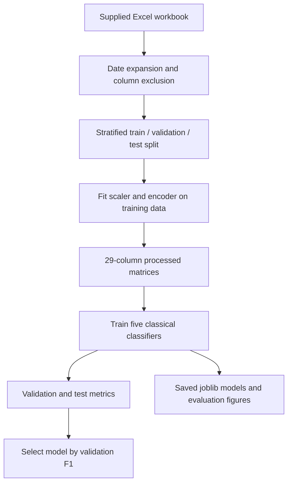

# Project overview

[Documentation index](README.md)

## Objective

Classify a medical insurance claim as `Fraud` or `Legitimate` using structured claim information. The intended use is to prioritize claims for human review. A model score alone does not establish that fraud occurred.

The project compares five classical classifiers on one supplied Excel workbook. `ClaimLegitimacy` is encoded as `Fraud = 1` and `Legitimate = 0`. The models expose class predictions and `predict_proba` scores; there is no separate probability calibration audit in this approach.

## Project context

Institution: IIIT Dharwad, B.Tech in Data Science and AI. Faculty adviser: Prof. Ramesh Athe. Team recorded in the project: B Varshith (23BDS011), M Jagadeshwar (23BDS033), and J Ganesh (23BDS024). The repository assigns Approach 1 ownership to Ganesh.

Related components live in `Approch-2-DL/` and `Approach-3-Agentic-AI/`. This documentation covers Approach 1 and its actual shared preprocessing dependency.

## Implemented offline workflow



The numeric scaler and categorical encoder are stored together in a fitted `ColumnTransformer`. Training uses the saved numeric matrices, while new claims must first pass through this transformer using named columns.

## Folder layout

```text
Approch-1/
  README.md                    Project entry point
  documentation/               Maintained documentation
  docs/                        Compatibility links and architecture illustrations
  data/raw/                    Supplied Excel workbook copy
  data/processed/              CSV splits, NPY matrices, transformer, feature names
  scripts/                     Six preprocessing, training, and reporting helpers
  models/                      Five fitted joblib estimators
  evaluation/                  Metrics, selected-model name, curves, error analysis
    eda_plots/                 Ten exploratory figures
  logs/                        Saved training metadata
  notebooks/                   Five generated notebook templates
  requirements.txt             Declared Python dependencies
```

## Integration boundary

The code in `ml-service/app/services/mlp_service.py` loads `Approch-1/data/processed/preprocessor.joblib` read-only. It checks the transformer's output order against `Approch-2-DL/results/processed/feature_names.txt`, then loads the Approach 2 MLP checkpoint. Its `/predict` response identifies the MLP and marks its score as uncalibrated.

There is no classical-model HTTP endpoint under Approach 1 in this checkout. Use the [local inference example](06_setup_and_usage.md#predict-with-an-existing-classical-model) to run a saved classical model. Architecture illustrations under `docs/images/` include broader design concepts and are not evidence that all pictured services are implemented.
