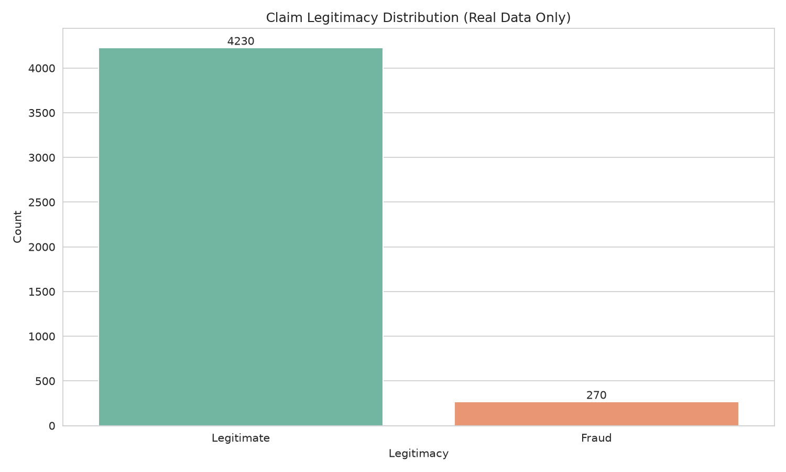
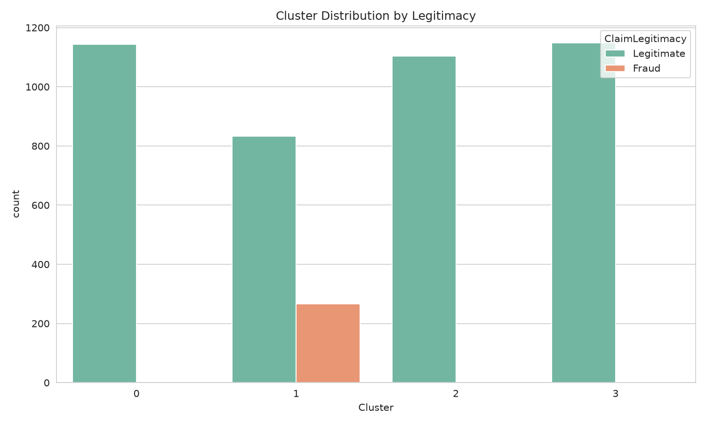

# Exploratory data analysis

[Documentation index](README.md)

The [EDA script](../scripts/eda_plots.py) reads the supplied workbook and produces the ten figures below. These plots describe the full workbook; training preprocessing is still fitted only on the training partition.

## Verified observations

- Fraud is the minority class: 270 of 4,500 claims. Always predicting Legitimate achieves 94% accuracy and zero fraud recall.
- `Cluster` is strongly associated with the target: 267 of 270 fraudulent claims fall in cluster 1. This motivates investigating the origin of that field and evaluating a model without it.
- The workbook has no missing cells or duplicate full rows. The preprocessing script does not implement a general cleaning policy for future workbooks.

| Numeric field | Minimum | Median | Mean | Maximum |
|---|---:|---:|---:|---:|
| ClaimAmount | 100.12 | 5,053.77 | 5,014.20 | 9,997.20 |
| PatientAge | 0 | 50.5 | 49.84 | 99 |
| PatientIncome | 20,006.87 | 84,061.21 | 84,384.28 | 149,957.52 |

| Cluster | Legitimate | Fraud | Fraud rate |
|---|---:|---:|---:|
| 0 | 1,144 | 0 | 0.00% |
| 1 | 833 | 267 | 24.27% |
| 2 | 1,104 | 0 | 0.00% |
| 3 | 1,149 | 3 | 0.26% |

## Figure inventory

| Figure | What it shows and how to read it |
|---|---|
| [Target distribution](../evaluation/eda_plots/target_distribution.png) | Class counts; establishes the imbalance baseline |
| [Claim amount by target](../evaluation/eda_plots/claim_amount_by_target.png) | Amount distributions split by label |
| [Age distribution](../evaluation/eda_plots/age_distribution.png) | Overall age distribution, without a target-conditioned comparison |
| [Income versus amount](../evaluation/eda_plots/income_vs_amount.png) | Label-colored scatter of 800 sampled rows, seed 42 |
| [Correlation heatmap](../evaluation/eda_plots/correlation_heatmap.png) | Correlations among ClaimAmount, PatientAge, PatientIncome, and Cluster |
| [Claim type counts](../evaluation/eda_plots/claim_type_counts.png) | Claim volumes by type; counts alone do not establish fraud rates |
| [Cluster and target](../evaluation/eda_plots/cluster_target.png) | Label counts within each cluster |
| [Monthly fraud trend](../evaluation/eda_plots/monthly_fraud_trend.png) | Fraud ratio by month number, pooling years; not a chronological monthly time series |
| [Provider specialty and target](../evaluation/eda_plots/specialty_target.png) | Label counts by specialty; does not control for confounders |
| [Claim status and target](../evaluation/eda_plots/claimstatus_target.png) | Exploratory comparison of the excluded status field |

## Interpretation limits

Count plots and tree feature importances show associations, not causes. The pooled month plot cannot establish stability across future time periods. The scatter uses a sample and should not be used to infer exact population counts. These plots do not establish fairness across demographic groups.

Follow the [setup instructions](06_setup_and_usage.md#regenerate-artifacts) before rerunning the EDA script because it still refers to the legacy `project/` path.
