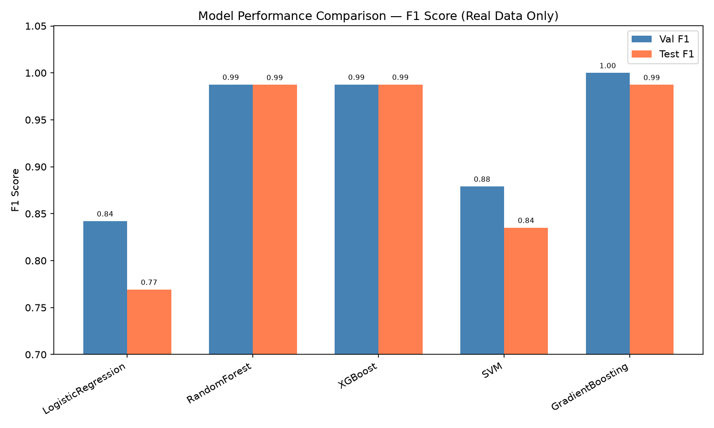

# Saved results and error analysis

[Documentation index](README.md)

Sources: [model_results.csv](../evaluation/model_results.csv), [model_results.json](../evaluation/model_results.json), [training_metrics.json](../logs/training_metrics.json), and [result_analysis.txt](../evaluation/result_analysis.txt). Tables below round the saved values to four decimals. They are a documentation snapshot, not an automatically refreshed dashboard.

## Validation comparison

Validation contains 675 claims: 41 Fraud and 634 Legitimate.

| Model | Accuracy | Precision | Recall | F1 | ROC AUC | Average precision |
|---|---:|---:|---:|---:|---:|---:|
| LogisticRegression | 0.9778 | 0.7407 | 0.9756 | 0.8421 | 0.9945 | 0.9411 |
| RandomForest | 0.9985 | 1.0000 | 0.9756 | 0.9877 | 1.0000 | 1.0000 |
| XGBoost | 0.9985 | 1.0000 | 0.9756 | 0.9877 | 1.0000 | 0.9994 |
| SVM | 0.9837 | 0.8000 | 0.9756 | 0.8791 | 0.9941 | 0.9442 |
| **GradientBoosting** | **1.0000** | **1.0000** | **1.0000** | **1.0000** | **1.0000** | **1.0000** |

**Selected model: GradientBoosting**, matching [best_model.txt](../evaluation/best_model.txt). Selection uses validation F1.

## Held-out test comparison

Test contains 675 claims: 40 Fraud and 635 Legitimate.

| Model | Accuracy | Precision | Recall | F1 | ROC AUC | Average precision |
|---|---:|---:|---:|---:|---:|---:|
| LogisticRegression | 0.9644 | 0.6250 | 1.0000 | 0.7692 | 0.9950 | 0.9186 |
| RandomForest | 0.9985 | 1.0000 | 0.9750 | 0.9873 | 1.0000 | 0.9994 |
| XGBoost | 0.9985 | 0.9756 | 1.0000 | 0.9877 | 1.0000 | 1.0000 |
| SVM | 0.9778 | 0.7451 | 0.9500 | 0.8352 | 0.9955 | 0.9252 |
| GradientBoosting | 0.9985 | 1.0000 | 0.9750 | 0.9873 | 0.9847 | 0.9765 |

XGBoost has the highest saved test F1, but this does not replace the validation-selected model. RandomForest test ROC AUC rounds to 1.0000; the stored value is approximately 0.99996063.

## Confusion counts

| Model | TN | FP | FN | TP | Total |
|---|---:|---:|---:|---:|---:|
| LogisticRegression | 611 | 24 | 0 | 40 | 675 |
| RandomForest | 635 | 0 | 1 | 39 | 675 |
| XGBoost | 634 | 1 | 0 | 40 | 675 |
| SVM | 622 | 13 | 2 | 38 | 675 |
| GradientBoosting | 635 | 0 | 1 | 39 | 675 |

LogisticRegression detected all labeled fraud in this test block while flagging 24 legitimate claims. XGBoost detected all 40 with one false alarm. RandomForest and GradientBoosting each missed one fraud and raised no false alarms. These are observations on this split, not guarantees about future claims or insurance payment decisions.

With only 40 positive test cases, one additional missed fraud changes recall by 2.5 percentage points. The small differences among the strongest models do not establish a reliable operational ranking.

## Saved run metadata

The log records Python 3.11.2, scikit-learn 1.9.1, 29 features, seed 42, and generation time `2026-09-13 04:44:42` (timezone unspecified). It does not record a complete dependency lockfile.

| Model | Fit seconds | Predict 100 rows, seconds | Saved bytes |
|---|---:|---:|---:|
| LogisticRegression | 0.013 | 0.0003 | 1,103 |
| RandomForest | 0.625 | 0.0537 | 3,465,961 |
| XGBoost | 0.028 | 0.0006 | 85,788 |
| SVM | 0.285 | 0.0025 | 96,459 |
| GradientBoosting | 0.192 | 0.0013 | 723,352 |

These are recorded timings from one run, not a controlled serving benchmark. The log's `test_metrics` object contains both `Val_*` and `Test_*` fields. Its `positive_class_weight` label says `balanced` for every model; consult the training source for XGBoost's actual `scale_pos_weight` setting.

## Evaluation figures

Per-model confusion matrices, ROC curves, and PR curves are in `evaluation/` with prefixes `cm_`, `roc_`, and `pr_`. Global feature-importance figures exist for [RandomForest](../evaluation/feature_importance_RandomForest.png) and [XGBoost](../evaluation/feature_importance_XGBoost.png). Their importance definitions differ by estimator; neither provides a causal or claim-specific explanation.
