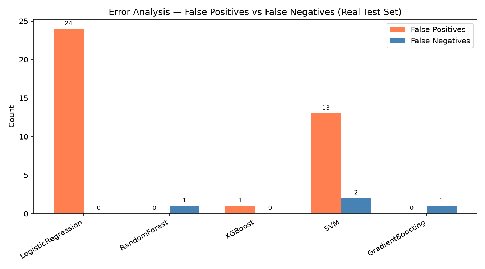

# Result analysis: Approach 1

Updated: 20 October 2026. Counts below reproduce [result_analysis.txt](result_analysis.txt). Metrics are saved in [model_results.csv](model_results.csv). The complete maintained discussion is in [Results](../documentation/05_results.md).

Train/validation/test sizes are 3,150 / 675 / 675, with 189 / 41 / 40 fraud cases. Preprocessing is fitted on training only. The 29-column contract excludes `ClaimStatus`. Model selection uses validation F1 and selects GradientBoosting.

| Model | TN | FP | FN | TP |
|---|---:|---:|---:|---:|
| LogisticRegression | 611 | 24 | 0 | 40 |
| RandomForest | 635 | 0 | 1 | 39 |
| XGBoost | 634 | 1 | 0 | 40 |
| SVM | 622 | 13 | 2 | 38 |
| GradientBoosting | 635 | 0 | 1 | 39 |

XGBoost detects all 40 labeled test frauds with one false alarm; LogisticRegression does so with 24 false alarms. RandomForest and GradientBoosting each miss one fraud with no false alarms. SVM misses two frauds and flags 13 legitimate claims.

Near-perfect results on this random split do not establish future performance. The supplied `Cluster` field is strongly associated with fraud, but its generation process is not documented in Approach 1. Audit its provenance, evaluate without it, and validate on later independent claims before operational use. No calibration, business-cost threshold selection, or fairness audit is implemented here.

`error_analysis.py` regenerates `result_analysis.txt` and the figure; this Markdown narrative is maintained separately.
