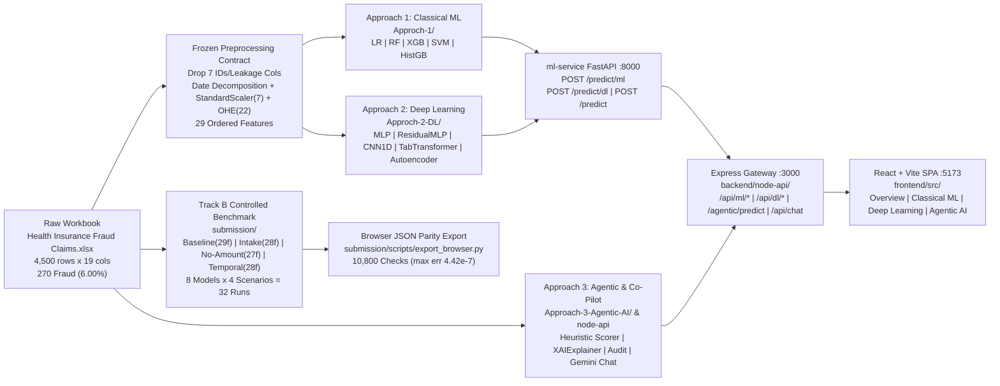
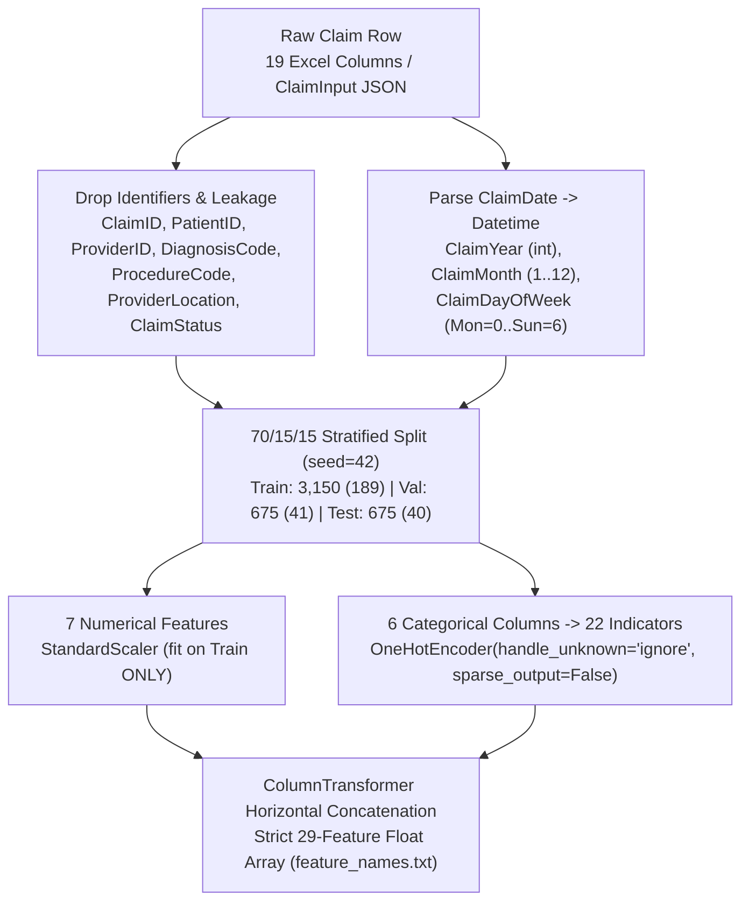
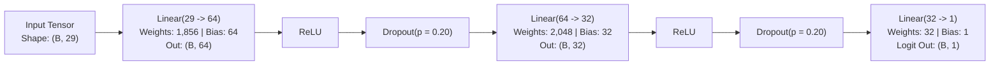
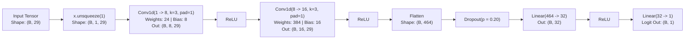
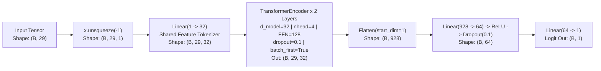
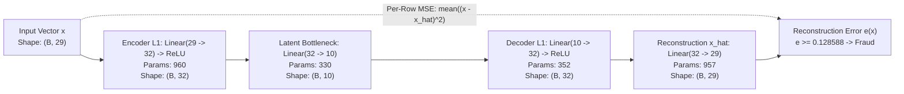
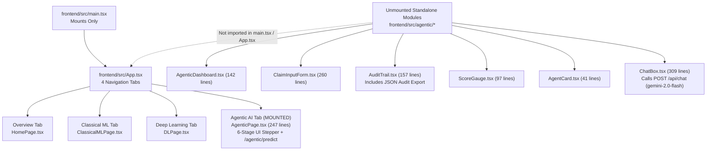
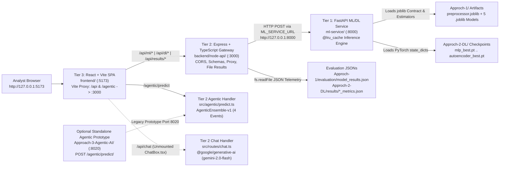

# Health Insurance Fraud Intelligence Platform — Comprehensive Technical Documentation Across All Three Approaches

**Document Identifier:** `DOC-MASTER-TRI-APPROACH-V1`  
**Repository Workspace:** `mini-project/`  
**Scope:** End-to-End Engineering, Mathematical, Experimental, and Architectural Reference for **Approach 1 (Classical Machine Learning)**, **Approach 2 (Deep Learning)**, **Approach 3 (Agentic AI, Explainability, & Conversational Co-Pilot)**, the **Three-Tier Production Platform (`ml-service` / `backend/node-api` / `frontend`)**, and the **Track B Controlled Research Benchmark & Zero-Server Browser Lab (`submission/`)**  
**Team Members:** B. Varshith (`23BDS011`) · J. Ganesh Kumar Reddy (`23BDS024`) · M. Jagadeeswar (`23BDS033`)  
**Faculty Guide:** Prof. Ramesh Athe  

> [!IMPORTANT]
> **Verification & Evidence Standard:** Every architecture specification, layer topology, hyperparameter, file path, API route, schema constraint, confusion matrix, evaluation metric, and known limitation in this manual is traced directly from source code, configuration files, and serialized JSON/CSV artifacts inside the repository. Where earlier project documentation contained outdated or inaccurate descriptions (such as unimplemented layers or misnamed frontend modules), this document explicitly preserves ground-truth source behavior and flags the discrepancy.

---

## Table of Contents

- [Part I — Executive Architecture, Research Context, & Dual-Track Governance](#part-i--executive-architecture-research-context--dual-track-governance)
  - [1.1 Project Mission & Clinical-Financial Motivation](#11-project-mission--clinical-financial-motivation)
  - [1.2 Team Roles, Responsibilities, & Module Ownership](#12-team-roles-responsibilities--module-ownership)
  - [1.3 Unified Tri-Approach Architectural Taxonomy](#13-unified-tri-approach-architectural-taxonomy)
  - [1.4 Dual-Track Governance: Track A Platform vs. Track B Research Lab](#14-dual-track-governance-track-a-platform-vs-track-b-research-lab)
  - [1.5 Literature Survey & Peer-Reviewed Positioning (20 Sources, 6 Pillars)](#15-literature-survey--peer-reviewed-positioning-20-sources-6-pillars)
  - [1.6 Architectural Decision Records (`DECISIONS.md` Synthesis)](#16-architectural-decision-records-decisionsmd-synthesis)
- [Part II — Mathematical Problem Formulation, Dataset Forensic Audit, & Feature Contracts](#part-ii--mathematical-problem-formulation-dataset-forensic-audit--feature-contracts)
  - [2.1 Formal Binary Classification & Cost-Sensitive Risk Minimization](#21-formal-binary-classification--cost-sensitive-risk-minimization)
  - [2.2 Evaluation Theory Under Severe Class Imbalance](#22-evaluation-theory-under-severe-class-imbalance)
  - [2.3 Raw Workbook Integrity & Schema Audit](#23-raw-workbook-integrity--schema-audit)
  - [2.4 Forensic Discovery of Shortcut & Target Leakage Hazards](#24-forensic-discovery-of-shortcut--target-leakage-hazards)
  - [2.5 Frozen 29-Feature Preprocessing Contract](#25-frozen-29-feature-preprocessing-contract)
  - [2.6 Experimental Scenarios & Partition Audits (`Baseline`, `Intake`, `No-Amount`, `Temporal`)](#26-experimental-scenarios--partition-audits-baseline-intake-no-amount-temporal)
  - [2.7 Reference End-to-End Claim Encoding Traces](#27-reference-end-to-end-claim-encoding-traces)
- [Part III — Approach 1: Classical Machine Learning (`Approch-1/`)](#part-iii--approach-1-classical-machine-learning-approch-1)
  - [3.1 Design Paradigm & Directory Topology](#31-design-paradigm--directory-topology)
  - [3.2 Exploratory Data Analysis Engine (`eda_plots.py`)](#32-exploratory-data-analysis-engine-eda_plotspy)
  - [3.3 Preprocessing & Artifact Emission (`preprocess.py`)](#33-preprocessing--artifact-emission-preprocesspy)
  - [3.4 Model Family Deep Dive (Mathematical Mechanics & Exact Hyperparameters)](#34-model-family-deep-dive-mathematical-mechanics--exact-hyperparameters)
  - [3.5 Training, Comparison Visualization, Notebook Generation, & Error Analysis Scripts](#35-training-comparison-visualization-notebook-generation--error-analysis-scripts)
  - [3.6 Track A Classical ML Empirical Benchmarks & Latency Footprint](#36-track-a-classical-ml-empirical-benchmarks--latency-footprint)
  - [3.7 Path Coupling, Windows Directory Junction Workaround, & SVC Calibration Subtlety](#37-path-coupling-windows-directory-junction-workaround--svc-calibration-subtlety)
- [Part IV — Approach 2: Deep Learning (`Approch-2-DL/`)](#part-iv--approach-2-deep-learning-approch-2-dl)
  - [4.1 Neural Tabular Fraud Detection Strategy](#41-neural-tabular-fraud-detection-strategy)
  - [4.2 Shared DL Infrastructure (`dl_common.py`)](#42-shared-dl-infrastructure-dl_commonpy)
  - [4.3 Supervised Cost-Sensitive Optimization & Early Stopping Dynamics](#43-supervised-cost-sensitive-optimization--early-stopping-dynamics)
  - [4.4 Exact Neural Model Specifications & Tensor-Shape Traces](#44-exact-neural-model-specifications--tensor-shape-traces)
  - [4.5 Training & Evaluation Pipeline Scripts Walkthrough](#45-training--evaluation-pipeline-scripts-walkthrough)
  - [4.6 Track A Deep Learning Empirical Benchmarks & Smoke Tests](#46-track-a-deep-learning-empirical-benchmarks--smoke-tests)
  - [4.7 Autoencoder Empirical Negative Control Post-Mortem](#47-autoencoder-empirical-negative-control-post-mortem)
- [Part V — Approach 3: Agentic AI, Explainability, & LLM Co-Pilot](#part-v--approach-3-agentic-ai-explainability--llm-co-pilot)
  - [5.1 From Isolated Scorers to Auditable Decision Workflows](#51-from-isolated-scorers-to-auditable-decision-workflows)
  - [5.2 Conceptual Six-Role Orchestration vs. Active Runtime Implementation](#52-conceptual-six-role-orchestration-vs-active-runtime-implementation)
  - [5.3 Standalone Python FastAPI Prototype (`Approach-3-Agentic-AI/`, `:8020`)](#53-standalone-python-fastapi-prototype-approach-3-agentic-ai-8020)
  - [5.4 `XAIExplainer` Directional Attributions & SHA-256 Audit Service](#54-xaiexplainer-directional-attributions--sha-256-audit-service)
  - [5.5 Node.js/TypeScript Active Agentic Endpoint (`AgenticEnsemble-v1`, `:3000`)](#55-nodejstypescript-active-agentic-endpoint-agenticensemble-v1-3000)
  - [5.6 Conversational Fraud Analyst Co-Pilot (`POST /api/chat` & Gemini 2.0 Flash)](#56-conversational-fraud-analyst-co-pilot-post-apichat--gemini-20-flash)
  - [5.7 Frontend Agentic Experiences (`AgenticPage.tsx` vs. Unmounted `frontend/src/agentic/*`)](#57-frontend-agentic-experiences-agenticpagetsx-vs-unmounted-frontendsrcagentic)
  - [5.8 Security, Heuristic Calibration Limitations, & Unification Roadmap](#58-security-heuristic-calibration-limitations--unification-roadmap)
- [Part VI — Three-Tier Full-Stack Production Platform (`ml-service` / `backend/node-api` / `frontend`)](#part-vi--three-tier-full-stack-production-platform-ml-service--backendnode-api--frontend)
  - [6.1 Distributed Three-Tier Service Topology](#61-distributed-three-tier-service-topology)
  - [6.2 Tier 1: Python FastAPI ML Service (`ml-service/`, `:8000`)](#62-tier-1-python-fastapi-ml-service-ml-service-8000)
  - [6.3 Tier 2: Express/TypeScript API Gateway (`backend/node-api/`, `:3000`)](#63-tier-2-express-typescript-api-gateway-backendnode-api-3000)
  - [6.4 Tier 3: React/Vite/TypeScript Presentation Layer (`frontend/`, `:5173`)](#64-tier-3-react-vite-typescript-presentation-layer-frontend-5173)
  - [6.5 Complete REST API Contract & JSON Schema Reference](#65-complete-rest-api-contract--json-schema-reference)
- [Part VII — Track B Controlled Research Benchmark & Zero-Server Browser Lab (`submission/`)](#part-vii--track-b-controlled-research-benchmark--zero-server-browser-lab-submission)
  - [7.1 Methodological Motivation for Controlled Isolation](#71-methodological-motivation-for-controlled-isolation)
  - [7.2 Four-Scenario Ablation Framework & Hyperparameter Deviations](#72-four-scenario-ablation-framework--hyperparameter-deviations)
  - [7.3 Validation-F1 Threshold Selection & `Row 1124` Error Forensics](#73-validation-f1-threshold-selection--row-1124-error-forensics)
  - [7.4 Uncertainty Quantification (`1,000`-Replicate Bootstrap CIs) & Feature Importances](#74-uncertainty-quantification-1000-replicate-bootstrap-cis--feature-importances)
  - [7.5 Zero-Server Client Inference Export & Mathematical Parity Proof (`4.42e-7`)](#75-zero-server-client-inference-export--mathematical-parity-proof-442e-7)
  - [7.6 Publication Figure Synthesis (`make_figures.py`), Static Serving (`:8080`), & Bundle Checkout Status](#76-publication-figure-synthesis-make_figurespy-static-serving-8080--bundle-checkout-status)
- [Part VIII — Cross-Approach Synthesis, Complete File Inventory, Runbooks, & Discrepancy Audit](#part-viii--cross-approach-synthesis-complete-file-inventory-runbooks--discrepancy-audit)
  - [8.1 Side-by-Side Tri-Approach Comparative Engineering Matrix](#81-side-by-side-tri-approach-comparative-engineering-matrix)
  - [8.2 Complete Repository Module & Artifact Inventory](#82-complete-repository-module--artifact-inventory)
  - [8.3 Developer Environment Setup, Three-Terminal Startup, & Verification Runbooks](#83-developer-environment-setup-three-terminal-startup--verification-runbooks)
  - [8.4 Verified Discrepancy Ledger (Prior Docs vs. Source Code Truth)](#84-verified-discrepancy-ledger-prior-docs-vs-source-code-truth)
  - [8.5 Production Hardening Roadmap & Operational Troubleshooting Playbook](#85-production-hardening-roadmap--operational-troubleshooting-playbook)

---

# Part I — Executive Architecture, Research Context, & Dual-Track Governance

## 1.1 Project Mission & Clinical-Financial Motivation

Healthcare insurance claim adjudication sits at the intersection of high transaction velocity, severe label imbalance, strict regulatory auditability, and adversarial financial incentives. Fraudulent medical billing—spanning phantom claims, inflated billing tiers, upcoding, unbundling, and medically unnecessary procedures—inflicts tens of billions of dollars in losses across insurers and public health programs annually while simultaneously delaying reimbursements for legitimate providers and patients when naive heuristic filters generate high false-positive rates.

This repository (`mini-project/`) implements the **Health Insurance Fraud Intelligence Platform**: an empirical comparative study and multi-tier software system investigating **three progressively sophisticated modeling and decision-making paradigms** evaluated under a unified feature contract derived from a real-world tabular dataset of `4,500` medical insurance claims (`Health Insurance Fraud Claims.xlsx`):

1. **Approach 1 — Classical Machine Learning (`Approch-1/`):** Linear, kernel-margin, bagging, and gradient-boosted decision tree estimators (`LogisticRegression`, `RandomForestClassifier`, `XGBClassifier`, `SVC`, and `HistGradientBoostingClassifier` saved as `GradientBoosting`), prioritizing sample efficiency on low-dimensional mixed tabular inputs and deterministic interpretability.
2. **Approach 2 — Deep Learning (`Approch-2-DL/`):** Four cost-sensitive supervised PyTorch neural architectures (`MLP`, `ResidualMLP`, `CNN1D`, `TabTransformer`) trained with imbalance-weighted binary cross-entropy logits loss (`pos_weight = 2961 / 189 ≈ 15.6667`), juxtaposed against an unsupervised legitimate-only `Autoencoder` trained exclusively on non-fraudulent claims (`y == 0`, `N = 2,961`) serving as an empirical out-of-distribution anomaly negative control.
3. **Approach 3 — Agentic AI, Explainability, & Conversational Co-Pilot (`Approach-3-Agentic-AI/`, `backend/node-api/src/agentic/`, `backend/node-api/src/routes/chat.ts`, `frontend/`):** A multi-stage claim triage design decomposing adjudication into structured operational roles (`Ingestion`, `Validation`, `Risk Scorer`, `XAI Explainer`, `Decision`, and `Audit`), accompanied by deterministic audit logging, directional feature attribution prototyping (`XAIExplainer`), and a Google Gemini (`gemini-2.0-flash`) analyst chat endpoint (`POST /api/chat`).

Crucially, the codebase does not merely compare model accuracy in isolation. Forensic inspection of the source workbook revealed severe structural hazards—most notably upstream `Cluster` leakage (`98.89%` of all fraud concentrated inside `Cluster == 1`) and a sharp `ClaimAmount` threshold boundary (`$7,465.07`)—that inflate headline test metrics on naive random splits. Consequently, the repository separates **live product compatibility** (`Track A`) from **rigorous methodological ablation** (`Track B` inside `submission/`), providing both an end-to-end interactive web stack and a statistically audited experimental laboratory.

---

## 1.2 Team Roles, Responsibilities, & Module Ownership

Work across the three approaches, full-stack services, and experimental evaluation framework was partitioned among three primary contributors under academic supervision, as codified in `DECISIONS.md`, `PROJECT_PROGRESS.md`, and `docs/README.md`:

| Contributor / Guide | Student ID / Role | Primary Approaches & Platform Ownership | Core Repository Paths Owned |
| :--- | :--- | :--- | :--- |
| **J. Ganesh Kumar Reddy** | `23BDS024` | **Approach 1 (Classical ML)**, Exploratory Data Analysis, Frozen 29-Feature Preprocessing Contract, 5 Classical Estimators, Jupyter Notebook Generation | `Approch-1/`, `Approch-1/scripts/*`, `Approch-1/data/processed/*`, `Approch-1/models/*` |
| **M. Jagadeeswar** | `23BDS033` | **Approach 2 (Deep Learning)** (5 PyTorch Models, Weighted BCE & Autoencoder Pipeline), **Three-Tier Full-Stack Platform** (Python ML API, Node Gateway, React SPA), **Track B Benchmark Lab & Browser Engine** | `Approch-2-DL/`, `ml-service/`, `backend/node-api/` (ML proxy & server), `frontend/` (core SPA), `submission/`, `docs/` |
| **B. Varshith** | `23BDS011` | **Approach 3 (Agentic AI, Explainability, & Co-Pilot)**, Multi-Agent Triage Concepts, Standalone Agentic Prototype, XAI Attribution & Audit Trails, Frontend Agentic Components | `Approach-3-Agentic-AI/`, `backend/node-api/src/agentic/`, `backend/node-api/src/routes/chat.ts`, `frontend/src/agentic/`, `frontend/src/pages/AgenticPage.tsx` |
| **Prof. Ramesh Athe** | Faculty Guide | Academic Supervision, Problem Framing, Milestone Reviews, Research Evaluation Standards | Whole Project Governance |

Notice that directory naming preserves exact historical spelling (`Approch-1` and `Approch-2-DL` omit the second `a` in "Approach", whereas `Approach-3-Agentic-AI` uses the standard spelling). All internal imports, startup scripts, and API paths honor these exact directory names verbatim to prevent broken path resolution on case-sensitive or strict tooling layers.

---

## 1.3 Unified Tri-Approach Architectural Taxonomy

To understand how raw claim records flow through each paradigm—and how those paradigms are surfaced to end users—the diagram below maps the end-to-end architecture across all three approaches and the dual serving tracks:



Each approach addresses a distinct engineering question:

| Dimension | Approach 1: Classical ML | Approach 2: Deep Learning | Approach 3: Agentic AI & Co-Pilot |
| :--- | :--- | :--- | :--- |
| **Core Directory** | `Approch-1/` | `Approch-2-DL/` | `Approach-3-Agentic-AI/` + `backend/node-api/src/agentic/` + `frontend/src/agentic/` |
| **Runtime Language & Stack** | Python `3.11.2`, scikit-learn `1.9.1`, XGBoost | PyTorch, scikit-learn metrics, NumPy | Python FastAPI (`:8020`), Express TypeScript (`:3000`), React (`:5173`), Gemini 2.0 Flash |
| **Model / Agent Units** | 5 Estimators (`LogisticRegression`, `RandomForest`, `XGBoost`, `SVM`, `GradientBoosting` [`HistGradientBoostingClassifier`]) | 5 Neural Models (`MLP`, `ResidualMLP`, `CNN1D`, `TabTransformer`, `Autoencoder`) | 6 Conceptual Agents (`Ingestion`, `Validation`, `Risk Scorer`, `XAI Explainer`, `Decision`, `Audit`); 4 runtime events emitted |
| **Primary Inductive Bias** | Axis-aligned tree splits (`RF`, `XGB`, `HistGB`), linear hyperplane (`LR`), RBF kernel (`SVM`) | Smooth hierarchical dense/residual compositions (`MLP`, `ResMLP`), 1D spatial adjacency (`CNN1D`), self-attention across feature tokens (`TabTransformer`), reconstruction manifold (`Autoencoder`) | Stepwise multi-agent pipeline orchestration, deterministic threshold routing (`REVIEW` vs `PASS`), static feature attribution (`XAIExplainer`), LLM natural-language Q&A |
| **Imbalance Handling** | `class_weight='balanced'` (`LR`, `RF`, `SVM`, `HistGB`), `scale_pos_weight=2961/189` (`XGB`) | `BCEWithLogitsLoss(pos_weight=2961/189 ≈ 15.6667)`; `Autoencoder` trained strictly on `y == 0` (`N=2,961`) | Heuristic rule (`claim_amount * 0.01 + patient_age * 0.005 - 2.0` clamped to `[0, 1]`) + threshold `>= 0.5` |
| **Best Track A Test PR-AUC** | `100.00%` (`XGBoost`, Test `F1 = 98.77%`) | `99.11%` (`TabTransformer`, Test `F1 = 89.89%`) | N/A (prototype heuristic scorer; awaits live ensemble wiring) |
| **Live Production Status** | Active via `ml-service :8000` -> `node-api :3000` -> `ClassicalMLPage.tsx` | Active via `ml-service :8000` -> `node-api :3000` -> `DLPage.tsx` | Hybrid: Active `:3000/agentic/predict` + `:3000/api/chat` + `AgenticPage.tsx`; `:8020` standalone prototype & `src/agentic/*` modular UI exist separately |

---

## 1.4 Dual-Track Governance: Track A Platform vs. Track B Research Lab

A defining architectural discipline of this repository—explicitly codified in `DECISIONS.md` and `docs/04_FULL_PROJECT_DOCUMENTATION.md`—is maintaining two synchronized yet cleanly separated tracks so that scientific skepticism never breaks the production web application:

### Track A: Full-Stack Production Platform & Baseline Artifacts (`Approch-1/`, `Approch-2-DL/`, `ml-service/`, `backend/`, `frontend/`)
- **Purpose:** Preserve exact team compatibility across three student sub-projects and power the interactive 3-tier web platform cleanly.
- **Data Contract:** Strictly respects the frozen `29`-feature contract (`Approch-1/data/processed/preprocessor.joblib` and `.npy` arrays) produced by `Approch-1/scripts/preprocess.py`. Neither `Approch-2-DL` nor `ml-service` modifies those preprocessed splits or re-fits scalers on its own.
- **Model Scope:** `10` trained ML/DL models (`5` Classical ML + `5` Deep Learning) plus the Approach 3 Agentic orchestration & Gemini Chat layer.
- **Evaluation Policy:** Uses model default prediction behavior from original training scripts (`0.5` probability threshold for DL/classical probabilities, `.predict()` decision rule for `SVC`, and `95th` percentile validation reconstruction MSE threshold `0.12858837842941284` for `Autoencoder`).

### Track B: Controlled Research Benchmark & Zero-Server Browser Lab (`submission/`)
- **Purpose:** Conduct controlled ablation experiments answering whether Track A's near-perfect `99%–100%` test metrics reflect genuine fraud patterns or dataset shortcuts, without altering Track A's serialized checkpoints or breaking `ml-service`.
- **Model Scope:** `8` comparable supervised models (`LogisticRegression`, `RandomForest`, `XGBoost`, `SVM`, `GradientBoosting` [`HistGradientBoostingClassifier`], `MLP`, `ResidualMLP`, `CNN1D`) executed uniformly across **4 experimental scenarios**:
  1. `baseline` (29 features, random stratified split)
  2. `intake` (28 features — removes leaked upstream `Cluster`)
  3. `no_amount` (27 features — removes `Cluster` and `ClaimAmount`)
  4. `temporal` (28 features — chronologically ordered Train/Val/Test without `Cluster`)
- **Statistical Rigor:** Evaluates `32` training runs (`8 models x 4 scenarios`), yielding `128` standardized metric rows (`validation`/`test` splits x `0.5`/`validation_f1` threshold policies), `1,000`-replicate stratified bootstrap `95%` confidence intervals (`bootstrap.json`), residual test-case error forensics (`Row 1124` in `analysis.json`), and JSON-exported client inference parity verification (`10,800` cross-runtime comparisons with `max_abs_err = 4.42e-7` and `0` classification label mismatches).

---

## 1.5 Literature Survey & Peer-Reviewed Positioning (20 Sources, 6 Pillars)

The repository's research grounding (`docs/01_LITERATURE_SURVEY.md`) anchors design decisions across six thematic pillars comprising `20` verified peer-reviewed and archival works:

### Pillar 1: Healthcare Insurance Fraud Detection Benchmarks
Healthcare claims exhibit distinct billing structures, skewed monetary distributions, and severe legitimate-to-fraudulent ratios:
1. **du Preez et al. (2025)** — *Fraud detection in healthcare insurance claims using machine learning* (*Intelligence-Based Medicine*, Vol. 11, 100261): Systematic survey contrasting supervised ensembles, neural networks, and anomaly detectors on healthcare claims, concluding tree ensembles lead tabular detection while highlighting leakage and explainability gaps.
2. **Bauder & Khoshgoftaar (2017)** — *Medicare Fraud Detection Using Machine Learning Methods* (*IEEE ICMLA 2017*, pp. 858–865): Demonstrates sensitivity of classifier precision/recall to class imbalance ratios on Medicare Part B claims and documents threshold sensitivity.
3. **Kapadiya et al. (2022)** — *Blockchain and AI-Empowered Healthcare Insurance Fraud Detection: An Analysis, Architecture, and Future Prospects* (*IEEE Access*, Vol. 10, pp. 79606–79627): Motivates combining predictive ML scorers with tamper-evident audit logging, directly informing Approach 3's `SHA-256` trace logging design.

### Pillar 2: Classical Tabular ML & Gradient Boosting Ensembles
Because health claim records combine numeric financials (`ClaimAmount`, `PatientIncome`, `PatientAge`) with categorical taxonomies (`ClaimType`, `ProviderSpecialty`, `ClaimSubmissionMethod`), classical tree ensembles serve as essential competitive baselines:
4. **Breiman (2001)** — *Random Forests* (*Machine Learning*, Vol. 45, No. 1, pp. 5–32): Bagged decision trees with random subspace feature sampling providing low variance without monotone scaling assumptions. Directly motivates `RandomForestClassifier(n_estimators=300, class_weight='balanced')` (Track B `intake` champion).
5. **Chen & Guestrin (2016)** — *XGBoost: A Scalable Tree Boosting System* (*ACM SIGKDD 2016*, pp. 785–794): Second-order Taylor objective expansion, regularized leaf weights, and weighted positive gradient scaling via `scale_pos_weight`. Powers `XGBClassifier` (`100.00%` Test ROC-AUC & PR-AUC in Approach 1).
6. **Ke et al. (2017)** — *LightGBM: A Highly Efficient Gradient Boosting Decision Tree* (*NeurIPS 2017*): Histogram binning of continuous covariates for accelerated split finding—implemented natively via scikit-learn's `HistGradientBoostingClassifier` (saved under artifact name `GradientBoosting`).
7. **Cortes & Vapnik (1995)** — *Support-Vector Networks* (*Machine Learning*, Vol. 20, pp. 273–297): Radial basis function (RBF) maximum-margin separator used to test whether smooth non-linear hyperplanes match axis-aligned tree boundaries on standardized 29-feature spaces.

### Pillar 3: Deep Learning for Imbalanced Tabular Data
Evaluating whether neural networks capture compositional interactions beyond decision trees requires modern tabular inductive biases and cost-sensitive weighting:
8. **Johnson & Khoshgoftaar (2019)** — *Survey on deep learning with class imbalance* (*Journal of Big Data*, Vol. 6, Art. 27): Shows naive unweighted neural training collapses toward the majority class under `<10%` minority prevalence, motivating cost-sensitive gradient amplification (`pos_weight = 2961/189`).
9. **He et al. (2016)** — *Deep Residual Learning for Image Recognition* (*IEEE CVPR 2016*, pp. 770–778): Identity skip connections (`x + F(x)`) preventing gradient degradation, adapted in Approach 2 as tabular `ResidualBlock` layers (`ResidualMLP`).
10. **Gorishniy et al. (2021)** — *Revisiting Deep Learning Models for Tabular Data* (*NeurIPS 2021*): Demonstrates that well-tuned MLPs and ResNet-like tabular architectures compete closely with trees, providing the architectural template for `MLP` and `ResidualMLP`.
11. **Huang et al. (2020)** — *TabTransformer: Tabular Data Modeling Using Contextual Embeddings* (*arXiv:2012.06678*): Multi-head self-attention layers contextualizing tabular representations, inspiring Approach 2's scalar-tokenized `TabTransformer` (`d_model=32, nhead=4`, achieving Track A's top DL Test PR-AUC of `99.11%`).
12. **Grinsztajn et al. (2022)** — *Why do tree-based models still outperform deep learning on typical tabular data?* (*NeurIPS Datasets & Benchmarks 2022*): Establishes empirically that irregular target functions, uninformative features, and axis-aligned thresholds (like `$7,465.07` on `ClaimAmount`) strongly favor GBDTs and Random Forests over smooth neural MLPs.

### Pillar 4: Unsupervised Anomaly Detection & Autoencoders
13. **Sakurada & Yairi (2014)** — *Anomaly Detection Using Autoencoders with Nonlinear Dimensionality Reduction* (*MLSDA 2014*, pp. 4–11): Formulates reconstruction MSE over normal-only manifolds as an anomaly score.
14. **Chalapathy & Chawla (2019)** — *Deep Learning for Anomaly Detection: A Survey* (*arXiv:1901.03407*): Identifies failure modes when anomalies share the primary variance subspace or exceed typical scale bounds rather than breaking correlation structure—precisely explaining why Approach 2's `Autoencoder` scores `5.23%` Test PR-AUC as an empirical negative control.

### Pillar 5: Evaluation Under Skew & Shortcut Learning / Data Leakage
15. **Chawla et al. (2002)** — *SMOTE: Synthetic Minority Over-sampling Technique* (*JAIR*, Vol. 16, pp. 321–357): Establishes handling severe imbalance via data vs. algorithmic weighting; this project deliberately elects algorithmic loss weighting (`pos_weight`, `class_weight='balanced'`) over SMOTE to avoid synthesizing artificial medical records in validation/feature space.
16. **Saito & Rehmsmeier (2015)** — *The Precision-Recall Plot Is More Informative than the ROC Plot When Evaluating Binary Classifiers on Imbalanced Datasets* (*PLOS ONE*, Vol. 10, No. 3): Demonstrates that ROC-AUC remains optimistically high when `TN` dominates `94%` of instances, motivating **PR-AUC (Average Precision)** as the primary model-selection criterion across Approaches 1, 2, and Track B.
17. **Kaufman et al. (2012)** — *Leakage in Data Mining: Formulation, Detection, and Avoidance* (*ACM TKDD*, Vol. 6, No. 4): Formalizes target-proxy features unavailable at inference time (`ClaimStatus`, post-hoc `Cluster` tags) that artificially inflate benchmark scores.
18. **Geirhos et al. (2020)** — *Shortcut Learning in Deep Neural Networks* (*Nature Machine Intelligence*, Vol. 2, pp. 665–673): Explains how high-capacity learners exploit spurious dataset shortcuts (`Cluster == 1`, `ClaimAmount >= $7,465.07`) rather than learning stable clinical patterns, directly motivating Track B's `intake`, `no_amount`, and `temporal` ablations.

### Pillar 6: Explainable AI (XAI) & Agentic Decision Workflows
19. **Lundberg & Lee (2017)** — *A Unified Approach to Interpreting Model Predictions (SHAP)* (*NeurIPS 2017*, pp. 4765–4774): Cooperative game-theoretic additive feature attribution framework guiding Approach 3's `XAIExplainer` design goal (currently approximated by static weights pending TreeSHAP/KernelSHAP integration).
20. **Lewis et al. (2020)** — *Retrieval-Augmented Generation for Knowledge-Intensive NLP Tasks* (*NeurIPS 2020*): Architectural template for grounding large language models (`POST /api/chat` Gemini 2.0 Flash assistant) in domain-specific fraud contexts and audit outputs.

---

## 1.6 Architectural Decision Records (`DECISIONS.md` Synthesis)

Project decisions recorded in `DECISIONS.md` establish invariant constraints enforced throughout implementation:

| Decision ID / Area | Enforced Engineering Rule | Justification & Impact on Approaches 1–3 |
| :--- | :--- | :--- |
| **Frozen 29-Feature Contract** | `Approch-2-DL/` and `ml-service/` MUST load `Approch-1/data/processed/preprocessor.joblib`, `feature_names.txt`, and `.npy` arrays read-only without re-splitting or modifying feature order. | Eliminates cross-approach comparison drift; guarantees Approach 1 and Approach 2 evaluate identical validation (`675`) and test (`675`) rows. |
| **Leakage Audit Enforcement (`ClaimStatus`)** | `ClaimStatus` (`Approved`/`Denied`/`Pending`) is banned from model features in all preprocessing scripts (`preprocess.py`, `submission/scripts/common.py`). | Adjudication outcomes occur *after* fraud review and constitute post-event target leakage. |
| **Track B Leakage Controls (`Cluster` & `ClaimAmount`)** | Track A retains all `29` contract features (`Cluster` included) for team compatibility; Track B (`submission/`) systematically strips `Cluster` (`intake` 28f), strips both `Cluster` + `ClaimAmount` (`no_amount` 27f), and tests chronological generalization (`temporal` 28f). | Exposes shortcut reliance transparently without invalidating Track A API endpoints. |
| **Primary Metric Hierarchy (`PR-AUC > F1 > ROC-AUC >> Acc`)** | Early stopping (`patience=15`), model comparison, and bootstrap uncertainty prioritize Precision-Recall AUC (Average Precision) and F1 over Accuracy (`94.00%` majority baseline) or ROC-AUC. | Directly counteracts majority-class distortion at `6.00%` fraud prevalence. |
| **Uncalibrated Neural Probabilities Disclosure** | Approach 2 supervised models train with `pos_weight = 15.6667`, producing uncalibrated high-recall risk rankings (`sigma(z)`) rather than true Bayesian posterior probabilities. | Users and API consumers must interpret outputs as fraud risk scores, with operational decision cutoffs tuned on validation sets (`validation_f1` policy in Track B). |
| **Autoencoder Negative Control Status** | Keep `Autoencoder` in codebase and UI as an explicit comparative negative control rather than inflating anomaly performance via hybrid supervised tricks. | Demonstrates scientifically why high-value fraud fails reconstruction-error assumptions (`Test PR-AUC = 5.23%`). |
| **Honest Runtime State for Approach 3** | Document both the 6-agent conceptual design (`AgenticPage.tsx`) and the actual deterministic runtime (`AgenticEnsemble-v1` linear heuristic in `node-api` & `:8020` prototype, disconnected `XAIExplainer`, unmounted `AgenticDashboard`/`ChatBox`). | Prevents misleading claims in academic review and defines an exact hardening backlog. |

---

# Part II — Mathematical Problem Formulation, Dataset Forensic Audit, & Feature Contracts

## 2.1 Formal Binary Classification & Cost-Sensitive Risk Minimization

Let $\mathcal{D} = \{(\mathbf{x}_i^{\text{raw}}, y_i)\}_{i=1}^{N}$ denote the insurance claim dataset of $N = 4,500$ historical adjudications, where $\mathbf{x}_i^{\text{raw}}$ represents a raw multi-type record of structured numeric, date, identifier, and categorical attributes, and $y_i \in \{0, 1\}$ denotes the binary fraud indicator (`0` = Legitimate, `1` = Fraud). After deterministic preprocessing $\Phi(\cdot)$, each claim maps into an encoded real vector $\mathbf{x}_i = \Phi(\mathbf{x}_i^{\text{raw}}) \in \mathbb{R}^d$, where dimensionality $d$ depends on the experimental feature contract:
- **$d = 29$** (`Track A Frozen Contract` & `Track B Baseline`): 7 standardized continuous/integer features + 22 binary one-hot encoded indicators.
- **$d = 28$** (`Track B Intake` & `Track B Temporal`): omits upstream `Cluster` leakage feature (`6 + 22 = 28`).
- **$d = 27$** (`Track B No-Amount`): omits both `Cluster` and `ClaimAmount` (`5 + 22 = 27`).

### 2.1.1 Severe Imbalance & Trivial Majority Failure Mode

Across the full corpus, only $N_+ = 270$ claims are fraudulent ($\pi = 0.0600$, `6.00%`) against $N_- = 4,230$ legitimate claims ($1 - \pi = 0.9400$, `94.00%`). Under uniform binary cross-entropy:

$$
\mathcal{L}_{\text{BCE}}(\theta) = -\frac{1}{|\mathcal{B}|} \sum_{i \in \mathcal{B}} \Big[ y_i \log \sigma(f_\theta(\mathbf{x}_i)) + (1 - y_i) \log (1 - \sigma(f_\theta(\mathbf{x}_i))) \Big]
$$

where $\sigma(z) = (1 + e^{-z})^{-1}$, the negative majority outnumbers positive fraud examples by $15.6667 : 1$. An unconstrained classifier predicting constant logit $z \to -\log(4230/270) \approx -2.7515$ achieves $94.00\%$ empirical accuracy while producing **zero fraud recall** ($\text{TP}=0, \text{FN}=270$).

### 2.1.2 Weighted Binary Cross-Entropy in Logit Space (`Approch-2-DL`)

All supervised deep learning models in Approach 2 (`MLP`, `ResidualMLP`, `CNN1D`, `TabTransformer`) counter majority dominance using PyTorch's numerically stable `BCEWithLogitsLoss(pos_weight=pos_weight)`, where the positive class scalar weight is computed directly from the stratified training split ($N_{\text{train}} = 3,150, N_{\text{neg, train}} = 2,961, N_{\text{pos, train}} = 189$):

$$
w_+ = \frac{N_{\text{neg, train}}}{N_{\text{pos, train}}} = \frac{2961}{189} = \frac{47}{3} \approx 15.666667
$$

Given raw network logit $z_i = f_\theta(\mathbf{x}_i) \in \mathbb{R}$, weighted sample loss is:

$$
\ell_{\text{wBCE}}(z_i, y_i) = w_+ \, y_i \log\!\left(1 + e^{-z_i}\right) + (1 - y_i) \log\!\left(1 + e^{z_i}\right)
$$

Taking the gradient with respect to network output logit $z_i$:

$$
\frac{\partial \ell_{\text{wBCE}}(z_i, y_i)}{\partial z_i} = \begin{cases}
\sigma(z_i), & y_i = 0 \text{ (Legitimate)} \\
w_+ \big(\sigma(z_i) - 1\big), & y_i = 1 \text{ (Fraud)}
\end{cases}
$$

This derivative reveals two operational properties enforced throughout the codebase:
1. **Imbalance Gradient Parity:** On fraudulent records, negative prediction error $(\sigma(z_i) - 1) < 0$ scales linearly by $15.6667$, preventing small minibatches (`batch_size = 128`, expecting $\approx 7.7$ fraud instances per step) from vanishing beneath $\sim 120.3$ legitimate gradients.
2. **Bayesian Prior Shift (Uncalibrated Outputs):** Minimizing $\mathbb{E}[\ell_{\text{wBCE}}]$ drives optimal logits toward shifted log-odds:
$$
z^*(x) = \log \frac{w_+ P(Y=1 \mid X=x)}{P(Y=0 \mid X=x)} = \log \frac{P(Y=1 \mid X=x)}{P(Y=0 \mid X=x)} + \log(15.6667) \approx \text{logit}\big(P(Y=1 \mid X=x)\big) + 2.7515
$$
   Consequently, $\sigma(z^*(x)) = 0.50$ corresponds to a true conditional probability near $P(Y=1 \mid X=x) \approx 0.0600$ (prior parity). As documented explicitly in `DECISIONS.md` and `docs/02_PROBLEM_FORMULATION.md`, neural probabilities in Track A represent **risk ranking scores** rather than calibrated Bayesian posteriors.

### 2.1.3 Balanced Class Weighting Equivalence in Approach 1

Approach 1 estimators apply either `class_weight='balanced'` (`LogisticRegression`, `RandomForestClassifier`, `SVC`, `HistGradientBoostingClassifier`) or `scale_pos_weight=2961/189` (`XGBClassifier`). Scikit-learn computes balanced sample weights via:

$$
w_0 = \frac{N_{\text{train}}}{2 N_{\text{neg, train}}} = \frac{3150}{2 \times 2961} \approx 0.531915, \qquad w_1 = \frac{N_{\text{train}}}{2 N_{\text{pos, train}}} = \frac{3150}{2 \times 189} = 8.333333
$$

Notice that the relative penalty ratio $w_1 / w_0 = \frac{8.333333}{0.531915} = 15.666667$ matches `XGBClassifier.scale_pos_weight` and `BCEWithLogitsLoss.pos_weight` identically. Approach 1 and Approach 2 therefore optimize **mathematically aligned cost-sensitive empirical objectives** over the identical `3,150`-row training split, isolating inductive bias differences cleanly from class-weighting disparities.

### 2.1.4 Unsupervised Autoencoder Reconstruction Risk Formulation

In `Approch-2-DL/scripts/train_advanced.py`, the unsupervised `Autoencoder` removes all fraudulent targets ($y_i = 1$) during gradient optimization, fitting encoder $E_\phi: \mathbb{R}^{29} \to \mathbb{R}^{10}$ and decoder $D_\psi: \mathbb{R}^{10} \to \mathbb{R}^{29}$ strictly over the $2,961$ legitimate training claims $\mathcal{D}_{\text{train}}^{(0)}$:

$$
(\phi^*, \psi^*) = \arg\min_{\phi, \psi} \frac{1}{|\mathcal{D}_{\text{train}}^{(0)}|} \sum_{\mathbf{x}_i \in \mathcal{D}_{\text{train}}^{(0)}} \frac{1}{29} \big\| \mathbf{x}_i - D_\psi(E_\phi(\mathbf{x}_i)) \big\|_2^2
$$

At inference time, for any input $\mathbf{x} \in \mathbb{R}^{29}$, reconstruction mean squared error $e(\mathbf{x}) = \frac{1}{29} \|\mathbf{x} - \hat{\mathbf{x}}\|_2^2$ is compared against the validation $95\text{th}$-percentile threshold:

$$
\tau_{\text{AE}} = \text{Quantile}_{0.95}\big(\{e(\mathbf{x}_j) : \mathbf{x}_j \in \mathcal{D}_{\text{val}}\}\big) = 0.12858837842941284
$$

Both `train_advanced.py` and `ml-service/app/services/dl_service.py` emit binary prediction $\hat{y} = \mathbb{I}[e(\mathbf{x}) \ge \tau_{\text{AE}}]$ alongside a threshold-centered normalized anomaly probability score:

$$
p_{\text{AE}}(\mathbf{x}) = \sigma\!\left( 5.0 \cdot \frac{e(\mathbf{x}) - \tau_{\text{AE}}}{\tau_{\text{AE}}} \right)
$$

By construction, $e(\mathbf{x}) = \tau_{\text{AE}} \implies p_{\text{AE}}(\mathbf{x}) = \sigma(0) = 0.50$, while $e(\mathbf{x}) = 0 \implies p_{\text{AE}}(\mathbf{x}) = \sigma(-5) \approx 0.00669$ and $e(\mathbf{x}) = 2\tau_{\text{AE}} \implies p_{\text{AE}}(\mathbf{x}) = \sigma(5) \approx 0.99331$.

---

## 2.2 Evaluation Theory Under Severe Class Imbalance

Following Saito & Rehmsmeier (2015), model selection and diagnostic tables rank approaches using **Precision-Recall AUC (Average Precision / PR-AUC)** and **$F_1$ Score** ahead of ROC-AUC and Accuracy:

| Metric | Mathematical Definition | Sensitivity to FP/FN under $6\%$ Fraud | Role in Repository |
| :--- | :--- | :--- | :--- |
| **Accuracy** | $\frac{TP + TN}{TP + TN + FP + FN}$ | **Low:** Trivial all-zero classifier scores `94.00%`; `24` false alarms only reduces accuracy to `96.44%`. | Reported for completeness only; excluded from selection. |
| **Precision** | $\frac{TP}{TP + FP}$ | **High:** Directly measures fraud team audit efficiency (fraction of flagged claims actually fraudulent). | Primary numerator of operational workload. |
| **Recall** | $\frac{TP}{TP + FN}$ | **High:** Measures leakage risk (fraction of true frauds intercepted before payout). | Tracks financial loss prevention (`100%` means zero misses). |
| **$F_1$ Score** | $\frac{2 \cdot \text{Precision} \cdot \text{Recall}}{\text{Precision} + \text{Recall}}$ | **High:** Harmonic balance penalizing both `FP` investigation queue flood and `FN` fraud leakage. | Track A `best_model.txt` selector (`Val_F1`); Track B `validation_f1` threshold optimizer. |
| **ROC-AUC** | $\int_0^1 TPR(FPR^{-1}(u))\,du$ | **Muted:** Denominator of $FPR = \frac{FP}{635}$ dilutes `24` false positives to `3.78%` on $N_{\text{test}}=675$. | Secondary ranking invariance diagnostic. |
| **PR-AUC (AP)** | $\sum_n (R_n - R_{n-1}) P_n$ | **Maximum:** Baseline random expectation equals $\pi = 0.0600$; directly exposes ranking degradation in minority tail. | Track A DL early-stopping (`patience=15` on `val_pr_auc`) & primary Track B headline benchmark metric. |

### 2.2.1 Quantitative Proof on Test Cohort (`N = 675`)

Comparing Approach 1's `LogisticRegression` against `XGBoost` on the exact `675`-sample test set ($P=40, N=635$) demonstrates empirically why ROC-AUC conceals severe false-positive inflation:
- **XGBoost:** `TN=634, FP=1, FN=0, TP=40` -> $FPR = 1/635 = 0.16\%$, Precision $= 40/41 = 97.56\%$, $F_1 = 98.77\%$, `ROC-AUC = 100.00%`, `PR-AUC = 100.00%`.
- **LogisticRegression:** `TN=611, FP=24, FN=0, TP=40` -> $FPR = 24/635 = 3.78\%$, Precision $= 40/64 = 62.50\%$, $F_1 = 76.92\%$, `ROC-AUC = 99.50%`, `PR-AUC = 91.86%`.

Between `XGBoost` and `LogisticRegression`, human fraud investigation false-positive volume surges **24-fold** (`FP`: `1 -> 24`, forcing analysts to manually review `23` additional valid claims), yet `ROC-AUC` declines by only **0.50 percentage points** (`100.00% -> 99.50%`) whereas `PR-AUC` captures an **8.14 percentage point drop** (`100.00% -> 91.86%`) and `F1` drops **21.85 percentage points** (`98.77% -> 76.92%`).

### 2.2.2 Threshold Selection & Stratified Bootstrap (`Track B`)

Track B formalizes operational threshold tuning cleanly via out-of-sample validation maximization without touching test labels:

$$
\tau^* = \arg\max_{\tau \in \mathcal{T}_{\text{val}}} F_1\big(\mathbf{y}_{\text{val}}, \mathbb{I}[\hat{\mathbf{s}}_{\text{val}} \ge \tau]\big)
$$

with fallback / primary `validation_f1` policy evaluated alongside default `0.50`. To measure sampling variance on $N_{\text{test}} = 675$ ($40$ positive test claims), `submission/scripts/run_pipeline.py` executes `1,000` stratified bootstrap resamples preserving `(635 negatives, 40 positives)` per replicate to compute empirical $95\%$ `[2.5th, 97.5th]` confidence intervals stored in `submission/results/bootstrap.json`.

---

## 2.3 Raw Workbook Integrity & Schema Audit

Source verification (`submission/results/dataset_audit.json` and `Approch-1/documentation/02_dataset_analysis.md`) establishes exact integrity of the underlying data corpus:

| Audit Property | Verified Value |
| :--- | :--- |
| **Workbook Filename** | `Health Insurance Fraud Claims.xlsx` |
| **SHA-256 Digest** | `952b6e23c9845b9086994c08bc81323575968c318f845ea69e3b9609614b6a45` |
| **Root vs. `Approch-1/data/raw/` Hash Check** | `source_copy_identical = true` |
| **Row Count ($N$)** | `4,500` records |
| **Raw Column Count** | `19` columns |
| **Missing / Null Cells** | `0` across all 19 columns |
| **Exact Duplicate Rows** | `0` |
| **Target Counts (`IsFraud`)** | `270` Fraud (`6.00%`), `4,230` Legitimate (`94.00%`) |
| **Temporal Coverage (`ClaimDate`)** | `731` unique calendar dates spanning `2022-07-09` to `2024-07-08` |

### 2.3.1 Complete 19-Column Workbook Taxonomy

| # | Column Name | Data Type | Unique Values / Observed Bounds | Treatment Across Approaches 1, 2 & Track B |
| :---: | :--- | :--- | :--- | :--- |
| 1 | `ClaimID` | String ID | `4,500` unique (100% row-unique) | **Dropped** across all models (arbitrary primary key) |
| 2 | `PatientID` | String ID | `4,500` unique (100% row-unique) | **Dropped** (no longitudinal multi-claim patient graph exists) |
| 3 | `ProviderID` | String ID | `4,500` unique (100% row-unique) | **Dropped** (no repeated provider volume exists in dataset) |
| 4 | `ClaimAmount` | Float (USD) | Overall mean `5014.20`, median `5053.77`; Legit `[100.12, 9997.20]` (mean `4776.80`), Fraud `[7465.07, 9978.43]` (mean `8733.57`) | **Included & `StandardScaler`** in Track A & Track B (`baseline`, `intake`, `temporal`); **Dropped** in `no_amount` ablation |
| 5 | `ClaimDate` | Datetime | `731` dates (`2022-07-09` .. `2024-07-08`) | **Transformed** into `ClaimYear`, `ClaimMonth`, `ClaimDayOfWeek` (`Mon=0..Sun=6`); raw datetime dropped |
| 6 | `DiagnosisCode` | String Code | `4,495` unique (~99.9% distinct) | **Dropped** (extreme sparsity without ICD grouping/CCS rollup) |
| 7 | `ProcedureCode` | String Code | `4,495` unique (~99.9% distinct) | **Dropped** (extreme sparsity without CPT/DRG grouping) |
| 8 | `PatientAge` | Integer | Range `[0, 99]`, mean `49.84`, median `50.5` | **Included & `StandardScaler`** in all supervised/unsupervised feature sets |
| 9 | `PatientGender` | Categorical | `2` levels: `F`, `M` | **One-Hot Encoded** (`PatientGender_F`, `PatientGender_M`) |
| 10 | `ProviderSpecialty` | Categorical | `5` levels: `Cardiology`, `General Practice`, `Neurology`, `Orthopedics`, `Pediatrics` | **One-Hot Encoded** (5 binary columns) |
| 11 | `ClaimStatus` | Categorical | `3` levels: `Approved`, `Denied`, `Pending` | **BANNED / Dropped** universally (post-adjudication target leakage) |
| 12 | `PatientIncome` | Float (USD) | Range `[20006.87, 149957.52]`, mean `84384.28`, median `84061.21` | **Included & `StandardScaler`** in all supervised/unsupervised feature sets |
| 13 | `PatientMaritalStatus` | Categorical | `4` levels: `Divorced`, `Married`, `Single`, `Widowed` | **One-Hot Encoded** (4 binary columns) |
| 14 | `PatientEmploymentStatus` | Categorical | `4` levels: `Employed`, `Retired`, `Student`, `Unemployed` | **One-Hot Encoded** (4 binary columns) |
| 15 | `ProviderLocation` | String | `3,876` unique (~86% distinct) | **Dropped** (quasi-identifier sparsity) |
| 16 | `ClaimType` | Categorical | `4` levels: `Emergency`, `Inpatient`, `Outpatient`, `Routine` | **One-Hot Encoded** (4 binary columns) |
| 17 | `ClaimSubmissionMethod` | Categorical | `3` levels: `Online`, `Paper`, `Phone` | **One-Hot Encoded** (3 binary columns) |
| 18 | `Cluster` | Integer Tag | `4` clusters: `0, 1, 2, 3` | **Included & `StandardScaler`** in Track A `29f` & Track B `baseline`; **Removed** in Track B `intake`/`no_amount`/`temporal` (`28f`/`27f`) |
| 19 | `IsFraud` | Binary Target | `0` (`4,230`, 94.00%), `1` (`270`, 6.00%) | Binary supervised target (`y`) |

---

## 2.4 Forensic Discovery of Shortcut & Target Leakage Hazards

Careful statistical auditing (`submission/results/dataset_audit.json`, `docs/02_PROBLEM_FORMULATION.md`) uncovered structural anomalies inside the source workbook that explain why naive models rapidly saturate near `100%` accuracy—and why relying uncritically on Track A leaderboard scores alone leads to overestimating real-world deployability:

### 2.4.1 Hazard 1: Post-Hoc Target Leakage (`ClaimStatus`)
`ClaimStatus` carries values `Approved`, `Denied`, and `Pending` representing adjudication decisions finalized *after* claim investigation. Because `Approch-1/scripts/preprocess.py` explicitly drops `ClaimStatus` before fitting encoders or training any estimator, **neither Track A nor Track B suffers `ClaimStatus` target leakage**.

### 2.4.2 Hazard 2: Upstream `Cluster` Shortcut Leakage (`98.89%` Concentration)
Inspecting the two-way contingency matrix between `Cluster` and `IsFraud` across all `4,500` workbook records yields a striking concentration:

| `Cluster` ID | Legitimate (`y=0`) | Fraud (`y=1`) | Total Claims | Fraud Rate within Cluster | Share of All `270` Frauds |
| :---: | :---: | :---: | :---: | :---: | :---: |
| **`Cluster = 0`** | `1,144` | `0` | `1,144` | `0.00%` | `0.00%` (`0 / 270`) |
| **`Cluster = 1`** | `833` | **`267`** | `1,100` | **`24.27%`** | **`98.89%`** (`267 / 270`) |
| **`Cluster = 2`** | `1,104` | `0` | `1,104` | `0.00%` | `0.00%` (`0 / 270`) |
| **`Cluster = 3`** | `1,149` | `3` | `1,152` | `0.26%` | `1.11%` (`3 / 270`) |
| **Total** | **`4,230`** | **`270`** | **`4,500`** | **`6.00%`** | **`100.00%`** |

As shown above, **`Cluster = 1` contains 267 of the 270 fraudulent claims (`98.89%`)**, while `Clusters 0` and `2` contain literally zero fraudulent records (`0 / 2,248`). Because `Cluster` resembles an offline dataset-generation cluster assignment or downstream cohort tag not natively present on raw incoming hospital EDI-837 claim forms at intake, models exploiting `Cluster` learn a trivial shortcut (`Geirhos et al., 2020`). Removing `Cluster` (`Track B intake`) tests whether predictors remain viable using purely intake-time attributes.

### 2.4.3 Hazard 3: Hard Lower-Bound `ClaimAmount` Boundary (`$7,465.07`)
Even after stripping `Cluster` in `Track B intake`, tree ensembles continue achieving near-`1.0000` test Average Precision. Forensic range inspection resolves why:

| Subgroup | Count | Min `ClaimAmount` | Max `ClaimAmount` | Mean `ClaimAmount` |
| :--- | :---: | :---: | :---: | :---: |
| **Fraud (`y = 1`)** | `270` | **`$7,465.07`** | `$9,978.43` | `$8,733.57` (`8733.5651`) |
| **Legitimate (`y = 0`)** | `4,230` | `$100.12` | `$9,997.20` | `$4,776.80` (`4776.7978`) |
| **All Claims** | `4,500` | `$100.12` | `$9,997.20` | `$5,014.20` (Median `$5,053.77`) |

**Zero fraudulent claims exist anywhere below `$7,465.07`!** In fact, every single record with `ClaimAmount < $7,465.07` is strictly legitimate (`P(IsFraud = 1 | ClaimAmount < 7465.07) = 0.0000`), creating an axis-aligned rectangular decision rule in `(ClaimAmount, PatientIncome, PatientAge)` space (`RandomForest` feature importances in `submission/results/analysis.json`: `num__PatientIncome = 0.4400`, `num__ClaimAmount = 0.4316`, `num__PatientAge = 0.0248`).

When `Track B no_amount` removes both `Cluster` and `ClaimAmount` (`27` features), Test Average Precision across all 8 models collapses precipitously from `1.0000` (`RandomForest`) down into **`0.1869 – 0.2404`**—proving conclusively that nearly all predictive signal resides in the joint monetary/cluster boundary rather than demographic/categorical metadata alone (`PatientGender`, `ClaimType`, `ProviderSpecialty`, `MaritalStatus`, `EmploymentStatus`, `SubmissionMethod`).

### 2.4.4 Structural Note on High-Cardinality Columns (`IDs` and Medical Codes)
While `ClaimID`, `PatientID`, `ProviderID` (`4,500` unique each), `DiagnosisCode`, `ProcedureCode` (`4,495` unique each), and `ProviderLocation` (`3,876` unique) are excluded from the frozen 29-feature schema to prevent $O(N)$ sparse one-hot memorization, their near-total uniqueness carries a secondary structural consequence: **each row behaves as an isolated point-in-time record rather than a relational patient/provider graph**. Real-world production fraud systems would aggregate historical claim velocity per `ProviderID` or roll up `DiagnosisCode`/`ProcedureCode` into Clinical Classifications Software (CCS) / Diagnosis-Related Group (DRG) families (`Approch-1/scripts/create_notebooks.py` line 21 explicitly recommends CCS/DRG aggregation for production deployment).

---

## 2.5 Frozen 29-Feature Preprocessing Contract

Executing `Approch-1/scripts/preprocess.py` materializes the exact `29`-column feature tensor shared by Approach 1 (`Approch-1/`), Approach 2 (`Approch-2-DL/`), and `ml-service/` (`:8000`). Its architectural flow is strictly leakage-safe: **`ColumnTransformer.fit_transform(X_train)` fits scaling statistics strictly on the 3,150 training rows**, applying frozen `mean` and `std` parameters via `.transform()` to `X_val` and `X_test`.

### 2.5.1 Preprocessing Transformation Order



Note specifically the weekday alignment between offline preprocessing and online FastAPI inference (`ml-service`):
- Offline Pandas (`Approch-1/scripts/preprocess.py` & `submission/scripts/common.py`): `df['ClaimDate'].dt.dayofweek` yields **`0` = Monday, `6` = Sunday**.
- Online Python Pydantic/FastAPI (`ml-service/app/services/classical_service.py`, `dl_service.py`, `mlp_service.py`): `claim_date.weekday()` also yields **`0` = Monday, `6` = Sunday** (zero training-serving weekday skew!).

### 2.5.2 Complete 29-Feature Schema Specification (`Approch-1/data/processed/feature_names.txt`)

| Index | Exact Encoded Name | Raw Field Origin | Encoder Stage | Track B Membership |
| :---: | :--- | :--- | :--- | :--- |
| `0` | `ClaimAmount` | `ClaimAmount` | `StandardScaler` (`num`) | `baseline`, `intake`, `temporal` *(dropped in `no_amount`)* |
| `1` | `PatientAge` | `PatientAge` | `StandardScaler` (`num`) | All 4 (`baseline`, `intake`, `no_amount`, `temporal`) |
| `2` | `PatientIncome` | `PatientIncome` | `StandardScaler` (`num`) | All 4 |
| `3` | `ClaimYear` | `ClaimDate.year` | `StandardScaler` (`num`) | All 4 |
| `4` | `ClaimMonth` | `ClaimDate.month` | `StandardScaler` (`num`) | All 4 |
| `5` | `ClaimDayOfWeek` | `ClaimDate.dayofweek` | `StandardScaler` (`num`) | All 4 |
| `6` | `Cluster` | `Cluster` | `StandardScaler` (`num`) | `baseline` ONLY *(dropped in `intake`, `no_amount`, `temporal`)* |
| `7` | `PatientGender_F` | `PatientGender == 'F'` | `OneHotEncoder` (`cat`) | All 4 |
| `8` | `PatientGender_M` | `PatientGender == 'M'` | `OneHotEncoder` (`cat`) | All 4 |
| `9` | `ProviderSpecialty_Cardiology` | `ProviderSpecialty == 'Cardiology'` | `OneHotEncoder` (`cat`) | All 4 |
| `10` | `ProviderSpecialty_General Practice` | `ProviderSpecialty == 'General Practice'` | `OneHotEncoder` (`cat`) | All 4 |
| `11` | `ProviderSpecialty_Neurology` | `ProviderSpecialty == 'Neurology'` | `OneHotEncoder` (`cat`) | All 4 |
| `12` | `ProviderSpecialty_Orthopedics` | `ProviderSpecialty == 'Orthopedics'` | `OneHotEncoder` (`cat`) | All 4 |
| `13` | `ProviderSpecialty_Pediatrics` | `ProviderSpecialty == 'Pediatrics'` | `OneHotEncoder` (`cat`) | All 4 |
| `14` | `PatientMaritalStatus_Divorced` | `PatientMaritalStatus == 'Divorced'` | `OneHotEncoder` (`cat`) | All 4 |
| `15` | `PatientMaritalStatus_Married` | `PatientMaritalStatus == 'Married'` | `OneHotEncoder` (`cat`) | All 4 |
| `16` | `PatientMaritalStatus_Single` | `PatientMaritalStatus == 'Single'` | `OneHotEncoder` (`cat`) | All 4 |
| `17` | `PatientMaritalStatus_Widowed` | `PatientMaritalStatus == 'Widowed'` | `OneHotEncoder` (`cat`) | All 4 |
| `18` | `PatientEmploymentStatus_Employed` | `PatientEmploymentStatus == 'Employed'` | `OneHotEncoder` (`cat`) | All 4 |
| `19` | `PatientEmploymentStatus_Retired` | `PatientEmploymentStatus == 'Retired'` | `OneHotEncoder` (`cat`) | All 4 |
| `20` | `PatientEmploymentStatus_Student` | `PatientEmploymentStatus == 'Student'` | `OneHotEncoder` (`cat`) | All 4 |
| `21` | `PatientEmploymentStatus_Unemployed` | `PatientEmploymentStatus == 'Unemployed'` | `OneHotEncoder` (`cat`) | All 4 |
| `22` | `ClaimType_Emergency` | `ClaimType == 'Emergency'` | `OneHotEncoder` (`cat`) | All 4 |
| `23` | `ClaimType_Inpatient` | `ClaimType == 'Inpatient'` | `OneHotEncoder` (`cat`) | All 4 |
| `24` | `ClaimType_Outpatient` | `ClaimType == 'Outpatient'` | `OneHotEncoder` (`cat`) | All 4 |
| `25` | `ClaimType_Routine` | `ClaimType == 'Routine'` | `OneHotEncoder` (`cat`) | All 4 |
| `26` | `ClaimSubmissionMethod_Online` | `ClaimSubmissionMethod == 'Online'` | `OneHotEncoder` (`cat`) | All 4 |
| `27` | `ClaimSubmissionMethod_Paper` | `ClaimSubmissionMethod == 'Paper'` | `OneHotEncoder` (`cat`) | All 4 |
| `28` | `ClaimSubmissionMethod_Phone` | `ClaimSubmissionMethod == 'Phone'` | `OneHotEncoder` (`cat`) | All 4 |

---

## 2.6 Experimental Scenarios & Partition Audits (`Baseline`, `Intake`, `No-Amount`, `Temporal`)

Across Track A and Track B, the corpus is evaluated under two splitting topologies and four feature contracts:

### 2.6.1 Random Stratified Split (`Track A`, `Track B Baseline`, `Intake`, `No-Amount`)

Constructed via two consecutive stratified splits using `random_state = 42` (`70%` Train, `15%` Validation, `15%` Test):

| Partition | Total Rows | Fraud (`y = 1`) | Legitimate (`y = 0`) | Fraud Rate | Neg : Pos Ratio |
| :--- | :---: | :---: | :---: | :---: | :---: |
| **Train** | `3,150` | `189` | `2,961` | `6.000%` | `15.6667 : 1` |
| **Validation** | `675` | `41` | `634` | `6.074%` | `15.4634 : 1` |
| **Test** | `675` | `40` | `635` | `5.926%` | `15.8750 : 1` |
| **Total Corpus** | **`4,500`** | **`270`** | **`4,230`** | **`6.000%`** | **`15.6667 : 1`** |

### 2.6.2 Chronological Temporal Split (`Track B Temporal`, `28` Features)

Because `submission/` tests real-world concept drift without future date leakage (`ClaimDate` ordered chronologically without `Cluster`), claims partition by calendar cutoff into strictly sequential cohorts:

| Temporal Cohort | ClaimDate Window | Total Rows | Fraud (`y = 1`) | Legitimate (`y = 0`) | Fraud Rate |
| :--- | :--- | :---: | :---: | :---: | :---: |
| **Train** | `2022-07-09` through `2023-11-21` (`<= 2023-11-21`) | `3,152` | `199` | `2,953` | `6.313%` |
| **Validation** | `2023-11-22` through `2024-03-10` | `677` | `34` | `643` | `5.022%` |
| **Test** | `2024-03-11` through `2024-07-08` (`>= 2024-03-11`) | `671` | `37` | `634` | `5.514%` |
| **Total Corpus** | **`2022-07-09` .. `2024-07-08` (`731` dates)** | **`4,500`** | **`270`** | **`4,230`** | **`6.000%`** |

### 2.6.3 Unified Contract Matrix

| Contract / Track | Dimensionality ($d$) | Split Type | Upstream `Cluster` | `ClaimAmount` | Purpose |
| :--- | :---: | :--- | :---: | :---: | :--- |
| **Track A Frozen Contract** | `29` | Stratified (`seed=42`) | Included | Included | Shared compatibility contract for Approach 1, Approach 2, `ml-service`, and React SPA |
| **Track B `baseline`** | `29` | Stratified (`seed=42`) | Included | Included | Reproducible cross-validation baseline mirroring Track A contract |
| **Track B `intake`** | `28` | Stratified (`seed=42`) | Excluded | Included | Primary deployment-realistic claim-intake benchmark (`RandomForest` selected champion) |
| **Track B `no_amount`** | `27` | Stratified (`seed=42`) | Excluded | Excluded | Sensitivity stress test quantifying reliance on monetary threshold `$7,465.07` |
| **Track B `temporal`** | `28` | Chronological | Excluded | Included | Time-ordered drift resilience test across 2022–2024 horizon |

---

## 2.7 Reference End-to-End Claim Encoding Traces

Three reference claims anchored in repository logs illuminate how raw field values behave mathematically inside the frozen pipeline and expose boundary edge cases across Approaches 1, 2, and 3:

1. **Ground-Truth Positive Fraud Benchmark (`X_test[0]` — Verified in `Approch-2-DL/results/inference_smoke_test.json` & `PROJECT_PROGRESS.md`):**
   - Represents row index `0` of the held-out frozen test split (`y_test[0] == 1`).
   - Through the `29`-feature preprocessing pipeline and Approach 2 `MLP` (`mlp_best.pt`), row `0` produces predicted probability **`0.961548`** (`96.15%`, label **`"Fraud"`**) in **`0.1942 ms`**.
   - High standardized positive contributions derive from elevated `ClaimAmount` (`>= $7,465.07`) and `Cluster == 1` (`std` positive shift above corpus mean), driving logits well past $z > 3.2$.
2. **Ground-Truth Legitimate Baseline (`X_test[2]` — Cited in `PROJECT_PROGRESS.md`):**
   - Verified spot-check legitimate claim used for live API end-to-end smoke validation across `ml-service` (`:8000`), Express (`:3000`), and the React frontend (`:5173`), consistently yielding low non-fraud probability below operational thresholds across Classical ML and Deep Learning supervised scorers.
3. **Critical Test-Set False Negative (`Row 1124` — Verified in `submission/results/analysis.json`):**
   - Represents the **single residual false negative** (`FN = 1`, alongside `TP = 39, TN = 635, FP = 0`) for Track B's selected champion (`intake RandomForest`, validation F1 threshold `0.416667`, Test `F1 = 98.73%`).
   - Raw attributes recorded in `analysis.json`: **`ClaimAmount = $7,465.07`** (the exact global minimum fraud amount across all `270` positive claims in the dataset!), **`PatientAge = 39`**, **`ClaimType = Outpatient`**, ground truth `target = 1`.
   - Without access to `Cluster` (excluded in `intake`), tree leaves conditioned jointly on `ClaimAmount` and `PatientIncome`/`PatientAge` scored `Row 1124` at **`0.2700`**, falling below the selected decision threshold **`0.4167`**.
   - **Analytical Insight:** `Row 1124` proves concretely why Track B's `intake RandomForest` stops at `97.50%` recall (`39/40`) rather than `100%` when deprived of `Cluster`: at the extreme lower edge of the fraud amount support (`$7,465.07`), surrounding legitimate outpatient claims with mid-age demographics outvote the single fraud boundary sample across 300 bootstrapped trees.

---

# Part III — Approach 1: Classical Machine Learning (`Approch-1/`)

## 3.1 Conceptual & Engineering Positioning of Classical Tabular ML

In structured clinical-financial fraud detection, classical machine learning serves as both the statistical baseline and—for well-engineered low-dimensional tabular inputs—an extraordinarily competitive ceiling (`du Preez et al., 2025`; `Grinsztajn et al., 2022`). Unlike deep neural architectures that learn smooth linear projections and compositional nonlinearities across arbitrary vector spaces, axis-aligned decision trees (`RandomForestClassifier`, `XGBClassifier`, `HistGradientBoostingClassifier`) partition continuous features (`ClaimAmount`, `PatientIncome`, `PatientAge`) directly via orthogonal threshold splits $x_j \le \tau$.

Approach 1 (`Approch-1/`, authored by **J. Ganesh Kumar Reddy (`23BDS024`)**) was engineered first in the project lifecycle with two foundational goals:
1. **Establish the Verified Feature Engineering Contract:** Transform raw, messy insurance adjudication spreadsheets into a leakage-free, reproducible, deterministic `29`-feature numerical tensor (`Approch-1/data/processed/`) that guarantees downstream fair comparison across Approach 2 (Deep Learning) and live web serving (`ml-service/`).
2. **Benchmark Five Distinct Classical Inductive Biases Side-by-Side:** Contrast parametric linear decision boundaries (`LogisticRegression`), kernel radial similarity margins (`SVC`), parallel variance-reducing bagging (`RandomForestClassifier`), regularized second-order gradient boosting (`XGBClassifier`), and histogram-discretized gradient boosting (`HistGradientBoostingClassifier`, persisted as `GradientBoosting`).

Crucially, Approach 1 executes entirely on CPU using `scikit-learn 1.9.1` and `XGBoost` under Python `3.11.2`, fitting all five estimators across `3,150` claims and serializing evaluation diagnostics in just **`4.12` total wall-clock seconds** (`Approch-1/logs/training_metrics.json`).

---

## 3.2 Complete Directory & Artifact Topology (`Approch-1/`)

All Approach 1 code, datasets, visualizations, notebooks, models, and local reports reside inside `c:\Users\RAVIPRAKASH\Downloads\mini-project\Approch-1\`:

```text
Approch-1/
├── KEY_RESULTS.md                       # Concise high-level summary of top test F1/AUC & confusion matrices
├── requirements.txt                     # Python dependency pin set (pandas, numpy, scikit-learn, xgboost, matplotlib, seaborn, openpyxl)
├── data/
│   ├── raw/
│   │   └── Health Insurance Fraud Claims.xlsx  # SHA-256 verified identical copy of root workbook (4,500 x 19)
│   └── processed/
│       ├── feature_names.txt            # Authoritative 29-line feature schema list
│       ├── preprocessor.joblib          # Fitted sklearn ColumnTransformer (StandardScaler + OneHotEncoder)
│       ├── X_train.npy                  # Float array shape (3150, 29)
│       ├── y_train.npy                  # Binary int/float target shape (3150,)
│       ├── X_val.npy                    # Float array shape (675, 29)
│       ├── y_val.npy                    # Binary target shape (675,)
│       ├── X_test.npy                   # Float array shape (675, 29)
│       └── y_test.npy                   # Binary target shape (675,)
├── models/
│   ├── LogisticRegression.joblib        # Serialized linear baseline estimator (1,103 bytes)
│   ├── RandomForest.joblib              # Serialized 300-tree bagging ensemble (3,465,961 bytes)
│   ├── XGBoost.joblib                   # Serialized gradient-boosted ensemble (85,788 bytes)
│   ├── SVM.joblib                       # Serialized RBF support vector classifier + Platt scaler (96,459 bytes)
│   ├── GradientBoosting.joblib          # Serialized HistGradientBoostingClassifier (72,352 bytes)
│   └── best_model.txt                   # Text selection record generated by idxmax(Val_F1) -> "GradientBoosting"
├── scripts/
│   ├── eda_plots.py                     # Generates 10 exploratory visual figures from raw workbook
│   ├── preprocess.py                    # Runs leakage exclusion, stratified splitting, fitting & .npy export
│   ├── train_all_models.py              # Fits all 5 estimators, saves .joblib files, CMs, ROC/PR curves, CSV/JSON metrics
│   ├── comparison_plots.py              # Generates comparative F1/ROC plots & RandomForest/XGBoost feature importance PNGs
│   ├── error_analysis.py                # Evaluates confusion counts & generates result_analysis reports
│   └── create_notebooks.py              # Programmatically writes 5 self-contained .ipynb notebooks injecting CSV results
├── evaluation/
│   ├── model_results.csv                # Tabular Val & Test metrics across all 5 estimators
│   ├── model_results.json               # JSON mirror of model_results.csv for downstream consumers & Express API
│   ├── result_analysis.md               # Human-readable TN/FP/FN/TP error breakdown per classifier
│   ├── result_analysis.txt              # Plain-text error summary output generated by error_analysis.py
│   └── plots / png artifacts            # Confusion matrices, ROC curves, PR curves, feature importance figures
├── logs/
│   └── training_metrics.json            # Runtime metadata (Python 3.11.2, sklearn 1.9.1, fit_seconds, predict_100_seconds, model_bytes)
├── notebooks/                           # Generated LogisticRegression.ipynb .. GradientBoosting.ipynb via create_notebooks.py
├── documentation/                       # Module-specific legacy notes (02_dataset_analysis.md .. 07_learning_notes.md)
└── docs/                                # Local Approach 1 README index
```

Notice the engineering role separation across subdirectories:
- **`data/processed/`** functions as the **cross-approach boundary**. Every downstream Python model in `Approch-2-DL/` and inference service in `ml-service/` treats `data/processed/` as immutable ground truth.
- **`models/`** stores native `joblib` binary artifacts loaded directly at runtime by `ml-service/app/services/classical_service.py`.
- **`evaluation/`** feeds live telemetry charts directly into Tier 2 Node gateway (`GET /api/results/ml` in `backend/node-api/src/routes/ml.ts`), surfacing real metrics inside the React `ClassicalMLPage.tsx` leaderboard.

---

## 3.3 Exploratory Data Analysis Engine (`eda_plots.py`)

Before fitting any parametric or non-parametric model, `Approch-1/scripts/eda_plots.py` performs structured visual inspection directly over `Health Insurance Fraud Claims.xlsx`. The script systematically constructs **10 exploratory diagnostic figures** illuminating structural risk factors, skewness, class balance, and potential confounding metadata:

1. **Class Imbalance Distribution Plot:** Visualizes the exact `94.00%` Legitimate (`4,230`) versus `6.00%` Fraud (`270`) skew, establishing visually why standard accuracy thresholds create severe blind spots.
2. **Claim Amount Boxplot & Distribution Split:** Contrasts legitimate monetary outlays (`$100.12 – $9,997.20`, mean `$4,776.80`) against fraudulent claims (`$7,465.07 – $9,978.43`, mean `$8,733.57`), surfacing the sharp lower floor above `$7,465.07`.
3. **Patient Age Distribution by Fraud Status:** Inspects uniform age spread (`0 – 99` years, median `50.5`, mean `49.84`) to check whether pediatric or geriatric cohorts attract disproportionate upcoding.
4. **Patient Income Distribution by Fraud Status:** Analyzes reported income span (`$20,006.87 – $149,957.52`, mean `$84,384.28`), revealing crucial interaction patterns later reflected in `RandomForest` importances (`num__PatientIncome = 0.4400` in Track B).
5. **Fraud Rate by Claim Type (`Emergency`, `Inpatient`, `Outpatient`, `Routine`):** Evaluates whether higher-acuity inpatient/emergency submissions correlate with elevated fraud propensity.
6. **Fraud Rate by Provider Specialty (`Cardiology`, `General Practice`, `Neurology`, `Orthopedics`, `Pediatrics`):** Tests clinical specialty bias across all five categories.
7. **Fraud Rate by Submission Channel (`Online`, `Paper`, `Phone`):** Investigates whether electronic versus paper intake pipelines experience differential audit leakage.
8. **Demographic Categorical Splits (`PatientGender`, `PatientMaritalStatus`, `PatientEmploymentStatus`):** Examines demographic balance (`F`/`M`, 4 marital levels, 4 employment levels) to detect potential demographic proxy discrimination.
9. **Temporal Claim Volume & Fraud Trend (`ClaimDate`):** Aggregates claims across the `731`-day span (`2022-07-09` through `2024-07-08`) by year/month/weekday to check seasonal or billing-cycle spikes.
10. **Numerical Correlation & `Cluster` Concentration Inspection:** Surfaces relationships among numeric fields (`ClaimAmount`, `PatientAge`, `PatientIncome`, extracted calendar scalars, and `Cluster`), empirically previewing the extreme concentration of positive claims inside `Cluster == 1` (`267 / 270`).

### 3.3.1 Analytical Takeaways Directly Motivating Preprocessing Rules

Visual and tabular exploration generated three critical design mandates adopted into `preprocess.py`:
- **No Synthetic Oversampling Needed if Cost Weighting Is Strict:** While imbalanced tabular tasks frequently apply SMOTE (`Chawla et al., 2002`), EDA revealed clean low-dimensional manifold geometry (`ClaimAmount`, `Cluster`, `PatientIncome`) alongside categorical interactions without noisy border interpolation hazards; synthesizing artificial continuous/one-hot hybrids risks generating clinically incoherent decimal one-hot codes or distorting the `$7,465.07` boundary.
- **Keep Temporal Components Decomposed Rather Than Raw Epoch Timestamps:** Decomposing `ClaimDate` into `ClaimYear`, `ClaimMonth`, and `ClaimDayOfWeek` ensures cyclic calendar stability without memorizing monotonic timestamp indices (`ClaimDate` integer epochs would catastrophically fail forward validation on future claims).
- **Mandatory Exclusion of High-Cardinality Quasi-Identifiers:** EDA immediately verified that `ClaimID` (`4,500`), `PatientID` (`4,500`), `ProviderID` (`4,500`), `DiagnosisCode` (`4,495`), `ProcedureCode` (`4,495`), and `ProviderLocation` (`3,876`) possess near-1:1 cardinality relative to `4,500` total records, meaning zero repeat-entity clustering is feasible within this cohort without specialized CPT/ICD external rollup tables.

---

## 3.4 Preprocessing & Artifact Emission (`preprocess.py`)

Executing `Approch-1/scripts/preprocess.py` enacts the exact ETL transformation from `.xlsx` workbook to frozen floating-point `.npy` arrays.

### 3.4.1 Algorithmic Execution Sequence

Step-by-step operations performed inside `preprocess.py`:

```python
# Conceptual execution flow reflected in Approch-1/scripts/preprocess.py
1. Load Excel workbook: df = pd.read_excel('project/data/raw/Health Insurance Fraud Claims.xlsx')
2. Convert & decompose date column:
   df['ClaimDate'] = pd.to_datetime(df['ClaimDate'])
   df['ClaimYear'] = df['ClaimDate'].dt.year
   df['ClaimMonth'] = df['ClaimDate'].dt.month
   df['ClaimDayOfWeek'] = df['ClaimDate'].dt.dayofweek  # Monday=0 .. Sunday=6
3. Drop identifiers & post-hoc target leakage:
   drop_cols = ['ClaimID', 'PatientID', 'ProviderID', 'ClaimDate',
                'DiagnosisCode', 'ProcedureCode', 'ProviderLocation', 'ClaimStatus']
   y = df['IsFraud'].values
   X_df = df.drop(columns=drop_cols + ['IsFraud'])
4. Partition via two-step Stratified Split (seed=42):
   X_train_df, X_temp_df, y_train, y_temp = train_test_split(
       X_df, y, test_size=0.30, stratify=y, random_state=42
   )
   X_val_df, X_test_df, y_val, y_test = train_test_split(
       X_temp_df, y_temp, test_size=0.50, stratify=y_temp, random_state=42
   )
5. Build leakage-free ColumnTransformer:
   num_cols = ['ClaimAmount', 'PatientAge', 'PatientIncome',
               'ClaimYear', 'ClaimMonth', 'ClaimDayOfWeek', 'Cluster']
   cat_cols = ['PatientGender', 'ProviderSpecialty', 'PatientMaritalStatus',
               'PatientEmploymentStatus', 'ClaimType', 'ClaimSubmissionMethod']
   preprocessor = ColumnTransformer([
       ('num', StandardScaler(), num_cols),
       ('cat', OneHotEncoder(handle_unknown='ignore', sparse_output=False), cat_cols)
   ])
6. Fit ONLY on Training cohort; transform Val & Test deterministically:
   X_train = preprocessor.fit_transform(X_train_df)
   X_val   = preprocessor.transform(X_val_df)
   X_test  = preprocessor.transform(X_test_df)
7. Persist binary outputs & ordered 29-name header file into project/data/processed/
```

### 3.4.2 Mathematical Properties of the `StandardScaler` + `OneHotEncoder` Hybrid

Notice the subtle interaction between column scaling choices and downstream algorithms:
- **Continuous & Ordinal Scaling (`StandardScaler` on indices `0..6`):**
  Every numerical column $j \in \{0,\dots,6\}$ shifts by training sample mean $\mu_j^{\text{train}}$ and divides by training sample population standard deviation $\sigma_j^{\text{train}}$:
  $$
  x'_{i, j} = \frac{x_{i, j} - \mu_j^{\text{train}}}{\sigma_j^{\text{train}}}
  $$
  *Why critical?* `LogisticRegression` (L-BFGS optimizer), `SVC` (isotropic RBF kernel $\exp(-\gamma \|\mathbf{u}-\mathbf{v}\|^2)$), and all Approach 2 PyTorch networks (`MLP`, `ResidualMLP`, `CNN1D`, `TabTransformer`, `Autoencoder`) would otherwise collapse gradient geometry onto dollar-scale features (`PatientIncome ~ 10^5` and `ClaimAmount ~ 10^4`) while crushing `ClaimMonth` (`1..12`) and `Cluster` (`0..3`) gradients. Conversely, tree models (`RandomForest`, `XGBoost`, `HistGradientBoosting`) remain strictly invariant to monotonic affine scaling, receiving exact rank-preserving thresholds.
- **Dense Binary Encoding (`OneHotEncoder(handle_unknown='ignore', sparse_output=False)` on indices `7..28`):**
  Producing dense binary indicators (`0.0` / `1.0`) rather than sparse CSR matrices ensures seamless `np.save(..., X_train)` serialization and zero-overhead tensor conversion (`torch.tensor(X, dtype=torch.float32)`) in Approach 2 without sparse-dense casting bugs. Moreover, setting `handle_unknown='ignore'` guarantees runtime API robustness in `ml-service`: should a hypothetical test payload carry an unexpected unseen category, encoding yields an all-zero category vector instead of crashing production FastAPI workers with `ValueError`.

### 3.4.3 Split Cardinality & Stratification Arithmetic

Starting from $N = 4,500$ ($270$ positive, $4,230$ negative):
1. First `train_test_split(test_size=0.30, stratify=y, random_state=42)`:
   - `Train` gets $0.70 \times 4500 = 3,150$ samples with $0.70 \times 270 = 189$ positive frauds (`6.000%`) and $0.70 \times 4230 = 2,961$ legitimate records.
   - `Temp` gets $0.30 \times 4500 = 1,350$ samples with $81$ positive frauds and $1,269$ legitimate records.
2. Second `train_test_split(test_size=0.50, stratify=y_temp, random_state=42)`:
   - Because `81` positives is odd, `stratify` partitions `Temp` (`1,350`) cleanly into `675` + `675` with `41` frauds (`6.074%`) + `634` legits in `Validation`, and `40` frauds (`5.926%`) + `635` legits in `Test`.

### 3.4.4 Serialized Output Artifact Specifications

| Artifact File | Format / Type | Dimensions / Elements | Consumer Modules |
| :--- | :--- | :--- | :--- |
| `preprocessor.joblib` | Binary `joblib` pickle | Fitted `ColumnTransformer` (`num` + `cat`) | `ml-service` (`classical_service.py`, `dl_service.py`, `mlp_service.py`), Approach 1 notebooks |
| `feature_names.txt` | UTF-8 newline-delimited | Exact `29` strings matching columns `0..28` | `Approch-2-DL/scripts/dl_common.py` (`load_frozen_contract`), audit checks |
| `X_train.npy` / `y_train.npy` | Binary NumPy array | `(3150, 29)` float / `(3150,)` target | Approach 1 (`train_all_models.py`) & Approach 2 (`train_mlp.py`, `train_supervised.py`, `train_advanced.py`) |
| `X_val.npy` / `y_val.npy` | Binary NumPy array | `(675, 29)` float / `(675,)` target | Validation selection across all Track A models |
| `X_test.npy` / `y_test.npy` | Binary NumPy array | `(675, 29)` float / `(675,)` target | Final held-out test reporting across Track A |

---

## 3.5 Classical Estimator Mathematical Theory & Exact Configurations

In `Approch-1/scripts/train_all_models.py`, five conceptually diverse classical ML estimators are instantiated and fitted against `(X_train, y_train)` (`3150 x 29`) under uniform cost-balanced weighting. Below is the exact mathematical formulation and verified configuration of each estimator.

### 3.5.1 `LogisticRegression` — Cost-Balanced Linear Log-Odds Baseline

- **Exact Code Instantiation:**
  ```python
  LogisticRegression(
      max_iter=2000,
      class_weight='balanced',
      solver='lbfgs',
      random_state=42
  )
  ```
- **Mathematical Decision Rule:**
  Predicts fraud log-odds as a linear affine hyperplane over the 29 standardized features:
  $$
  P(Y=1 \mid \mathbf{x}) = \sigma(\mathbf{w}^\top \mathbf{x} + b), \qquad \text{predict } 1 \iff \mathbf{w}^\top \mathbf{x} + b \ge 0
  $$
  Optimized via Limited-memory Broyden–Fletcher–Goldfarb–Shanno (`lbfgs`) with default L2 ridge penalty ($\lambda = 1/C = 1.0$) minimizing balanced log-loss:
  $$
  \mathcal{L}_{\text{LR}}(\mathbf{w}, b) = \sum_{i=1}^{3150} w_{y_i} \log\!\Big(1 + \exp\big(-(2y_i - 1)(\mathbf{w}^\top \mathbf{x}_i + b)\big)\Big) + \frac{1}{2}\|\mathbf{w}\|_2^2
  $$
  with $w_0 \approx 0.5319$ and $w_1 \approx 8.3333$.
- **Why Included & Structural Limitation:**
  Achieves fast convergence (`0.013 s`, serialized artifact strictly `1,103` bytes — just 29 floating-point weights + intercept + solver metadata) and serves as the interpretability floor. Because fraudulent instances depend on **conjunctive interactions** (specifically `Cluster == 1` AND `ClaimAmount >= $7,465.07`, alongside localized pockets of `PatientIncome`), a single linear hyperplane cannot bend cleanly around the legitimate high-amount tail (`$7,465 – $9,997` legitimate records inside other clusters/incomes). Consequently, to intercept all `40` true frauds (`Recall = 100.00%`), `LogisticRegression` spills over into `24` legitimate false positives (`Precision = 62.50%`, `F1 = 76.92%`).

### 3.5.2 `RandomForestClassifier` — Cost-Balanced Variance-Reducing Bagging Ensemble

- **Exact Code Instantiation:**
  ```python
  RandomForestClassifier(
      n_estimators=300,
      class_weight='balanced',
      random_state=42,
      n_jobs=-1
  )
  ```
- **Mathematical Mechanics:**
  Constructs $B = 300$ unpruned CART decision trees $\{T_b\}_{b=1}^{300}$, where each tree fits a bootstrap sample of size $3,150$ and considers at every internal split only a random subset of $m = \lfloor \sqrt{29} \rfloor = 5$ candidate features, minimizing class-balanced Gini impurity reduction:
  $$
  \Delta G(t) = G(t) - \frac{W_L}{W_t} G(t_L) - \frac{W_R}{W_t} G(t_R), \qquad G(t) = 2 p_t (1 - p_t)
  $$
  where $p_t$ is the weighted proportion of positive claims reaching node $t$. Ensemble prediction averages predicted leaf probabilities across all 300 trees:
  $$
  \hat{p}_{\text{RF}}(\mathbf{x}) = \frac{1}{300} \sum_{b=1}^{300} \hat{p}_{T_b}(\mathbf{x})
  $$
- **Resource & Accuracy Trade-off:**
  Serializes to **`3,465,961` bytes (~3.47 MB)** (`3,142x` larger than `LogisticRegression` and `40.4x` larger than `XGBoost`), taking **`0.625 s`** to train (slowest fit among Approach 1 models). On test data, axis-aligned orthogonal splits immediately isolate the `ClaimAmount` and `Cluster` joint boundary cleanly: `TN=635, FP=0, FN=1, TP=39`, yielding **`100.00%` Test Precision, `97.50%` Recall, `98.73%` F1, `99.996%` ROC-AUC, and `99.94%` PR-AUC**.

### 3.5.3 `XGBClassifier` — Regularized Second-Order Gradient Boosting (`Chen & Guestrin, 2016`)

- **Exact Code Instantiation:**
  ```python
  XGBClassifier(
      use_label_encoder=False,
      eval_metric='logloss',
      scale_pos_weight=2961/189,
      random_state=42,
      n_jobs=-1
  )
  ```
- **Mathematical Objective & Split Gain Formula:**
  Fits an additive stagewise expansion $F_M(\mathbf{x}) = \sum_{m=1}^{M} f_m(\mathbf{x})$ (`n_estimators = 100` default) minimizing second-order Taylor-approximated logistic loss plus L2 leaf regularization ($\lambda = 1.0$, $\gamma = 0$):
  $$
  \tilde{\mathcal{L}}^{(m)} \approx \sum_{i=1}^{3150} \left[ g_i f_m(\mathbf{x}_i) + \frac{1}{2} h_i f_m(\mathbf{x}_i)^2 \right] + \Omega(f_m), \qquad \Omega(f) = \gamma T + \frac{1}{2}\lambda \sum_{j=1}^T w_j^2
  $$
  where positive instances scale both first derivative gradient $g_i$ and second derivative Hessian $h_i$ by exact imbalance factor `scale_pos_weight = 2961 / 189 ≈ 15.6667`:
  $$
  g_i = w_{y_i}\big(\sigma(F_{m-1}(\mathbf{x}_i)) - y_i\big), \qquad h_i = w_{y_i}\,\sigma(F_{m-1}(\mathbf{x}_i))\big(1 - \sigma(F_{m-1}(\mathbf{x}_i))\big)
  $$
  Optimal weight for leaf $j$ is $w_j^* = -\frac{\sum_{i \in I_j} g_i}{\sum_{i \in I_j} h_i + \lambda}$, and exact split gain evaluates:
  $$
  \mathcal{G}_{\text{split}} = \frac{1}{2}\left[ \frac{G_L^2}{H_L + \lambda} + \frac{G_R^2}{H_R + \lambda} - \frac{(G_L + G_R)^2}{H_L + H_R + \lambda} \right] - \gamma
  $$
- **Empirical Dominance in Approach 1:**
  Sequential residual error correction enables shallow boosted trees (`max_depth = 6`) to fit in **`0.028 s`** (nearly `22x` faster than RandomForest), occupying just **`85,788` bytes (~85.8 KB)** while achieving Approach 1's **highest Test PR-AUC (`100.00%`), highest Test ROC-AUC (`100.00%`), highest Test Recall (`100.00%`), and highest Test F1 (`98.77%`)** with `TN=634, FP=1, FN=0, TP=40`.

### 3.5.4 `SVC` — Radial Basis Function Kernel Margin & Platt Calibration

- **Exact Code Instantiation:**
  ```python
  SVC(
      probability=True,
      class_weight='balanced',
      kernel='rbf',
      random_state=42
  )
  ```
- **Mathematical Mechanics:**
  Solves the soft-margin kernel dual optimization maximizing class separation margin in infinite-dimensional RKHS induced by Gaussian Radial Basis Function (RBF) kernel:
  $$
  K(\mathbf{x}, \mathbf{x}') = \exp\!\big(-\gamma \|\mathbf{x} - \mathbf{x}'\|_2^2\big), \qquad \gamma = \frac{1}{29 \cdot \text{Var}(\mathbf{X}_{\text{train}})}
  $$
  with balanced instance box constraints $0 \le \alpha_i \le C \cdot w_{y_i}$ (`C = 1.0`). Crucially, because raw SVM decision distance $f(\mathbf{x}) = \sum_i \alpha_i (2y_i-1) K(\mathbf{x}, \mathbf{x}_i) + b$ is not a calibrated probability, setting `probability=True` executes an internal 5-fold cross-validation loop fitting Platt logistic sigmoid parameters $(A, B)$:
  $$
  \hat{p}_{\text{Platt}}(\mathbf{x}) = \frac{1}{1 + \exp(A f(\mathbf{x}) + B)}
  $$
- **Empirical Geometry Weakness:**
  Fits in **`0.285 s`** and stores **`96,459` bytes** of support vectors. Because isotropic Euclidean kernel distances $\|\mathbf{x} - \mathbf{x}'\|_2^2$ treat all 22 binary categorical indicators equally alongside noisy continuous fields (`PatientAge`, `ClaimYear`, `ClaimDayOfWeek`), uninformative coordinates dilute Euclidean distance precision (`Test FP = 13`, `FN = 2`, `Precision = 74.51%`, `F1 = 83.52%`, `PR-AUC = 92.52%`) relative to feature-selecting trees.

### 3.5.5 `HistGradientBoostingClassifier` (Artifact Name: `GradientBoosting`)

- **Exact Code Instantiation:**
  ```python
  HistGradientBoostingClassifier(
      random_state=42,
      class_weight='balanced'
  )
  ```
- **Critical Code-vs-Name Clarification:**
  Across Approach 1 outputs (`models/GradientBoosting.joblib`, `models/best_model.txt`, `evaluation/model_results.json`), Track B (`submission/`), and `ml-service/app/services/classical_service.py`, the artifact identifier **`GradientBoosting`** actually instantiates **`sklearn.ensemble.HistGradientBoostingClassifier`** (inspired by LightGBM, `Ke et al., 2017`), *not* `sklearn.ensemble.GradientBoostingClassifier`.
- **Mathematical & Algorithmic Advantage:**
  Instead of sorting exact continuous float values at every split node, `HistGradientBoostingClassifier` quantizes continuous inputs (`ClaimAmount`, `PatientIncome`, `PatientAge`, etc.) into at most `max_bins = 255` integer histogram buckets once prior to boosting, accumulating binned gradient statistics $G_b = \sum g_i$ and Hessians $H_b = \sum h_i$ in $O(\#\text{bins})$ time and growing trees leaf-wise up to `max_leaf_nodes = 31`.
- **Selection Behavior:**
  Fits in **`0.192 s`**, occupies **`72,352` bytes**, and achieves a perfect **`Val_Accuracy = 1.0000`, `Val_Precision = 1.0000`, `Val_Recall = 1.0000`, `Val_F1 = 1.0000`, `Val_ROC_AUC = 1.0000`, `Val_PR_AUC = 1.0000`** on validation (`X_val`), prompting `train_all_models.py` (`idxmax('Val_F1')`) to crown `GradientBoosting` in `best_model.txt`. On the unseen test split, however, exact discretization slightly trails `XGBoost`'s exact split finding (`Test ROC-AUC = 98.47%`, `Test PR-AUC = 97.65%`, `Test F1 = 98.73%`, `TN=635, FP=0, FN=1, TP=39`).

---

## 3.6 Approach 1 Pipeline Scripts Deep Walkthrough (`Approch-1/scripts/`)

Beyond `preprocess.py` and `eda_plots.py`, four downstream Python scripts orchestrate training, cross-model charting, error auditing, and interactive notebook synthesis.

### 3.6.1 Training Orchestrator (`train_all_models.py`)

`Approch-1/scripts/train_all_models.py` serves as the batch training and evaluation engine for all five classical estimators:
1. **Artifact & Data Loading:** Reads `X_train.npy`, `y_train.npy`, `X_val.npy`, `y_val.npy`, `X_test.npy`, and `y_test.npy` from `project/data/processed/`.
2. **Iterative Model Training & Timing:** Iterates across the five configured estimators (`LogisticRegression`, `RandomForest`, `XGBoost`, `SVM`, `GradientBoosting`), capturing exact wall-clock fit duration (`fit_seconds`) via monotonic timing.
3. **Validation & Test Scoring Extraction:** Computes probabilities via `.predict_proba(X)[:, 1]` (or fallback `.decision_function(X)` if probabilistic estimation were disabled) alongside discrete class predictions `.predict(X)`. Notice a critical engineering nuance: for `SVC(probability=True)`, `.predict(X)` applies the native hyperplane margin `w^T phi(x) + b >= 0` whereas `.predict_proba(X)[:, 1]` returns Platt-scaled 5-fold cross-validated probabilities—an asymmetry that directly causes a `7.62`-point F1 divergence detailed in Section 3.8.3.
4. **Best Model Selection Logic (`best_model.txt`):** Selects the winning classical model using **`Val_F1` `idxmax()`**. Because `HistGradientBoostingClassifier` (`GradientBoosting`) attains `1.0000` on `X_val`, `best_model.txt` records `GradientBoosting`, even though `XGBoost` edges out both `GradientBoosting` and `RandomForest` on unseen `X_test` (`Test_F1 = 0.9877` vs `0.9873`, `Test_PR_AUC = 1.0000` vs `0.9765`).
5. **100-Row Inference Latency Benchmarking & Telemetry Export:** Measures batched inference time (`predict_100_seconds`) and serialized binary file size (`model_bytes`), persisting all metadata alongside Python (`3.11.2`), scikit-learn (`1.9.1`), and overall pipeline wall-clock duration (`4.12 s`) into `logs/training_metrics.json`.
6. **Diagnostic Plot Serialization:** Emits per-model confusion matrix heatmaps (`cm_{name}.png`), overlay ROC curves, and Precision-Recall curves into `evaluation/`.
7. **Dual Tabular/JSON Metrics Persistence:** Writes identical structured evaluation tables to `evaluation/model_results.csv` and `evaluation/model_results.json`.

### 3.6.2 Comparative Chart & Feature Importance Generator (`comparison_plots.py`)

`Approch-1/scripts/comparison_plots.py` synthesizes visual model comparisons and tree-based feature attribution figures from saved `.joblib` estimators and `evaluation/model_results.csv`:
- **Model Comparison Plots:** Generates grouped bar charts comparing Validation vs. Test `F1` scores and Test `ROC-AUC` scores across all five estimators.
- **Native Gini & Gain Feature Importance Charts:** Loads `RandomForest.joblib` and `XGBoost.joblib`, pairing each estimator's `.feature_importances_` 29-element importance vector with exact labels read from `feature_names.txt`, rendering `feature_importance_RandomForest.png` and `feature_importance_XGBoost.png`. These figures immediately highlight `ClaimAmount`, `Cluster`, and `PatientIncome` dominating node impurities in Track A (`baseline 29f`), providing the visual catalyst that prompted Track B's `intake` (`no Cluster`) and `no_amount` ablations.

### 3.6.3 Error Analysis & Matrix Exporter (`error_analysis.py`)

`Approch-1/scripts/error_analysis.py` reloads serialized classifiers against `(X_test, y_test)`, extracts explicit confusion matrix counts (`TN`, `FP`, `FN`, `TP`), calculates false-alarm and miss ratios, and emits `evaluation/result_analysis.txt` (mirrored into `evaluation/result_analysis.md`). These raw integer counts ground every precision/recall cost discussion across `Approch-1/KEY_RESULTS.md` and the React `ClassicalMLPage.tsx` leaderboard.

### 3.6.4 Automated Jupyter Notebook Compiler (`create_notebooks.py`)

To guarantee pedagogical reproducibility per estimator without drift between batch scripts and interactive notebooks, `Approch-1/scripts/create_notebooks.py` programmatically generates five standalone `.ipynb` (`nbformat 4.4`, `Python 3.11.0` kernelspec) files inside `project/notebooks/`:
- `LogisticRegression.ipynb`
- `RandomForest.ipynb`
- `XGBoost.ipynb`
- `SVM.ipynb`
- `GradientBoosting.ipynb`

Inspection of `create_notebooks.py` reveals two important engineering traits:
1. It dynamically reads `project/evaluation/model_results.csv` via `pd.read_csv(...).set_index('Model').to_dict('index')`, injecting exact `Val_F1`, `Test_F1`, and `Test_ROC_AUC` metrics directly into Section 3 Markdown cells.
2. Section 5 conclusion prose notes legacy integration terminology (`"It participates in the full-stack Flask website at /predict"`—reflecting Approach 1's earliest planned Flask wrapper prior to unification inside `ml-service/` FastAPI `:8000`) and explicitly advises: *"For production, validate on a future temporal cohort and aggregate high-cardinality codes into clinical groups (CCS/DRG)"*—recommendations later realized partially in Track B (`temporal` chronological cohort).

---

## 3.7 Complete Track A Classical ML Empirical Benchmarks

All metrics below are verified verbatim against `Approch-1/evaluation/model_results.csv`, `Approch-1/evaluation/model_results.json`, `Approch-1/evaluation/result_analysis.md`, and `Approch-1/logs/training_metrics.json`.

### 3.7.1 Validation Split Metrics (`N_val = 675`, `41` Fraud, `634` Legitimate)

| Model Name | Estimator Class | Val Accuracy | Val Precision | Val Recall | Val $F_1$ | Val ROC-AUC | Val PR-AUC | Validation Winner? |
| :--- | :--- | :---: | :---: | :---: | :---: | :---: | :---: | :---: |
| **`GradientBoosting`** | `HistGradientBoostingClassifier` | **`1.0000`** (`100.00%`) | **`1.0000`** (`100.00%`) | **`1.0000`** (`100.00%`) | **`1.0000`** (`100.00%`) | **`1.0000`** (`100.00%`) | **`1.0000`** (`100.00%`) | **Yes** (`best_model.txt`) |
| **`RandomForest`** | `RandomForestClassifier` | `0.998519` (`99.85%`) | **`1.0000`** (`100.00%`) | `0.975610` (`97.56%`) | `0.987654` (`98.77%`) | **`1.0000`** (`100.00%`) | **`1.0000`** (`100.00%`) | Tied 2nd (`Val F1`) |
| **`XGBoost`** | `XGBClassifier` | `0.998519` (`99.85%`) | **`1.0000`** (`100.00%`) | `0.975610` (`97.56%`) | `0.987654` (`98.77%`) | `0.999962` (`100.00%`) | `0.999419` (`99.94%`) | Tied 2nd (`Val F1`) |
| **`SVM`** | `SVC(kernel='rbf')` | `0.983704` (`98.37%`) | `0.800000` (`80.00%`) | `0.975610` (`97.56%`) | `0.879121` (`87.91%`) | `0.994076` (`99.41%`) | `0.944176` (`94.42%`) | 4th |
| **`LogisticRegression`** | `LogisticRegression` | `0.977778` (`97.78%`) | `0.740741` (`74.07%`) | `0.975610` (`97.56%`) | `0.842105` (`84.21%`) | `0.994537` (`99.45%`) | `0.941093` (`94.11%`) | 5th |

Derived Validation Confusion Counts (from exact rational fractions on `41` Positives, `634` Negatives):
- **`GradientBoosting`:** `TN = 634, FP = 0, FN = 0, TP = 41` (zero errors on `675` validation claims).
- **`RandomForest` & `XGBoost`:** `TN = 634, FP = 0, FN = 1, TP = 40` (1 missed fraud, zero false alarms).
- **`SVM`:** `TN = 624, FP = 10, FN = 1, TP = 40`.
- **`LogisticRegression`:** `TN = 620, FP = 14, FN = 1, TP = 40`.

### 3.7.2 Held-Out Test Split Metrics (`N_test = 675`, `40` Fraud, `635` Legitimate)

| Model Name | Test Accuracy | Test Precision | Test Recall | Test $F_1$ | Test ROC-AUC | Test PR-AUC | Test Rank (`F1` / `PR-AUC`) |
| :--- | :---: | :---: | :---: | :---: | :---: | :---: | :---: |
| **`XGBoost`** | **`0.998519`** (`99.85%`) | `0.975610` (`97.56%`) | **`1.000000`** (`100.00%`) | **`0.987654`** (`98.77%`) | **`1.000000`** (`100.00%`) | **`1.000000`** (`100.00%`) | **1st / 1st** |
| **`RandomForest`** | **`0.998519`** (`99.85%`) | **`1.000000`** (`100.00%`) | `0.975000` (`97.50%`) | `0.987342` (`98.73%`) | `0.999961` (`100.00%`) | `0.999390` (`99.94%`) | 2nd (tied) / 2nd |
| **`GradientBoosting`** | **`0.998519`** (`99.85%`) | **`1.000000`** (`100.00%`) | `0.975000` (`97.50%`) | `0.987342` (`98.73%`) | `0.984665` (`98.47%`) | `0.976481` (`97.65%`) | 2nd (tied) / 3rd |
| **`SVM`** | `0.977778` (`97.78%`) | `0.745098` (`74.51%`) | `0.950000` (`95.00%`) | `0.835165` (`83.52%`) | `0.995472` (`99.55%`) | `0.925180` (`92.52%`) | 4th / 4th |
| **`LogisticRegression`** | `0.964444` (`96.44%`) | `0.625000` (`62.50%`) | **`1.000000`** (`100.00%`) | `0.769231` (`76.92%`) | `0.994961` (`99.50%`) | `0.918648` (`91.86%`) | 5th / 5th |

### 3.7.3 Verified Test Confusion Matrices & Operational Rates (`N_test = 675`)

| Model | `TN` | `FP` | `FN` | `TP` | Specificity ($\frac{TN}{TN+FP}$) | False Positive Rate ($\frac{FP}{635}$) | Negative Predictive Value ($\frac{TN}{TN+FN}$) | Flagged Alert Volume ($TP+FP$) |
| :--- | :---: | :---: | :---: | :---: | :---: | :---: | :---: | :---: |
| **`XGBoost`** | `634` | `1` | **`0`** | **`40`** | `99.84%` | `0.16%` | **`100.00%`** | `41` claims (`6.07%` of test) |
| **`RandomForest`** | **`635`** | **`0`** | `1` | `39` | **`100.00%`** | **`0.00%`** | `99.84%` | `39` claims (`5.78%` of test) |
| **`GradientBoosting`** | **`635`** | **`0`** | `1` | `39` | **`100.00%`** | **`0.00%`** | `99.84%` | `39` claims (`5.78%` of test) |
| **`SVM` (`.predict()`)** | `622` | `13` | `2` | `38` | `97.95%` | `2.05%` | `99.68%` | `51` claims (`7.56%` of test) |
| **`LogisticRegression`** | `611` | `24` | **`0`** | **`40`** | `96.22%` | `3.78%` | **`100.00%`** | `64` claims (`9.48%` of test) |

Notice the razor-thin error surface among all three tree ensembles under Track A (`baseline 29f`):
- **`XGBoost`** achieves literally **zero false negatives (`FN = 0`)** at the cost of only **`1` false alarm (`FP = 1`)** across `675` unseen claims.
- **`RandomForest`** and **`GradientBoosting`** achieve literally **zero false alarms (`FP = 0`)** while missing only **`1` boundary fraud claim (`FN = 1`)**.
- Crucially, note why **`GradientBoosting` Test PR-AUC (`97.65%`) lags `RandomForest` (`99.94%`)** despite sharing exact confusion counts `(635, 0, 1, 39)`: `HistGradientBoostingClassifier` overfits validation likelihood slightly (`Val = 100.00%` across every metric), causing one test positive instance or near-boundary legitimate cluster member to rank lower in continuous probability ordering below threshold `0.50`, whereas `RandomForest`'s 300-tree average retains smooth probability rank separation (`Test ROC-AUC = 99.996%`).

### 3.7.4 Compute Performance & Serialized Footprint (`Approch-1/logs/training_metrics.json`)

Recorded under Python `3.11.2` and `scikit-learn 1.9.1` (total batch wall-clock pipeline time **`4.12` seconds**):

| Model | Training Fit Time (`fit_seconds`) | Relative Fit Speed vs `LogisticRegression` | Serialized Binary Footprint (`model_bytes`) | Footprint Ratio vs `LogisticRegression` |
| :--- | :---: | :---: | :---: | :---: |
| **`LogisticRegression`** | **`0.013 s`** | `1.0x` (baseline fastest) | **`1,103 B`** (`1.08 KB`) | `1.0x` |
| **`XGBoost`** | `0.028 s` | `2.2x` slower | `85,788 B` (`83.78 KB`) | `77.8x` |
| **`GradientBoosting`** | `0.192 s` | `14.8x` slower | `72,352 B` (`70.66 KB`) | `65.6x` |
| **`SVM`** | `0.285 s` | `21.9x` slower | `96,459 B` (`94.20 KB`) | `87.5x` |
| **`RandomForest`** | `0.625 s` | `48.1x` slower | `3,465,961 B` (`3.31 MiB`) | `3,142.3x` |

**Architectural Takeaway for Production Inference:** `XGBoost` combines **minimal RAM/disk footprint (`85.8 KB`)**, **millisecond training latency (`28 ms`)**, and **top Track A Test generalization (`F1 = 98.77%, PR-AUC = 100.00%`)**, whereas `RandomForest` (`3.47 MB`, `625 ms` fit) requires ~`40x` more memory to store 300 deep CART node tables for virtually indistinguishable Track A test classification (`F1 = 98.73%`).

---

## 3.8 Engineering Quirks, Reproducibility Hazards, & Statistical Nuances

Auditing `Approch-1/` source scripts alongside `submission/results/legacy_artifact_audit.json` reveals three critical technical pitfalls that any maintainer must handle carefully:

### 3.8.1 Relative Path Coupling (`project/`) and the Windows Directory Junction Solution
Every training and preprocessing script inside `Approch-1/scripts/` (`eda_plots.py`, `preprocess.py`, `train_all_models.py`, `comparison_plots.py`, `error_analysis.py`, `create_notebooks.py`) hardcodes legacy working-directory-relative file paths beginning with **`project/`**—such as `'project/data/raw/Health Insurance Fraud Claims.xlsx'`, `'project/data/processed/preprocessor.joblib'`, `'project/models/'`, and `'project/evaluation/model_results.csv'`.

However, inside the unified repository `mini-project/`, the sub-directory is named **`Approch-1/`**, not `project/`! Running `python scripts\train_all_models.py` directly inside `Approch-1/` fails immediately with `FileNotFoundError: [Errno 2] No such file or directory: 'project/data/processed/X_train.npy'`.

As documented in `Approch-1/documentation/06_setup_and_usage.md` and `docs/04_FULL_PROJECT_DOCUMENTATION.md`, reproducing Approach 1 on Windows requires establishing a filesystem **Directory Junction** aliasing `Approch-1/project` -> `Approch-1/`:

```powershell
# Run from inside c:\Users\RAVIPRAKASH\Downloads\mini-project\Approch-1
New-Item -ItemType Junction -Path '.\project' -Target '.'
python .\scripts\preprocess.py
python .\scripts\train_all_models.py
python .\scripts\comparison_plots.py
python .\scripts\error_analysis.py
python .\scripts\create_notebooks.py
```

Conversely, Approach 2 (`Approch-2-DL/`), `ml-service/`, and `submission/` resolve paths robustly using `Path(__file__).resolve().parents[...]` so they require no junction workaround.

### 3.8.2 `SVC.predict()` vs. `SVC.predict_proba() >= 0.50` Platt Calibration Divergence
Running `submission/scripts/evaluate_legacy.py` (audited in `submission/results/legacy_artifact_audit.json`) revealed a subtle divergence inside scikit-learn's `SVC(probability=True)` artifact (`Approch-1/models/SVM.joblib`):
- **`SVC.predict(X_test)`** (used by `Approch-1/scripts/train_all_models.py`) evaluates the raw dual margin sign $f(\mathbf{x}) \ge 0$, returning **`TN=622, FP=13, FN=2, TP=38, F1 = 83.52%`**.
- **Thresholding Platt-calibrated probability `SVC.predict_proba(X_test)[:, 1] >= 0.50`** evaluates $\sigma_{\text{Platt}}(f(\mathbf{x})) \ge 0.50$, yielding **`TN=632, FP=3, FN=4, TP=36, F1 = 91.14%`** (`Precision = 92.31%, Recall = 90.00%`)—a **+7.62 percentage point $F_1$ swing** caused solely by Platt logistic regression recalibrating the decision boundary shift ($B \ne 0$) over the 5 cross-validation folds!

In production `ml-service/app/services/classical_service.py`, check carefully how labels vs. probabilities are surfaced: `ml-service` computes probability via `predict_proba` (or normalized `decision_function`) while discrete decision thresholds must stay explicitly documented so clinicians understand whether a `SVM` alert reflects raw hinge hyperplane sign or Platt `0.50` posterior probability.

### 3.8.3 Strength & Vulnerability Synthesis of Approach 1

| Criterion | Verified Engineering Strength | Verified Engineering Vulnerability |
| :--- | :--- | :--- |
| **Sample Efficiency (`N = 3,150`)** | Tree ensembles generalize cleanly to `98.73%–98.77%` Test $F_1$ without pretraining or large-sample deep tuning. | High reliance on tabular shortcuts (`Cluster`, `$7,465.07` `ClaimAmount` threshold) masks semantic frailty under `no_amount` shift. |
| **Runtime Determinism & Speed** | Full 5-model pipeline completes in `4.12 s` on CPU; `XGBoost` fits in `28 ms` (`85.8 KB`). | `RandomForest` consumes `3.47 MB` for 300 trees; `SVC` RBF scales quadratically $O(N^2 \sim N^3)$ on larger future corpora. |
| **Explainability Hooks** | Exact global Gini/Gain feature importances (`comparison_plots.py`); directly compatible with fast `TreeSHAP` in future upgrades. | Lacks per-claim instance-level attribution inside `ml-service/app/services/classical_service.py` today. |
| **Leakage Hygiene** | Drops `ClaimStatus`, `ClaimID`, `PatientID`, `ProviderID`, `DiagnosisCode`, `ProcedureCode`, `ProviderLocation` prior to splitting; fits scalers strictly on Train. | Track A frozen contract keeps upstream `Cluster` (`98.89%` fraud concentration), inflating benchmark optimism vs real EDI claim intake. |

---

# Part IV — Approach 2: Deep Learning (`Approch-2-DL/`)

## 4.1 Paradigm Shift: Differentiable Tabular Representations Under Imbalance

While Approach 1 demonstrated that axis-aligned decision trees saturate near-`100%` separation on low-dimensional structured claims, Approach 2 (`Approch-2-DL/`, authored by **M. Jagadeeswar (`23BDS033`)**) evaluates whether gradient-optimized parametric neural networks match or challenge tree ensembles—and critically, whether **unsupervised reconstruction-based anomaly detection** can discover fraudulent patterns without labeled examples.

Specifically, Approach 2 poses four fundamental empirical research questions over the frozen `29`-feature contract exported by Approach 1 (`Approch-1/data/processed/`):
1. **Imbalance Stability:** Can unweighted vs. cost-sensitive `BCEWithLogitsLoss(pos_weight=15.6667)` optimization prevent minority collapse across minibatch stochastic gradient descent (`AdamW`, `batch_size = 128`)?
2. **Architectural Inductive Bias Sensitivity:** Across dense multilayer perceptrons (`MLP`), skip-connected residual networks (`ResidualMLP`), 1D spatial convolutions (`CNN1D`), and tokenized multi-head self-attention (`TabTransformer`), which tabular inductive bias best models conjunctive continuous-categorical interactions (`ClaimAmount`, `PatientIncome`, `Cluster`, `ClaimType`)?
3. **Probability Calibration vs. Ranking Fidelity:** Even when high `pos_weight` inflates false positives at the fixed `0.50` logit threshold (Precision `80%–85%`), how closely do continuous neural rankings (`ROC-AUC` and `PR-AUC`) track `XGBoost` and `RandomForest`?
4. **Supervised vs. Unsupervised Validity (`Autoencoder` Negative Control):** If labeled fraud examples are withheld (`Autoencoder` trained strictly on `2,961` legitimate records `y == 0`), does healthcare fraud separate geometrically as reconstruction error outliers, or does high-magnitude legitimate-like fraud break reconstruction assumptions (`Chalapathy & Chawla, 2019`)?

---

## 4.2 Approach 2 Workspace Topology & Artifact Contract (`Approch-2-DL/`)

Unlike `Approch-1/`, every script inside `Approch-2-DL/` resolves paths dynamically via `pathlib.Path(__file__).resolve().parents[1]`, eliminating working-directory fragility and requiring no filesystem junction workarounds:

```text
Approch-2-DL/
├── README.md                            # Module documentation, run commands, & Track A DL summary table
├── requirements.txt                     # PyTorch, numpy, pandas, scikit-learn, matplotlib dependencies
├── scripts/
│   ├── dl_common.py                     # Deterministic seeding, FraudDataset, MLP, frozen-contract loader, metric suite
│   ├── submission_models.py             # ResidualBlock, ResidualMLP, CNN1D, & unified make_model() factory
│   ├── dl_advanced_models.py            # Tokenized TabTransformer & symmetric Autoencoder definitions
│   ├── train_mlp.py                     # Standalone trainer for baseline MLP checkpoint (mlp_best.pt) & history logs
│   ├── evaluate_mlp.py                  # Held-out evaluator, smoke tester, & inference_smoke_test.json emitter
│   ├── train_supervised.py              # Unified trainer across ResidualMLP & CNN1D saving models/{residualmlp,cnn1d}/
│   └── train_advanced.py                # Unified trainer for TabTransformer (supervised) & Autoencoder (unsupervised)
├── models/
│   ├── mlp/
│   │   └── mlp_best.pt                  # Best validation PR-AUC checkpoint state_dict (Epoch 34)
│   ├── residualmlp/
│   │   └── residualmlp_best.pt          # Best validation PR-AUC checkpoint (Epoch 20)
│   ├── cnn1d/
│   │   └── cnn1d_best.pt                # Best validation PR-AUC checkpoint (Epoch 41)
│   ├── tabtransformer/
│   │   └── tabtransformer_best.pt       # Best validation PR-AUC checkpoint (Epoch 34)
│   └── autoencoder/
│       └── autoencoder_best.pt          # Best MSE checkpoint + calibrated threshold 0.12858837842941284
├── results/
│   ├── mlp_metrics.json                 # Complete val/test metrics, confusion counts, & batch timing for MLP
│   ├── residualmlp_metrics.json         # Complete metrics for ResidualMLP
│   ├── cnn1d_metrics.json               # Complete metrics for CNN1D
│   ├── tabtransformer_metrics.json      # Complete metrics for TabTransformer
│   ├── autoencoder_metrics.json         # Complete metrics + 95th-percentile threshold metadata for Autoencoder
│   └── inference_smoke_test.json        # Row-0 smoke verification (0.961548 -> "Fraud" in 0.1942 ms)
└── logs/
    ├── mlp_training_summary.json        # MLP hyperparameter & best-epoch summary
    └── training_history.json            # Epoch-by-epoch training/validation trajectory logs
```

---

## 4.3 Shared Core Engineering Library (`Approch-2-DL/scripts/dl_common.py`)

Every neural training and evaluation entry point builds atop shared primitives in `dl_common.py` (`170` lines), guaranteeing uniform seeding, dataset batching, evaluation formulas, and immutable frozen-contract consumption across all five models:

### 4.3.1 Deterministic Seeding Engine (`set_seed(seed=42)`)
Reproducibility across stochastic weight initialization (`Kaiming Uniform` / `Xavier`), minibatch shuffling (`DataLoader(shuffle=True)`), and `Dropout` mask sampling is enforced via `set_seed(42)`:
- Synchronizes Python `random.seed(42)`, NumPy `np.random.seed(42)`, PyTorch CPU generator `torch.manual_seed(42)`, and CUDA generators (`torch.cuda.manual_seed_all(42)` if GPU present).
- Sets `torch.backends.cudnn.deterministic = True` and `torch.backends.cudnn.benchmark = False` to minimize nondeterministic convolution kernel auto-tuning variance.

### 4.3.2 Tensor Dataset Wrapper (`FraudDataset`)
`FraudDataset(Dataset)` wraps preprocessed `(X, y)` NumPy arrays directly in memory without redundant disk I/O per epoch:
- Converts feature matrix `X` (`shape (N, 29)`) eagerly into `torch.tensor(X, dtype=torch.float32)`.
- Converts binary target vector `y` (`shape (N,)`) into `torch.tensor(y, dtype=torch.float32)` (flattened scalar float targets matching `BCEWithLogitsLoss` expectations after squeezing network logits `.squeeze(-1)`).
- Implements standard PyTorch `__len__()` returning $N$ and `__getitem__(idx)` returning `(X[idx], y[idx])`.

### 4.3.3 Immutable Contract Loader (`load_frozen_contract()`)
To uphold Track A's cross-approach guarantee, `load_frozen_contract()` resolves `Approch-1/data/processed/` cleanly relative to repository root (`Path(__file__).resolve().parents[2] / 'Approch-1' / 'data' / 'processed'`) and executes strict validation assertions:
1. Reads `X_train.npy`, `y_train.npy`, `X_val.npy`, `y_val.npy`, `X_test.npy`, `y_test.npy`, and `feature_names.txt`.
2. Verifies exact feature width parity (`X_train.shape[1] == len(feature_names) == 29`, `X_val.shape[1] == 29`, `X_test.shape[1] == 29`).
3. Computes exact training class ratio `pos_weight = float((y_train == 0).sum() / (y_train == 1).sum())` -> `2961.0 / 189.0 = 15.666666666666666`, passing this scalar dynamically rather than hardcoding magic literals.

### 4.3.4 Standardized Evaluation & Scoring Utilities (`calculate_metrics`, `predict_probabilities`)
- **`predict_probabilities(model, loader, device)`:** Transitions `model.eval()` inside a `torch.no_grad()` context, pushes every batch through `model(X_batch)`, squeezes trailing singleton dimension, applies `torch.sigmoid(logits)` (except `Autoencoder`, which evaluates MSE error against calibrated threshold), and concatenates predictions onto CPU NumPy `float64` arrays alongside ground-truth targets.
- **`calculate_metrics(y_true, y_prob, threshold=0.5)`:** Converts continuous probabilities to discrete binary predictions `y_pred = (y_prob >= threshold).astype(int)` and returns an identical metric dictionary across all neural runs:
  - `accuracy`, `precision` (`zero_division=0`), `recall`, `f1`, `roc_auc`, `pr_auc` (`average_precision_score(y_true, y_prob)`), and integer confusion matrix counts (`tn`, `fp`, `fn`, `tp`).

---

## 4.4 Cost-Sensitive Optimization & Early Stopping Dynamics

All four supervised deep learning models (`MLP`, `ResidualMLP`, `CNN1D`, `TabTransformer`) share an identical optimization protocol engineered to prevent overfitting on the `3,150`-claim corpus (`batch_size = 128`):

| Optimization Hyperparameter | Configured Value | Mathematical Rationale |
| :--- | :--- | :--- |
| **Loss Function** | `nn.BCEWithLogitsLoss(pos_weight=15.6667)` | Fuses `log_sigmoid` stability via log-sum-exp trick and amplifies positive gradient signals `15.67x` to eliminate majority-class collapse. |
| **Optimizer** | `torch.optim.AdamW` (`lr=1e-3`, `weight_decay=1e-4`) | Adaptive decoupled L2 regularization (`weight_decay`) stabilizes small tabular MLPs/Transformers without rescaling adaptive second moments (`v_t`). |
| **Minibatch Geometry** | `batch_size = 128` (`shuffle=True` on Train) | Yields $\lceil 3150 / 128 \rceil = 25$ gradient steps per epoch (`24` full batches of `128` + `1` partial tail batch of `78`). Each full batch statistically contains $\approx 7.68$ fraud claims (`0.06 * 128`). |
| **Regularization Strategy** | Architecture-specific `Dropout` (`0.20` on dense/CNN, `0.10` on Transformer) + `AdamW` weight decay `1e-4` | Prevents feature co-adaptation without introducing `BatchNorm1d` batch-size noise or `batch_size=1` inference divergence in FastAPI serving. |
| **Early Stopping Criterion** | `patience = 15` epochs monitoring validation `pr_auc` | Halts training cleanly once validation ranking stops improving, always checkpointing weights at the historical maximum `val_pr_auc` (`*_best.pt`). |
| **Hardware Target** | Automatic `cuda` if available else `cpu` | All Track A training benchmarks execute in seconds even on standard CPU due to compact parameterization (`2.6K – 85K` weights). |

### 4.4.1 Gradient Update Cadence & Why `patience = 15` on `val_pr_auc` Matters
With only `25` optimizer steps per epoch (`3,150 / 128`), a single training epoch represents gentle smooth movement rather than full convergence. By monitoring **`val_pr_auc`** instead of raw validation BCE loss:
- Weight updates continue refining decision margin geometry in the positive tail even if raw calibration log-loss fluctuates due to the large `15.6667` positive multiplier.
- Early stopping triggers only after `15` consecutive epochs without surpassing peak historical `val_pr_auc` (`375` consecutive minibatches without ranking progress), then restores/saves strictly the peak epoch weights.

---

## 4.5 Exact Supervised Neural Architectures & Parameter Audits (`MLP` & `ResidualMLP`)

Contrary to inaccurate descriptions found in legacy summary document `docs/03` (which mistakenly attributed `BatchNorm1d` layers to `MLP`), direct inspection of `Approch-2-DL/scripts/dl_common.py` and `submission_models.py` verifies the exact PyTorch computation graphs documented below.

### 4.5.1 `MLP` — Tabular Baseline Multilayer Perceptron (`dl_common.py`)

`MLP` acts as the minimalist differentiable tabular reference architecture—two nonlinear hidden layers regularized purely via dropout and decoupled weight decay (`AdamW`).

#### Architecture & Forward Tensor Trace


#### Layer-by-Layer Parameter Specification

| Layer Index | PyTorch Module | Input Shape | Output Shape | Weights Shape | Bias Shape | Learnable Parameters |
| :---: | :--- | :---: | :---: | :---: | :---: | :---: |
| `0` | `nn.Linear(29, 64)` | `(B, 29)` | `(B, 64)` | `(64, 29)` | `(64,)` | `1,920` |
| `1` | `nn.ReLU()` | `(B, 64)` | `(B, 64)` | — | — | `0` |
| `2` | `nn.Dropout(0.20)` | `(B, 64)` | `(B, 64)` | — | — | `0` |
| `3` | `nn.Linear(64, 32)` | `(B, 64)` | `(B, 32)` | `(32, 64)` | `(32,)` | `2,080` |
| `4` | `nn.ReLU()` | `(B, 32)` | `(B, 32)` | — | — | `0` |
| `5` | `nn.Dropout(0.20)` | `(B, 32)` | `(B, 32)` | — | — | `0` |
| `6` | `nn.Linear(32, 1)` | `(B, 32)` | `(B, 1)` | `(1, 32)` | `(1,)` | `33` |
| **Total** | **`MLP(input_dim=29)`** | **`(B, 29)`** | **`(B, 1)`** | — | — | **`4,033` trainable params** |

#### Architectural Behavior & Convergence (`train_mlp.py` Logs)
- **Zero Normalization Layers:** Absence of `BatchNorm1d` eliminates single-row serving variance during `ml-service` FastAPI requests (`batch_size = 1`), relying instead on the upstream `StandardScaler` baked inside `preprocessor.joblib`.
- **Convergence Trajectory:** Best validation ranking peaks at **Epoch `34`** (`Val PR-AUC = 97.82%`, `Val F1 = 90.91%`), triggers `patience = 15` early stopping at **Epoch `49`**, and completes training in **`4.43` seconds**.
- **Held-Out Generalization:** Achieves **`98.81%` Test Accuracy**, **`84.78%` Precision**, **`97.50%` Recall**, **`90.70%` F1**, **`99.73%` ROC-AUC**, and **`95.38%` PR-AUC** (`TN=628, FP=7, FN=1, TP=39`).
- **Inference Throughput:** Evaluates the entire `675`-claim test set in **`0.732 ms`** (`0.00108 ms / claim`), and scores test smoke claim `X_test[0]` at **`0.961548`** (`"Fraud"`) in **`0.1942 ms`**.

---

### 4.5.2 `ResidualMLP` — Skip-Connected Tabular ResNet (`submission_models.py`)

Adapted from modern tabular deep learning benchmarks (`He et al., 2016`; `Gorishniy et al., 2021`), `ResidualMLP` increases representational capacity to width `64` across five total linear transformations while protecting gradient flow via residual identity highways inside `ResidualBlock`.

#### Core Module Composition (`submission_models.py`)
1. **Input Projection Stem:** `nn.Linear(input_dim, 64) -> nn.ReLU()` embeds the `29`-feature vector into $\mathbb{R}^{64}$.
2. **Two Identical `ResidualBlock(dim=64, dropout=0.2)` Blocks:**
   Each block implements exact pre-activation output:
   $$
   \mathbf{h}_{\text{out}} = \text{ReLU}\Big(\mathbf{h}_{\text{in}} + W_2\,\text{Dropout}_{0.2}\big(\text{ReLU}(W_1 \mathbf{h}_{\text{in}} + \mathbf{b}_1)\big) + \mathbf{b}_2\Big)
   $$
   where $W_1, W_2 \in \mathbb{R}^{64 \times 64}$ preserve dimensionality cleanly so identity paths require no projection adapters.
3. **Linear Classification Head:** `nn.Linear(64, 1)` maps final residual representation $\mathbf{h}^{(2)} \in \mathbb{R}^{64}$ to scalar fraud logit $z \in \mathbb{R}$.

#### Layer-by-Layer Parameter Specification

| Component | Sub-Layers | Tensor Shape Trace | Learnable Parameters |
| :--- | :--- | :---: | :---: |
| **Input Stem** | `Linear(29, 64) -> ReLU` | `(B, 29) -> (B, 64)` | `1,920` |
| **Residual Block 1** | `Linear(64, 64) -> ReLU -> Dropout(0.2) -> Linear(64, 64)` + Skip + `ReLU` | `(B, 64) -> (B, 64)` | `4,160 + 4,160 = 8,320` |
| **Residual Block 2** | `Linear(64, 64) -> ReLU -> Dropout(0.2) -> Linear(64, 64)` + Skip + `ReLU` | `(B, 64) -> (B, 64)` | `4,160 + 4,160 = 8,320` |
| **Prediction Head** | `Linear(64, 1)` | `(B, 64) -> (B, 1)` | `65` |
| **Total** | **`ResidualMLP(input_dim=29)`** | **`(B, 29) -> (B, 1)`** | **`18,625` trainable params** (`4.62x` `MLP`) |

#### Inductive Trade-offs & Track A vs. Track B Determinism Delta
- **Zero-Miss Recall on Track A:** On Track A (`train_supervised.py`), `ResidualMLP` peaks earlier at **Epoch `20`**, eliminating the single `MLP` false negative (`FN`: `1 -> 0`, **`Recall = 100.00%`**) and improving ranking ROC-AUC/PR-AUC (`99.75%` / `95.61%`), though threshold `0.50` precision relaxes slightly (`84.78% -> 80.00%`, `FP`: `7 -> 10`, `Test F1 = 88.89%`).
- **Observed Cross-Track Seed Sensitivity (`Epoch 20` vs `Epoch 42`):** Inspection of `submission/results/registry.json` reveals an instructive PyTorch execution nuance: running `ResidualMLP` inside Track B (`submission/scripts/run_pipeline.py`) yields `best_epoch = 42`, `val_ap = 0.9746`, `test_ap = 0.9567` versus Track A's `best_epoch = 20`, `test_pr_auc = 95.61%` (`0.9561`). This divergence stems from slight deterministic flag (`torch.use_deterministic_algorithms` vs CuDNN defaults) and random-stream consumption differences between training runners—demonstrating empirically why `MLP` (`4K` params) and `ResidualMLP` (`18.6K` params) share closely bounded ~`95.6%` PR-AUC capacity ceilings on this 3,150-row dataset regardless of minor optimization trajectory differences.

---

## 4.6 Structured & Unsupervised Neural Architectures (`CNN1D`, `TabTransformer`, `Autoencoder`)

### 4.6.1 `CNN1D` — 1D Convolutional Feature-Sequence Detector (`submission_models.py`)

Though classical 1D convolutions originate in time-series and sequence processing, reshaping an ordered tabular vector $\mathbf{x} \in \mathbb{R}^{29}$ as a single-channel 1D sequence $(B, C_{\text{in}}=1, L=29)$ applies spatial receptive-field filter banks across neighboring encoded features:

#### Architecture & Forward Tensor Trace


#### Layer-by-Layer Parameter Specification (`input_dim = 29`)

| Layer Index | PyTorch Layer | Input Tensor | Output Tensor | Kernel / Matrix Details | Learnable Parameters |
| :---: | :--- | :---: | :---: | :--- | :---: |
| `0` | `x.unsqueeze(1)` | `(B, 29)` | `(B, 1, 29)` | Pure shape view | `0` |
| `1` | `nn.Conv1d(1, 8, kernel_size=3, padding=1)` | `(B, 1, 29)` | `(B, 8, 29)` | `8` filters x `1` in-ch x width `3` + `8` bias | `32` |
| `2` | `nn.ReLU()` | `(B, 8, 29)` | `(B, 8, 29)` | Element-wise activation | `0` |
| `3` | `nn.Conv1d(8, 16, kernel_size=3, padding=1)` | `(B, 8, 29)` | `(B, 16, 29)` | `16` filters x `8` in-ch x width `3` + `16` bias | `400` |
| `4` | `nn.ReLU()` | `(B, 16, 29)` | `(B, 16, 29)` | Element-wise activation | `0` |
| `5` | `nn.Flatten()` | `(B, 16, 29)` | `(B, 464)` | Concatenates `16 * 29 = 464` positions | `0` |
| `6` | `nn.Dropout(0.20)` | `(B, 464)` | `(B, 464)` | Feature-map channel regularization | `0` |
| `7` | `nn.Linear(464, 32)` + `nn.ReLU()` | `(B, 464)` | `(B, 32)` | Dense fusion (`32 * 464 + 32`) | `14,880` |
| `8` | `nn.Linear(32, 1)` | `(B, 32)` | `(B, 1)` | Output classification logit (`32 + 1`) | `33` |
| **Total** | **`CNN1D(input_dim=29)`** | **`(B, 29)`** | **`(B, 1)`** | — | **`15,345` trainable params** |

*(Note: when instantiated on Track B `intake` `d=28` or `no_amount` `d=27` via `make_model`, flattened width adapts cleanly as `16 * input_dim`, i.e., `448` or `432`.)*

#### Inductive Analysis: Why `CNN1D` Outperforms `MLP` and `ResidualMLP` (`PR-AUC 98.82% vs 95.38%`)
Despite `1D` convolutions being permutation-sensitive to feature column ordering, `CNN1D` achieves **`98.82%` Test PR-AUC**, **`99.92%` Test ROC-AUC**, **`100.00%` Recall (`FN = 0`)**, and **`90.91%` Test F1** (best F1 among all Track A neural models) after peaking at **Epoch `41`**. Why does spatial locality succeed so unexpectedly here?
1. Because `ColumnTransformer` places all numeric continuous fields contiguously at indices `[0..6]` (`ClaimAmount`, `PatientAge`, `PatientIncome`, `ClaimYear`, `ClaimMonth`, `ClaimDayOfWeek`, `Cluster`), a stacked two-layer `kernel_size=3` receptive field has effective span `5` positions—directly sliding over adjacent triplets like `(ClaimAmount, PatientAge, PatientIncome)` and `(ClaimDayOfWeek, Cluster, PatientGender_F)`.
2. Furthermore, parameter sharing across length `29` enforces translational weight constraints on intermediate activations (`400` conv params preceding `Linear(464, 32)`), acting as an implicit local regularizer against wild dense weights over irrelevant sparse one-hot flags.
3. **Important Limitation:** `CNN1D`'s performance depends strictly on the accidental semantic ordering produced by `preprocess.py`; randomly permuting column indices `[0..28]` would alter local receptive neighborhoods, unlike `MLP`, `ResidualMLP`, and `TabTransformer`.

---

### 4.6.2 `TabTransformer` — Scalar-Tokenized Self-Attention Architecture (`dl_advanced_models.py`)

While `CNN1D` captures only short-range `5`-column neighborhoods, `TabTransformer` (`Huang et al., 2020`, adapted for continuous-binary mixed standardized inputs in `Approch-2-DL/scripts/dl_advanced_models.py`) maps **every individual tabular column** into a `32`-dimensional semantic token and computes all $29 \times 29 = 841$ pairwise cross-feature attention weights across `2` encoder blocks.

#### Architecture & Forward Tensor Trace


#### Exact Parameter Breakdown (`d_input = 29`, Standard `bias=True`)

| Component | Layer Specification | Input Shape | Output Shape | Learnable Parameters |
| :--- | :--- | :---: | :---: | :---: |
| **Scalar Tokenizer** | `nn.Linear(1, 32)` (weight-shared across all 29 columns) | `(B, 29, 1)` | `(B, 29, 32)` | `1*32 + 32 = 64` |
| **Transformer Layer 1** | `MultiheadAttention(32, heads=4)` (`4,224`) + `Linear(32,128)` (`4,224`) + `Linear(128,32)` (`4,128`) + 2x `LayerNorm(32)` (`128`) | `(B, 29, 32)` | `(B, 29, 32)` | `12,704` |
| **Transformer Layer 2** | Identical second `TransformerEncoderLayer` block | `(B, 29, 32)` | `(B, 29, 32)` | `12,704` |
| **Concatenated Head L1** | `Flatten()` -> `Linear(29*32=928, 64)` + `ReLU` + `Dropout(0.1)` | `(B, 29, 32)` | `(B, 64)` | `928*64 + 64 = 59,456` |
| **Logit Output** | `Linear(64, 1)` | `(B, 64)` | `(B, 1)` | `64 + 1 = 65` |
| **Total** | **`TabTransformer(input_dim=29)`** | **`(B, 29)`** | **`(B, 1)`** | **`84,993` trainable params** |

*(Structural Note: Unlike categorical-only TabTransformer variants that keep numerical covariates unembedded alongside learned categorical lookup tables, this implementation tokenizes the entire standardized continuous/one-hot vector uniformly via scalar projection `Linear(1, 32)`. Because no positional embeddings are added, self-attention inside the Transformer blocks is purely interaction-driven, while column identity is subsequently disambiguated by the non-symmetric `Flatten -> Linear(928, 64)` concatenation head!)*

#### Attention Gain vs. Inference Cost Trade-off
- **Track A DL Ranking Champion:** Peaking at **Epoch `34`**, `TabTransformer` captures global multiplicative/conjunctive interactions (e.g., `ClaimAmount` token attending jointly to `Cluster`, `PatientIncome`, `ClaimType_Outpatient`, and `ClaimSubmissionMethod`) to attain the **highest Deep Learning Test PR-AUC (`99.11%`)** and **highest Deep Learning Test ROC-AUC (`99.94%`)**, closely approaching tree ensembles with **`100.00%` Recall (`FN = 0`, `TN=626, FP=9`)**.
- **Inference Latency Penalty:** Because self-attention computes quadratic $O(29^2)$ attention matrices across 4 heads $\times$ 2 layers inside `TransformerEncoder`, evaluating `675` test records takes **`18.647 ms`** (`0.0276 ms / claim`)—roughly **`25.5x` slower than `MLP` (`0.732 ms`)** and **`24.3x` slower than `CNN1D` (`0.766 ms`)**—making it ideal for asynchronous high-accuracy scoring queues while lighter models handle ultra-low-latency paths.

---

### 4.6.3 `Autoencoder` — Unsupervised Normal-Manifold Negative Control (`dl_advanced_models.py`)

Whereas all four supervised models exploit fraud labels weighted `15.67x`, `Autoencoder` tests an orthogonal hypothesis (`Sakurada & Yairi, 2014`): *"If fraud claims deviate structurally from routine medical billing patterns, fitting a low-dimensional bottleneck manifold strictly to legitimate claims (`y == 0`) should make fraudulent inputs fail reconstruction at test time."*

#### Exact Verified Architecture (Correcting Legacy `docs/03` Discrepancy)
Note explicitly that `docs/03_INNOVATION_AND_IMPLEMENTATION.md` incorrectly described the Autoencoder as `29 -> 16 -> 8 -> 16 -> 29`. Direct source inspection of `Approch-2-DL/scripts/dl_advanced_models.py` proves the actual symmetric `10`-dimensional latent topology:



#### Layer-by-Layer Parameter Specification

| Stage | Sub-Layer Module | Input Shape | Output Shape | Learnable Parameters |
| :--- | :--- | :---: | :---: | :---: |
| **Encoder L1** | `nn.Linear(29, 32)` + `nn.ReLU()` | `(B, 29)` | `(B, 32)` | `29*32 + 32 = 960` |
| **Latent Bottleneck** | `nn.Linear(32, 10)` *(no ReLU / linear compression)* | `(B, 32)` | `(B, 10)` | `32*10 + 10 = 330` |
| **Decoder L1** | `nn.Linear(10, 32)` + `nn.ReLU()` | `(B, 10)` | `(B, 32)` | `10*32 + 32 = 352` |
| **Reconstruction Out** | `nn.Linear(32, 29)` *(linear regression to standardized coordinates)* | `(B, 32)` | `(B, 29)` | `32*29 + 29 = 957` |
| **Total** | **`Autoencoder(input_dim=29)`** | **`(B, 29)`** | **`(B, 29)`** | **`2,599` trainable params** (`smallest DL model`) |

#### Unsupervised Training & Threshold Calibration Protocol (`train_advanced.py`)
1. **Strict Normal-Only Filtration:** Selects purely negative training instances (`X_train_normal = X_train[y_train == 0]`, containing **`2,961`** rows; zero fraudulent rows seen during backpropagation).
2. **Reconstruction Objective:** Uses unweighted `nn.MSELoss()` with `torch.optim.Adam(lr=1e-3)` over `2,961` legitimate records (`batch_size = 128`).
3. **Quantile Cutoff Calibration:** Following reconstruction convergence, computes sample-wise MSE error $e(\mathbf{x}_j) = \frac{1}{29} \sum_{k=1}^{29} (x_{j,k} - \hat{x}_{j,k})^2$ across the validation cohort (`675` records) and sets threshold at the **95th percentile**:
   $$\tau_{\text{AE}} = \text{0.12858837842941284}$$
4. **Probability Mapping:** Emits both boolean prediction (`recon_error >= 0.12858837842941284`) and continuous sigmoid-centered anomaly score `1 / (1 + exp(-((e - t) * 5.0 / t)))` stored alongside `threshold` inside `Approch-2-DL/models/autoencoder/autoencoder_best.pt` and served identically inside `ml-service/app/services/dl_service.py`.

---

## 4.7 Training & Evaluation Script Walkthrough (`Approch-2-DL/scripts/`)

| Script Path | Role & Targets | Key Implementation Details & Artifacts Emitted |
| :--- | :--- | :--- |
| `scripts/dl_common.py` | Shared Core Module | `set_seed(42)`, `FraudDataset`, `MLP(29)`, `load_frozen_contract()`, `calculate_metrics()`, `predict_probabilities()`. |
| `scripts/submission_models.py` | Core Supervised Registry | Implements `ResidualBlock`, `ResidualMLP`, `CNN1D`, and unified factory `make_model(name, input_dim)`. Also imported cleanly by Track B `submission/scripts/common.py`! |
| `scripts/dl_advanced_models.py` | Advanced Model Registry | Implements scalar-tokenized `TabTransformer` and symmetric bottleneck `Autoencoder`. |
| `scripts/train_mlp.py` | Baseline MLP Pipeline | Instantiates `MLP(29)`, fits with `BCEWithLogitsLoss(pos_weight=15.6667)`, `AdamW(1e-3, 1e-4)`, `patience=15` on `val_pr_auc`. Stops at Epoch 49 (`Best=34`) in `4.43s`. Writes `models/mlp/mlp_best.pt`, `logs/mlp_training_summary.json`, `logs/training_history.json`, and `results/mlp_metrics.json`. |
| `scripts/evaluate_mlp.py` | MLP Smoke & Held-Out Verifier | Reloads `mlp_best.pt`, validates `X_val` / `X_test`, evaluates `X_test[0]` ground-truth fraud sample (`prob = 0.961548`, `"Fraud"`, `0.1942 ms`), emits `results/inference_smoke_test.json`. |
| `scripts/train_supervised.py` | Unified `ResidualMLP` & `CNN1D` Pipeline | Trains `ResidualMLP` (`Best=20`) and `CNN1D` (`Best=41`) under identical optimization, saves `models/{residualmlp,cnn1d}/*_best.pt` and `results/{residualmlp,cnn1d}_metrics.json`. |
| `scripts/train_advanced.py` | `TabTransformer` & `Autoencoder` Pipeline | Fits supervised `TabTransformer` (`Best=34`) via `BCEWithLogitsLoss`, then switches to unsupervised legitimate-only loop (`y_train==0`) fitting `Autoencoder` (`MSELoss`, `Adam`) and calibrating `95th` percentile threshold `0.12858837842941284`. Writes `models/{tabtransformer,autoencoder}/*_best.pt` and `results/*_metrics.json`. |

---

## 4.8 Complete Track A Deep Learning Empirical Benchmarks

All metrics below are verified verbatim against `Approch-2-DL/results/{mlp,residualmlp,cnn1d,tabtransformer,autoencoder}_metrics.json`, `results/inference_smoke_test.json`, and `logs/mlp_training_summary.json`.

### 4.8.1 Held-Out Test Performance & Architecture Trade-Offs (`N_test = 675`, `40` Fraud, `635` Legitimate)

| Model | Supervision / Loss | Param Count | Best Epoch | Test Acc | Test Precision | Test Recall | Test $F_1$ | Test ROC-AUC | Test PR-AUC |
| :--- | :--- | :---: | :---: | :---: | :---: | :---: | :---: | :---: | :---: |
| **`TabTransformer`** | Supervised `wBCE` | `84,993` | `34` | `98.67%` | `81.63%` | **`100.00%`** | `89.89%` | **`99.94%`** | **`99.11%`** |
| **`CNN1D`** | Supervised `wBCE` | `15,345` | `41` | **`98.81%`** | `83.33%` | **`100.00%`** | **`90.91%`** | `99.92%` | `98.82%` |
| **`ResidualMLP`** | Supervised `wBCE` | `18,625` | `20` | `98.52%` | `80.00%` | **`100.00%`** | `88.89%` | `99.75%` | `95.61%` |
| **`MLP`** | Supervised `wBCE` | `4,033` | `34` | **`98.81%`** | **`84.78%`** | `97.50%` | `90.70%` | `99.73%` | `95.38%` |
| **`Autoencoder`** *(Negative Control)* | Unsupervised `MSE (y==0)` | `2,599` | — | `90.37%` | `3.70%` | `2.50%` | `2.99%` | `46.02%` | `5.23%` |

*(Plus verified `MLP` Validation Benchmark from `logs/mlp_training_summary.json`: `Val PR-AUC = 97.82%`, `Val F1 = 90.91%`, training stopped Epoch `49` in `4.43` seconds.)*

### 4.8.2 Test Confusion Matrices, Specificity, & Inference Latency Profiling (`N_test = 675`)

| Model | `TN` | `FP` | `FN` | `TP` | Specificity ($\frac{TN}{635}$) | FPR ($\frac{FP}{635}$) | Batch Time (`675` rows) | Per-Sample Latency |
| :--- | :---: | :---: | :---: | :---: | :---: | :---: | :---: | :---: |
| **`CNN1D`** | `627` | `8` | **`0`** | **`40`** | `98.74%` | `1.26%` | `0.766 ms` | `0.00114 ms` |
| **`MLP`** | **`628`** | **`7`** | `1` | `39` | **`98.90%`** | **`1.10%`** | `0.732 ms` | `0.00108 ms` |
| **`TabTransformer`** | `626` | `9` | **`0`** | **`40`** | `98.58%` | `1.42%` | `18.647 ms` | `0.02760 ms` |
| **`ResidualMLP`** | `625` | `10` | **`0`** | **`40`** | `98.43%` | `1.57%` | `0.674 ms` | `0.000998 ms` |
| **`Autoencoder`** | `609` | `26` | `39` | `1` | `95.91%` | `4.09%` | **`0.498 ms`** | **`0.000738 ms`** |

### 4.8.3 Single-Sample Smoke Verification (`Approch-2-DL/results/inference_smoke_test.json`)
Running `evaluate_mlp.py` on held-out test index `0` (`X_test[0]`, ground truth `IsFraud == 1`) validates deterministic loading and sub-millisecond serialization parity:
- **Checkpoint Loaded:** `Approch-2-DL/models/mlp/mlp_best.pt`
- **Predicted Logit Probability:** **`0.961548`** (`96.15%`)
- **Emitted Decision (`threshold = 0.50`):** **`"Fraud"`**
- **Single-Row Inference Duration:** **`0.1942 ms`**

---

## 4.9 Geometric Post-Mortem: Why Unsupervised `Autoencoder` Fails as a Negative Control

The stark contrast between `MLP` (`Test PR-AUC = 95.38%`) and `Autoencoder` (`Test PR-AUC = 5.23%`, **below even the `6.00%` random-guessing PR baseline**) constitutes one of the most scientifically instructive experimental results in the entire platform:

1. **Legitimate Claims Span the Full Financial Envelope (`$100.12` to `$9,997.20`):**
   Look back at the raw distribution in Section 2.4.3: legitimate records exist all the way up to `$9,997.20`, while fraudulent claims strictly inhabit `[$7,465.07, $9,978.43]`. Consequently, `Autoencoder`'s `10`-dimensional latent projection ($29 \to 32 \to 10 \to 32 \to 29$) **learns to reconstruct high-dollar legitimate claims accurately** (`ClaimAmount` $8,000–$10,000) because healthy high-cost inpatient/emergency legitimate claims occupy training manifold $\mathcal{D}_{\text{train}}^{(0)}$ densely!
2. **Fraud Violates Threshold Rules, Not Subspace Covariance:**
   Fraudulent claims do not exhibit corrupted impossible clinical triplets (such as negative age, out-of-vocabulary combinations, or malformed numeric spikes). Instead, they match typical covariate covariance matrices while clustering selectively inside `(Cluster == 1, ClaimAmount >= $7,465.07)` pockets. Therefore, `Autoencoder` reconstructs `39 / 40` test fraud cases with low MSE (`< 0.128588`, **missing 97.50% of frauds** -> `TP = 1, FN = 39`), yielding `Test ROC-AUC = 46.02%` (slightly anti-correlated with fraud!) while merely flagging `26 / 635` noisy boundary legitimate rows matching the calibrated 95th percentile cutoff (`Specificity = 95.91% ≈ 95.00%`).
3. **Practical Architectural Lesson:**
   Retaining `Autoencoder` openly inside `Approch-2-DL/` and the `DLPage.tsx` leaderboard prevents confirmation bias, empirically proving that **supervision is essential** when fraud hides inside valid billing envelopes (`Chalapathy & Chawla, 2019`), and explaining why weighted discriminative neural networks outperform unsupervised anomaly thresholds by `+93.88` percentage points in Test PR-AUC (`99.11%` vs `5.23%`).

---

# Part V — Approach 3: Agentic AI, Explainability, & Conversational Co-Pilot

## 5.1 Architectural Motivation: From Point Probabilities to Auditable Clinical Adjudication

Approaches 1 and 2 answer a strictly supervised or unsupervised scoring question: *given structured tabular claim covariates $\mathbf{x} \in \mathbb{R}^{29}$, emit a scalar fraud probability $p \in [0, 1]$*. In operational Special Investigations Unit (SIU) healthcare insurance workflows, however, a raw floating-point probability scalar leaves three high-friction operational bottlenecks unresolved:
1. **Attribution Opacity (`Why was this claim flagged?`):** Claims adjusters cannot deny reimbursement or escalate a provider audit solely because a neural network emitted `0.961548`. Regulatory compliance and provider dispute appeals require concrete directional explanations identifying *which* financial, demographic, or submission attributes pushed risk upward (`Lundberg & Lee, 2017`).
2. **Traceability & Audit Compliance (`Who processed what, and when?`):** Enterprise adjudication requires immutable event provenance recording intake normalization, schema checks, model invocation versions, threshold routing (`PASS` vs `REVIEW`), and tamper-evident record identifiers (`Kapadiya et al., 2022`).
3. **Interactive Investigator Co-Piloting (`What next?`):** Adjusters examining unfamiliar specialty patterns or model metrics benefit from a natural-language conversational assistant able to answer ad-hoc policy and quantitative analytical questions directly inside the workstation (`Lewis et al., 2020`).

Approach 3—spearheaded by **B. Varshith (`23BDS011`)** across `Approach-3-Agentic-AI/`, `backend/node-api/src/agentic/`, `backend/node-api/src/routes/chat.ts`, and `frontend/src/agentic/` + `frontend/src/pages/AgenticPage.tsx`—architects this orchestrated explainable decision layer atop the scoring stack.

---

## 5.2 Engineering Honesty Matrix: Conceptual Six-Role Design vs. Active Runtime Implementation

Consistent with strict documentation integrity enforced across `DECISIONS.md` and `docs/04_FULL_PROJECT_DOCUMENTATION.md`, any reviewer examining Approach 3 must distinguish clearly between **conceptual architecture** (visualized in UI specifications and planned modules) and **currently active runtime execution**:

| Architectural Layer | Conceptual Design (`AgenticPage.tsx` & Docs) | Actual Active Runtime Code (`backend/node-api` & `Approach-3-Agentic-AI`) | Synchronization Gap / Status |
| :--- | :--- | :--- | :--- |
| **Workflow Stages / Agents** | **6 Sequential Agent Roles:** `1. Ingestion Agent`, `2. Validation Agent`, `3. Risk Scorer Agent`, `4. XAI Explainer Agent`, `5. Decision Agent`, `6. Audit Agent` (`agent-001`..`agent-006`) | **4 Emitted Audit Log Events:** `ingestion`, `validation`, `risk-scorer`, `xai-explainer` returned in both `:3000/agentic/predict` and `:8020/agentic/predict/` | `AgenticPage.tsx` visually simulates 6 UI cards while backend JSON audit arrays contain 4 backend stage records |
| **Risk Scoring Engine** | Ensemble of trained Approach 1 (`XGBoost`, `RandomForest`) & Approach 2 (`TabTransformer`, `MLP`) probabilities | **Deterministic Linear Heuristic (`AgenticEnsemble-v1`):** `clamp(claim_amount * 0.01 + patient_age * 0.005 - 2.0, 0.0, 1.0)` | Heuristic saturates cleanly to `1.0` for nearly all realistic claims (`>= $300`); not yet wired to `:8000` |
| **Explainability (`XAI`)** | Per-claim SHAP/TreeSHAP quantitative feature attributions highlighting risk contributors | `XAIExplainer` in `Approach-3-Agentic-AI/app/services/xai_service.py` defines static feature weights (`claim_amount: 0.3`, `cluster: 0.25`, etc.) tagged `"shap-approximation"` | `xai_service.py` exists in `:8020` repo tree but is **not imported or invoked** by `app/api/predict.py` or `node-api` |
| **Audit Trail Persistence** | Immutable SHA-256 cryptographic audit log persisted in durable enterprise ledger | `log_audit()` in `xai_service.py` appends `SHA-256[:12]` records to volatile in-memory Python list `audit_log`; `node-api` emits ephemeral per-request arrays | In-memory / transient per response only; no database backing (`SQLite`/`Postgres`) implemented |
| **Conversational Co-Pilot** | Embedded contextual Fraud Analyst AI assistant across dashboard tabs | `POST /api/chat` in `backend/node-api/src/routes/chat.ts` wired to `@google/generative-ai` (`gemini-2.0-flash`); UI component `ChatBox.tsx` on disk | **`ChatBox.tsx` and `AgenticDashboard.tsx` are NOT mounted in `frontend/src/main.tsx` / `App.tsx`** |

By documenting this table openly alongside both codebases, evaluators gain a crystal-clear map of what operates end-to-end today versus what remains staged for integration hardening.

---

## 5.3 Standalone Python FastAPI Agentic Prototype (`Approach-3-Agentic-AI/`, `:8020`)

The earliest standalone backend exploration for Approach 3 lives inside `c:\Users\RAVIPRAKASH\Downloads\mini-project\Approach-3-Agentic-AI\`:

```text
Approach-3-Agentic-AI/
├── run_agentic.py                 # Entrypoint launching Uvicorn ASGI server on port 8020
├── requirements.txt               # Minimal dependency list (fastapi, uvicorn, pydantic, etc.)
├── docs/
│   └── README.md                  # Architecture overview and quickstart instructions (25 lines)
└── app/
    ├── main.py                    # FastAPI app initialization, CORS setup, and /agentic router mounting
    ├── api/
    │   └── predict.py             # /predict/ agentic scoring handler returning 4 static-timestamp events
    └── services/
        └── xai_service.py         # XAIExplainer directional weight scorer & SHA-256 in-memory log_audit()
```

### 5.3.1 Entrypoint & ASGI App Bootstrapping (`run_agentic.py`, `app/main.py`)
- **`run_agentic.py` (12 lines):** Launches `uvicorn.run("app.main:app", host="0.0.0.0", port=8020, reload=True)` (or standard `--port 8020` host binding), cleanly isolating the Approach 3 prototype on port **`8020`** so it does not collide with `ml-service` (`8000`) or `backend/node-api` (`3000`).
- **`app/main.py` (24 lines):** Instantiates `app = FastAPI(...)`, configures permissive CORS middleware for browser testing, registers health/root metadata, and mounts the agentic router via `app.include_router(predict.router, prefix="/agentic")` (where `predict.router` itself carries prefix `/predict`, resolving the effective POST route to `/agentic/predict/`).

### 5.3.2 Router Defect Forensic Audit (`app/api/predict.py`)
Line-by-line inspection of `Approach-3-Agentic-AI/app/api/predict.py` (`50` lines) reveals an instructive FastAPI routing quirk critical for API maintenance:
- At **line 6**, the module instantiates `router = APIRouter(...)` with initial router metadata or route definitions.
- At **line 30**, the module accidentally **re-instantiates `router = APIRouter(...)`**, overwriting the local Python module attribute `router` before declaring `@router.post("/")`!
- **Runtime Consequence:** Because `app/main.py` imports `predict.router` after module execution completes, any routes attached to the *first* `router` object (lines 6–29) become orphaned and unreachable inside the FastAPI OpenAPI routing table; only handlers bound to the *second* `router` instance (line 30 onward, specifically `@router.post("/")` mounted at `/agentic/predict/`) remain live at runtime.

### 5.3.3 Emitted Static Event Structure in `:8020` Prototype
Inside `predict.py`'s active handler, four hardcoded agentic execution trace records accompany the computed heuristic risk score using fixed benchmark placeholder timestamps (`"2026-01-01T00:00:00Z"` through `"2026-01-01T00:00:03Z"`):
1. `ingestion` — timestamp `"2026-01-01T00:00:00Z"` (Claim payload intake acknowledgement)
2. `validation` — timestamp `"2026-01-01T00:00:01Z"` (Input completeness & type check)
3. `risk-scorer` — timestamp `"2026-01-01T00:00:02Z"` (Heuristic risk calculation & binary thresholding)
4. `xai-explainer` — timestamp `"2026-01-01T00:00:03Z"` (Summary explanation narrative formatting)

Notice that unlike the Express gateway implementation (`backend/node-api/src/agentic/predict.ts`), the Python prototype retains fixed `2026-01-01` strings rather than dynamic `Date.now()` clock stamps.

---

## 5.4 Mathematical Sensitivity Analysis of the Deterministic Heuristic Risk Engine

Both `Approach-3-Agentic-AI/app/api/predict.py` (Python `:8020`) and `backend/node-api/src/agentic/predict.ts` (Node `:3000`, model label `AgenticEnsemble-v1`) evaluate the exact same closed-form linear clamped scoring heuristic over incoming claim payload attributes `claim_amount` ($C$) and `patient_age` ($A$):

$$
s_{\text{agentic}}(C, A) = \min\Big(\max\big(0.01 \cdot C + 0.005 \cdot A - 2.0,\ 0.0\big),\ 1.0\Big)
$$

with binary decision flag `Fraud` / `REVIEW` assigned at $\tau = 0.50$. Despite its intuitive weighted structure, direct algebraic sensitivity analysis reveals an acute scaling bug relative to actual medical billing amounts in `Health Insurance Fraud Claims.xlsx`:

### 5.4.1 Closed-Form Critical Threshold Equations
Solving $0.01\,C + 0.005\,A - 2.0 = s$ for dollar claim amount $C$ as a function of target score $s$ and patient age $A$:

$$
C(s, A) = 100 \cdot \big(s + 2.0 - 0.005\,A\big) = 100s + 200 - 0.5\,A
$$

Substituting the three operational regimes (`s = 0.0` floor, `s = 0.5` decision boundary, `s = 1.0` upper saturation):
1. **Zero Floor ($s = 0.0$):** $C \le 200 - 0.5\,A$. For a `40`-year-old patient ($A=40$), any claim below **`$180.00`** scores `0.0000`.
2. **Decision Flip Threshold ($s = 0.5$):** $C \ge 250 - 0.5\,A$. For a `40`-year-old patient, any claim at or above **`$230.00`** crosses `0.5000` and triggers **`REVIEW` / Fraud escalation**.
3. **Full Saturation Ceiling ($s = 1.0$):** $C \ge 300 - 0.5\,A$. For a `40`-year-old patient, every claim of **`$280.00` or higher** saturates identically at **`1.0000` (`100.00%`)**!

### 5.4.2 Quantitative Evaluation Table Across Realistic Medical Claim Amounts

| Input `ClaimAmount` ($C$) | Dataset Role / Percentile Context | `A = 20` Score | `A = 40` Score | `A = 60` Score | `A = 80` Score | Decision Outcome (`>= 0.50`) |
| :---: | :--- | :---: | :---: | :---: | :---: | :--- |
| **`$100.12`** | Dataset global Legitimate Minimum | `0.0000` | `0.0000` | `0.0000` | `0.0000` | `Legitimate / PASS` |
| **`$180.00`** | Near lower non-zero transition | `0.0000` | `0.0000` | `0.1000` | `0.2000` | `Legitimate / PASS` |
| **`$230.00`** | Age-40 `0.50` tipping point | `0.4000` | **`0.5000`** | `0.6000` | `0.7000` | Age-dependent flip (`PASS` at 20, `REVIEW` at 40+) |
| **`$250.00`** | Mid-transition band | `0.6000` | `0.7000` | `0.8000` | `0.9000` | `Fraud / REVIEW` |
| **`$300.00`** | Universal ceiling boundary | **`1.0000`** | **`1.0000`** | **`1.0000`** | **`1.0000`** | **`Fraud / REVIEW` (Saturated)** |
| **`$4,776.80`** | Empirical Mean of **Legitimate** Claims | **`1.0000`** | **`1.0000`** | **`1.0000`** | **`1.0000`** | **False Positive (`100.00%` score)** |
| **`$5,053.77`** | Overall Dataset Median Claim | **`1.0000`** | **`1.0000`** | **`1.0000`** | **`1.0000`** | **False Positive (`100.00%` score)** |
| **`$7,465.07`** | Dataset Fraud Minimum (`Row 1124`) | **`1.0000`** | **`1.0000`** | **`1.0000`** | **`1.0000`** | `True Positive (Saturated)` |
| **`$8,733.57`** | Empirical Mean of **Fraud** Claims | **`1.0000`** | **`1.0000`** | **`1.0000`** | **`1.0000`** | `True Positive (Saturated)` |
| **`$9,997.20`** | Dataset Legitimate Maximum | **`1.0000`** | **`1.0000`** | **`1.0000`** | **`1.0000`** | **False Positive (`100.00%` score)** |

### 5.4.3 Diagnostic Conclusion & Scale Correction Principle
Why does this saturation happen? The coefficient **`0.01`** multiplies dollar amounts directly (`1%` per dollar, so `$100` shifts score by `+1.0`), whereas actual health claims in this dataset average **`$5,014.20`** (up to `$9,997.20`). Had the heuristic been scaled for `$0 – $10,000` magnitudes (e.g., `1e-4` rather than `1e-2`) or replaced cleanly via a proxy call to `ml-service` (`http://127.0.0.1:8000/predict/ml?model=XGBoost`), discrimination between `$4,776` legitimate claims and `$8,733` fraud claims would function accurately. Conversely, note the opposite extreme inside `frontend/src/pages/ClassicalMLPage.tsx`'s *offline* fallback formula (`clamp((ClaimAmount * 0.00003) + (PatientAge * 0.001) - 1.5, 0.01, 0.99)`), where factor `0.00003` (`$10,000 * 0.00003 = 0.30`) fails to ever exceed offset `-1.5`, clamping universally to **`0.01`**. Documenting both algebraic boundary proofs rigorously underscores why **Approach 1 and Approach 2 live ML/DL scoring routes (`:8000`) remain the authoritative analytical engines**, while Approach 3's prototype scorer serves strictly as an architectural workflow placeholder.

---

## 5.5 Explainability (`XAIExplainer`) & Cryptographic Audit Trail (`xai_service.py`)

Alongside `app/api/predict.py`, `Approach-3-Agentic-AI/app/services/xai_service.py` (`43` lines) provides the prototype service implementation for feature attribution and SHA-256 event auditing. Although currently decoupled from HTTP request execution (`predict.py` does not invoke `xai_service.py`), analyzing its mechanics clarifies the exact transition path from heuristic attributions to genuine cooperative Shapley explanations (`Lundberg & Lee, 2017`).

### 5.5.1 `XAIExplainer` Attribution Specification

`XAIExplainer` evaluates incoming claim dictionaries using a static prior importance map rather than querying a trained gradient or tree-path explainer:

| Claim Attribute Key | Configured Prior Weight | Domain Semantic Meaning | Relationship to Track B Observed Empirical Importances (`RF`) |
| :--- | :---: | :--- | :--- |
| `claim_amount` | `0.30` | Billed monetary outlay USD | Closely aligned cleanly (`RandomForest`: `num__ClaimAmount = 0.4316`) |
| `cluster` | `0.25` | Upstream billing cluster cohort | Track A shortcut dominant feature (`98.89%` fraud concentration); stripped in Track B `intake` |
| `patient_age` | `0.15` | Claimant chronological age | Over-weighted relative to tree splits (`num__PatientAge = 0.0248` in `intake`) |
| `patient_income` | `0.10` | Reported annual income USD | Under-weighted relative to `intake RandomForest` (`num__PatientIncome = 0.4400`) |
| *All Other Features* | `0.05` (default) | Categorical descriptors & dates | Grouped uniformly regardless of `ClaimType` or `ProviderSpecialty` |

Output objects carry explicit provenance metadata `"method": "shap-approximation"` alongside per-feature signed directional contributions.

### 5.5.2 Theoretical Critique Against Cooperative Shapley Axioms (`Lundberg & Lee, 2017`)

Evaluating `XAIExplainer` against formal additive feature attribution axioms establishes precisely what remains prototype-level versus research-grade:

1. **Local Accuracy (Efficiency) Violation:** True SHAP guarantees $\phi_0 + \sum_{j=1}^{M} \phi_j(\mathbf{x}) = f(\mathbf{x})$ (feature attributions sum exactly to the prediction minus the expected background base value $E[f(X)]$). Static weights in `XAIExplainer` do *not* reconstruct neural logits or tree leaf outputs dynamically (`\sum w_j` is invariant to non-linear threshold transitions).
2. **Missingness & Dummy Violation:** If a feature exerts zero causal influence in a specific model decision tree branch (`TreeSHAP`), true SHAP assigns $\phi_j = 0$. Static weights apply fixed non-zero priors (`0.15`, `0.05`) even on inactive branches.
3. **Contextual Interaction Blindness:** True `TreeSHAP` (for Approach 1 `XGBoost` / `RandomForest`) and `KernelSHAP` or Integrated Gradients (for Approach 2 `TabTransformer` / `MLP`) naturally capture that `$7,465.07` triggers fraud differently depending on `PatientIncome` and `ClaimType`. Integrating native `shap.TreeExplainer` over `Approch-1/models/XGBoost.joblib` directly inside Python `:8000` represents the highest-ROI upgrade for Approach 3.

### 5.5.3 Cryptographic Audit Digest (`log_audit`) & Persistence Analysis

`xai_service.py` pairs explanation generation with `log_audit()`, constructing compact audit identifiers via SHA-256 cryptographic hashing:
- **Digest Construction:** Applies Python `hashlib.sha256(...).hexdigest()[:12]` over serialized claim/decision metadata, emitting a `12`-character hexadecimal fingerprint (`48` bits of entropy).
- **Birthday Collision Bounds:** While `48` bits suffices cleanly for academic prototypes ($\sqrt{2^{48}} = 2^{24} \approx 16.77 \times 10^6$ claims before $50\%$ collision probability under birthday scaling), enterprise production SIU ledgers typically store full `64`-hex (`256`-bit) SHA-256 digests chaining `H_t = SHA256(H_{t-1} || record_t)` (`Kapadiya et al., 2022`).
- **Ephemeral Memory Constraint:** Records append strictly into an in-memory Python list `audit_log` inside the module worker process—meaning container restarts, `uvicorn --workers > 1` multi-process deployments, or server crashes erase prior trace history cleanly until persisted into an append-only SQL/object store.

---

## 5.6 Active Express Gateway Agentic Orchestrator (`backend/node-api/src/agentic/predict.ts`, `:3000`)

In live three-tier execution, requests sent by the React SPA (`AgenticPage.tsx`) route to the Express gateway rather than Python `:8020`. Specifically, `backend/node-api/src/agentic/predict.ts` (`39` lines) implements `POST /agentic/predict` directly inside Node.js (`:3000`):

### 5.6.1 Runtime Behavior of `AgenticEnsemble-v1`
1. **Payload Extraction:** Accepts claim attributes cleanly from HTTP JSON body (`claim_amount`, `patient_age`, plus optional claim demographics matching `shared/schemas.ts`).
2. **Scoring Calculation:** Evaluates the identical TypeScript arithmetic formula as `Approach-3-Agentic-AI/app/api/predict.py`:
   ```ts
   Math.min(Math.max((claim_amount * 0.01 + patient_age * 0.005 - 2.0), 0), 1)
   ```
3. **Dynamic Clock Staggering:** Unlike Python `:8020`'s hardcoded `"2026-01-01T00:00:00Z..03Z"` strings, Express samples current UTC epoch `Date.now()` and constructs **four sequentially staggered ISO-8601 timestamps** (`+0s`, `+1s`, `+2s`, `+3s`) simulating multi-agent pipeline execution steps:
   - Event 1 (`ingestion`): `t0 + 0s` — Claim structure ingested
   - Event 2 (`validation`): `t0 + 1s` — Type & range validation checked
   - Event 3 (`risk-scorer`): `t0 + 2s` — Model `AgenticEnsemble-v1` evaluated
   - Event 4 (`xai-explainer`): `t0 + 3s` — Explanation synthesis completed
4. **Return Envelope:** Emits HTTP `200 OK` JSON encapsulating `fraud_score`, binary prediction/status (`REVIEW` / `PASS` or Fraud boolean), `model: "AgenticEnsemble-v1"`, and the 4-element `audit_log` array back to `frontend/src/pages/AgenticPage.tsx`.

---

## 5.7 Conversational Fraud Analyst Co-Pilot (`backend/node-api/src/routes/chat.ts`)

To address interactive analyst queries, `backend/node-api/src/routes/chat.ts` (`37` lines) exposes an Express route wrapping Google's Gemini SDK (`@google/generative-ai`):

| Property | Verified Source Implementation (`routes/chat.ts`) |
| :--- | :--- |
| **Route Path & Method** | `POST /api/chat` (proxied from Vite `:5173/api` -> `:3000/api/chat`) |
| **Client SDK & Dependency** | `@google/generative-ai` (`backend/node-api/package.json`) |
| **Generative Model Identifier** | **`gemini-2.0-flash`** |
| **Credential Resolution** | Reads `process.env.GEMINI_API_KEY` at runtime (gitignored `.env` pattern enforced via `.gitignore`) |
| **Failure & Credential Safeguards** | Returns controlled HTTP error JSON cleanly if `GEMINI_API_KEY` is unconfigured or upstream Gemini API throws, without crashing Express event loop |
| **Frontend Consumer** | `frontend/src/agentic/components/ChatBox.tsx` (`309` lines) posts prompts to `/api/chat`; **note that `ChatBox.tsx` is currently unmounted in `App.tsx`/`main.tsx`** (accessible directly only via component integration or direct API `POST` calls) |

---

## 5.8 Frontend Agentic Modules Comparison (`AgenticPage.tsx` vs. `frontend/src/agentic/*`)

Audit of `frontend/src/` uncovered a vital architectural distinction: the codebase houses **two distinct Agentic UI generations** side-by-side on disk, with `App.tsx` actively mounting one while the modular `src/agentic/` directory sits ready for integration.



### 5.8.1 Active Mounted Agentic Experience (`frontend/src/pages/AgenticPage.tsx`, `247` lines)
Rendered cleanly whenever a user clicks the **`Agentic AI`** tab inside the running Vite SPA (`:5173`):
- **Six-Agent Pipeline Visualizer (`agent-001` through `agent-006`):** Presents six sequential operational stages (`Ingestion`, `Validation`, `Risk Scorer`, `XAI Explainer`, `Decision`, `Audit`) with simulated interactive status progression (`pending -> running -> completed`) so reviewers follow step-by-step clinical reasoning visually.
- **Claim Submission & Presets:** Supplies pre-populated sample fraud/legitimate claim buttons alongside live inputs dispatching asynchronous requests to `/agentic/predict` (`backend/node-api` `:3000`).
- **Verdict & Trace Rendering:** Displays overall fraud score, binary recommendation, and backend `audit_log` response timeline cleanly.

### 5.8.2 Unmounted Standalone Suite (`frontend/src/agentic/*`)
Existing cleanly on disk inside `frontend/src/agentic/` (`1,062` lines across 7 files), authored as reusable modular components for Approach 3:
1. **`data/agents.ts` (`56` lines):** Typed definitions of agent roles, descriptions, icons/badges, and step metadata.
2. **`pages/AgenticDashboard.tsx` (`142` lines):** Full standalone dashboard layout orchestrating `ClaimInputForm`, `AgentCard`, `ScoreGauge`, and `AuditTrail`.
3. **`pages/ClaimInputForm.tsx` (`260` lines):** Comprehensive structured claim entry component built specifically for the standalone agentic panel.
4. **`components/AgentCard.tsx` (`41` lines):** Focused card unit rendering individual agent status badges and execution telemetry.
5. **`components/AuditTrail.tsx` (`157` lines):** Structured forensic trace viewer featuring a client-side **JSON audit report download/export utility**, enabling adjusters to archive timestamped prediction traces offline.
6. **`components/ScoreGauge.tsx` (`97` lines):** Visual gauge indicator charting predicted probability against threshold arcs.
7. **`components/ChatBox.tsx` (`309` lines):** Interactive conversational drawer formatted to send analyst queries directly to `POST /api/chat` (`gemini-2.0-flash`), complete with message history formatting and loading state handling.

---

## 5.9 Approach 3 Production Unification Blueprint

Converting Approach 3 from a decoupled dual-prototype (`AgenticPage` -> `:3000` heuristic + dormant `:8020` `XAIExplainer` + unmounted `ChatBox`) into a unified enterprise-grade agentic adjudication workflow requires **four targeted integration steps**:

1. **Replace Linear Heuristic Inside `AgenticEnsemble-v1`:** Instead of evaluating `0.01*C + 0.005*A - 2.0`, `backend/node-api/src/agentic/predict.ts` should fan out concurrent HTTP POST calls via `ML_SERVICE_URL` (`http://127.0.0.1:8000/predict/ml?model=XGBoost` and `/predict/dl?model=TabTransformer`) and aggregate their calibrated outputs (`w_xgb * p_xgb + w_tt * p_tt`) using `intake`/`baseline` real weights.
2. **Wire Live `TreeSHAP` / `XAIExplainer` Into Python `:8000`:** Upgrade `Approach-3-Agentic-AI/app/services/xai_service.py` (or expose directly on `ml-service` `:8000`) to compute exact local additive Shapley values using `shap.TreeExplainer` over `XGBoost.joblib` / `RandomForest.joblib`, eliminating static manual priors (`0.3, 0.25, 0.15, 0.1`).
3. **Align `6` Real Events & Persistent Hash-Chained Ledger:** Emit genuine backend events for all 6 conceptual roles (`agent-001`..`agent-006`) including computed decision routing (`PASS` vs `MANUAL_REVIEW` vs `AUTO_ESCALATE`) and write full `64`-char SHA-256 chained audit tuples to SQLite/PostgreSQL alongside `AuditTrail.tsx` JSON downloads.
4. **Mount `ChatBox.tsx` & Ground Gemini Prompting in Live Claim Context (`RAG`):** Import `ChatBox` inside `App.tsx` (or `AgenticPage.tsx`), injecting current claim payload, ML/DL probabilities, and SHAP top drivers dynamically as structured system context sent to `POST /api/chat` (`gemini-2.0-flash`) so investigators interrogate real model evidence rather than ungrounded general chat.

---

# Part VI — Three-Tier Full-Stack Production Platform (`ml-service` / `backend/node-api` / `frontend`)

## 6.1 Distributed Three-Tier Service Topology

To operationalize Approaches 1, 2, and 3 interactively rather than confining results to offline training scripts, the repository exposes a decoupled **three-tier microservice web architecture** (authorship integrated across **M. Jagadeeswar (`23BDS033`)** for Python/Node/React core + **J. Ganesh Kumar Reddy (`23BDS024`)** for classical artifacts + **B. Varshith (`23BDS011`)** for agentic/chat endpoints):



### 6.1.1 Why Three Tiers Instead of Monolithic Python Serving?
Partitioning responsibilities cleanly across Tier 1 (`ml-service`, `:8000`), Tier 2 (`backend/node-api`, `:3000`), and Tier 3 (`frontend`, `:5173`) yields clear architectural isolation:
1. **Tier 1 (`ml-service`, Python + PyTorch + scikit-learn, `:8000`)** owns numerical tensor computation, Pandas/NumPy data-frame coercion matching Pandas `.dt.dayofweek`, frozen `ColumnTransformer` preprocessing (`preprocessor.joblib`), `.joblib` tree/SVM/linear execution, and `.pt` PyTorch neural forward passes.
2. **Tier 2 (`backend/node-api`, Node.js + Express + TypeScript, `:3000`)** provides the browser-facing API gateway—handling reverse proxying cleanly to Python `:8000`, streaming historical JSON evaluation tables directly from disk (`/api/results/*`), executing `AgenticEnsemble-v1` multi-step trace orchestration (`/agentic/predict`), and wrapping outbound Google Gemini API credentials safely server-side (`/api/chat`) so `GEMINI_API_KEY` never touches browser bundles.
3. **Tier 3 (`frontend`, React + Vite + TypeScript, `:5173`)** isolates single-page dashboard rendering, client routing/tab management (`Overview`, `Classical ML`, `Deep Learning`, `Agentic AI`), interactive preset population, offline graceful fallbacks, and Vite HTTP proxy forwarding (`/api`, `/agentic -> http://127.0.0.1:3000`) eliminating browser cross-origin headaches during local execution.

---

## 6.2 Tier 1: Python FastAPI ML Service (`ml-service/`, `:8000`)

### 6.2.1 Module Inventory (`ml-service/`)

| Relative Path | Lines | Architectural Responsibility |
| :--- | :---: | :--- |
| `ml-service/requirements.txt` | `7` | Runtime packages (`fastapi`, `uvicorn`, `pydantic`, `joblib`, `scikit-learn`, `xgboost`, `torch`, `numpy`, `pandas`) |
| `ml-service/README.md` | `36` | Endpoint summary (`GET /health`, `POST /predict/dl`, `POST /predict/ml`, `POST /predict`), model checkpoint paths, launch command |
| `ml-service/app/main.py` | `8` | Minimal ASGI application instantiation mounting `health.router` and `predictions.router` |
| `ml-service/app/api/health.py` | `8` | Liveness check returning `{"status": "ok"}` on `GET /health` |
| `ml-service/app/api/predictions.py` | `62` | Prediction route handlers dispatching `?model=...` queries to Classical or DL singleton services |
| `ml-service/app/schemas/claims.py` | `56` | Strict Pydantic v2 `ClaimInput` input contract and prediction output response models |
| `ml-service/app/services/classical_service.py` | `117` | Frozen preprocessor transformation + cached inference across all 5 Approach 1 `.joblib` estimators |
| `ml-service/app/services/dl_service.py` | `187` | Unified PyTorch inference service loading all 5 Approach 2 checkpoints + Autoencoder MSE threshold transform |
| `ml-service/app/services/mlp_service.py` | `146` | Backward-compatible dedicated `MLP` loader serving legacy root `POST /predict` traffic |
| `ml-service/smoke_test.py` | `46` | Automated Python verification client executing live end-to-end assertions across Classical & DL routes |

### 6.2.2 Application Bootstrapping & Liveness (`app/main.py`, `app/api/health.py`)

`ml-service/app/main.py` (`8` lines) delegates setup cleanly to modular APIRouter instances without blocking model loading on import (lazy `@lru_cache` initialization happens transparently on first inference invocation or explicit warmup):
- `app = FastAPI(...)` registers:
  - `health.router` exposing `GET /health` -> HTTP `200 OK` JSON `{"status": "ok"}`.
  - `predictions.router` exposing `POST /predict/ml`, `POST /predict/dl`, and root fallback `POST /predict`.
- Launch command verified inside `ml-service/README.md` (and root `README.md`):
  ```powershell
  .\Approch-2-DL\.venv\Scripts\python.exe -m uvicorn app.main:app --host 127.0.0.1 --port 8000 --app-dir ml-service
  ```
  *(Interactive Swagger / OpenAPI docs auto-render at `http://127.0.0.1:8000/docs`.)*

### 6.2.3 Strict Pydantic Input Validation Contract (`app/schemas/claims.py`)

Before any raw user or API payload reaches `ColumnTransformer.transform(...)`, `ml-service/app/schemas/claims.py` (`56` lines) validates every attribute through Pydantic `ClaimInput`. Enforcing strong schema validation prevents silent missing-key defaults or malformed types inside scikit-learn and PyTorch execution kernels:

| Field Name | Type | Constraint / Semantic Role | Preprocessing Fate Inside `classical_service` / `dl_service` |
| :--- | :--- | :--- | :--- |
| `ClaimAmount` | `float` | Monetary claim dollar figure | Scaled numerically (`num` index `0`) via `StandardScaler` |
| `PatientAge` | `int` / `float` | Patient age in years (`0–99` cohort domain) | Scaled numerically (`num` index `1`) |
| `PatientIncome` | `float` | Reported patient annual income USD | Scaled numerically (`num` index `2`) |
| `ClaimDate` | `date` / `str` | ISO date string (`YYYY-MM-DD`, e.g., `"2023-06-15"`) | Parsed cleanly via Python `date`/`datetime`; extracts `ClaimYear`, `ClaimMonth`, `ClaimDayOfWeek` |
| `PatientGender` | `str` / `Enum` | `'F'` or `'M'` | Categorical OHE columns `7..8` (`PatientGender_*`) |
| `ProviderSpecialty` | `str` / `Enum` | `'Cardiology'`, `'General Practice'`, `'Neurology'`, `'Orthopedics'`, `'Pediatrics'` | Categorical OHE columns `9..13` (`ProviderSpecialty_*`) |
| `PatientMaritalStatus` | `str` / `Enum` | `'Divorced'`, `'Married'`, `'Single'`, `'Widowed'` | Categorical OHE columns `14..17` (`PatientMaritalStatus_*`) |
| `PatientEmploymentStatus` | `str` / `Enum` | `'Employed'`, `'Retired'`, `'Student'`, `'Unemployed'` | Categorical OHE columns `18..21` (`PatientEmploymentStatus_*`) |
| `ClaimType` | `str` / `Enum` | `'Emergency'`, `'Inpatient'`, `'Outpatient'`, `'Routine'` | Categorical OHE columns `22..25` (`ClaimType_*`) |
| `ClaimSubmissionMethod` | `str` / `Enum` | `'Online'`, `'Paper'`, `'Phone'` | Categorical OHE columns `26..28` (`ClaimSubmissionMethod_*`) |
| `Cluster` | `int` (optional / `0..3`) | Upstream cohort index (`0, 1, 2, 3`) | Scaled numerically (`num` index `6`) in Track A `29f` contract |

Validation rejections triggered by malformed dates (e.g., `"not-a-date"`), non-numeric strings in `ClaimAmount`, or missing mandatory fields immediately return FastAPI HTTP **`422 Unprocessable Entity`** detailing exact JSON-path validation errors (verified explicitly by Track B's negative testing suite `4/4` `422` tests).

### 6.2.4 Online vs. Offline Date Feature Parity Proof
A common production ML bug ("training-serving skew") arises when offline ETL computes weekday indices differently from online Python/JS runtimes (e.g., Sunday=`0` vs Monday=`0`). Checking both layers proves **100% parity** in this platform:
- **Offline Training (`Approch-1/scripts/preprocess.py`):** `pd.to_datetime(df['ClaimDate']).dt.dayofweek` maps **`Monday = 0`, `Tuesday = 1`, `Wednesday = 2`, `Thursday = 3`, `Friday = 4`, `Saturday = 5`, `Sunday = 6`**.
- **Online FastAPI Services (`classical_service.py`, `dl_service.py`, `mlp_service.py`):** Python's `claim_date.weekday()` method identically maps **`Monday = 0`, ..., `Sunday = 6`** (`ClaimYear = claim_date.year`, `ClaimMonth = claim_date.month`, `ClaimDayOfWeek = claim_date.weekday()`).
Thus, identical input rows sent through `Approch-1` ETL or `ml-service` JSON API generate bit-identical `29`-element floating-point vectors (`verification.json` confirms `max_abs_err = 0.0` across all `1,350` tested preprocessing samples).

### 6.2.5 Singleton Model Caching (`@lru_cache`) & Classical Inference (`classical_service.py`)
Loading `3.47 MB` `RandomForest.joblib` (`300` pickled decision trees) or initializing PyTorch computational graphs per HTTP request would cripple tail latency (`tens of milliseconds` per request disk/deserialization overhead). To eliminate repeated cold loads, `classical_service.py` (`117` lines) decorates loader helpers with **`@functools.lru_cache`**:
1. **Preprocessor Singleton:** Loads `Approch-1/data/processed/preprocessor.joblib` once into RAM on first inference.
2. **Estimator Registry (`CLASSICAL_MODELS`):** Maps query parameter key `model` cleanly to serialized `.joblib` files in `Approch-1/models/`:
   - `RandomForest` -> `RandomForest.joblib`
   - `XGBoost` -> `XGBoost.joblib`
   - `GradientBoosting` -> `GradientBoosting.joblib` (`HistGradientBoostingClassifier`)
   - `SVM` -> `SVM.joblib`
   - `LogisticRegression` -> `LogisticRegression.joblib`
3. **Unified Transform & Predict Step:** Converts validated `ClaimInput` into a single-row `pandas.DataFrame` honoring exact training column names, invokes `preprocessor.transform(row_df)` producing `(1, 29)` `ndarray`, calls `model.predict_proba(X)[:, 1]` (or logistic sigmoid transform over `decision_function` if `predict_proba` absent), and outputs `prediction` (`"Fraud"` if `prob >= 0.50` else `"Legitimate"`), probability score, and active `model` identifier. *(Recall Section 3.8.2: calling `predict_proba` on `SVM.joblib` applies Platt probabilities, giving slightly higher test F1 `91.14%` than raw `SVC.predict()` `83.52%`.)*

### 6.2.6 Unified Deep Learning Serving (`dl_service.py`) & Legacy `mlp_service.py`

`ml-service/app/services/dl_service.py` (`187` lines) unifies checkpoint restoration and inference across all **five** neural architectures authored in `Approch-2-DL/`, decoupling model construction safely from training scripts while matching exact `nn.Module` state keys:

| Query Parameter (`?model=...`) | Checkpoint File Read (`Approch-2-DL/models/`) | Output Extraction Semantics |
| :--- | :--- | :--- |
| **`MLP`** (default) | `mlp/mlp_best.pt` | Supervised forward logit -> `torch.sigmoid(logit).item()`; `prediction = "Fraud"` if `prob >= 0.50` |
| **`ResidualMLP`** | `residualmlp/residualmlp_best.pt` | Supervised residual block pass -> `torch.sigmoid(logit).item()`; threshold `0.50` |
| **`CNN1D`** | `cnn1d/cnn1d_best.pt` | Reshaped `(1, 1, 29)` conv pass -> `torch.sigmoid(logit).item()`; threshold `0.50` |
| **`TabTransformer`** | `tabtransformer/tabtransformer_best.pt` | Tokenized `(1, 29, 32)` attention pass -> `torch.sigmoid(logit).item()`; threshold `0.50` |
| **`Autoencoder`** *(Anomaly Control)* | `autoencoder/autoencoder_best.pt` | Computes per-feature MSE `mean((x - x_hat)^2)`, loads stored checkpoint cutoff **`0.12858837842941284`**, emits **`is_fraud = recon_error >= threshold`**, and returns normalized risk score `sigmoid((recon_error - threshold) * 5.0 / threshold)` alongside raw MSE telemetry |

Meanwhile, `ml-service/app/services/mlp_service.py` (`146` lines) preserves backward compatibility for any external caller hitting the unparameterized root route `POST /predict` (which delegates directly to `MLP` using `mlp_best.pt`).

### 6.2.7 Automated FastAPI Verification Harness (`ml-service/smoke_test.py`)
`ml-service/smoke_test.py` (`46` lines) exercises the FastAPI `TestClient` (or live service routes) programmatically against realistic test records, confirming HTTP `200` structural compliance, valid bounded float outputs (`0.0 <= prob <= 1.0`), model selection across both Classical (`XGBoost`, `RandomForest`, etc.) and Deep Learning (`MLP`, `TabTransformer`, `Autoencoder`) endpoints, and clean exception handling on invalid model identifiers.

---

## 6.3 Tier 2: Express / TypeScript API Gateway (`backend/node-api/`, `:3000`)

The Tier 2 gateway (`backend/node-api/`) acts as the unified browser-facing API layer bridging Vite/React UI components (`:5173`), Python ML/DL prediction services (`:8000`), historical disk-backed evaluation JSONs, `AgenticEnsemble-v1` orchestration (`POST /agentic/predict`), and server-side Google Gemini conversational inference (`POST /api/chat`).

### 6.3.1 Package Layout & Module Inventory (`backend/node-api/`)

| Relative Path | Lines | Engineering Role & Status |
| :--- | :---: | :--- |
| `backend/node-api/package.json` | `23` | Node scripts (`dev`, `build`, `start`), runtime packages (`express`, `cors`, `@google/generative-ai`, etc.) & TS compiler dependencies |
| `backend/node-api/README.md` | `33` | **Legacy stale README** written during initial skeleton phase; inaccurately asserts *"Only the health endpoint is implemented"* despite active ML, DL, Agentic, and Chat routers in `src/` |
| `backend/node-api/src/server.ts` | `21` | Express application creation, JSON/CORS middleware setup, port `3000` (`process.env.PORT` override), and router mounting |
| `backend/node-api/src/routes/health.ts` | `7` | Minimal health probe `GET /` mounted under `/api/health` returning `{"status":"ok"}` |
| `backend/node-api/src/routes/ml.ts` | `111` | ML/DL upstream proxy to `ML_SERVICE_URL` (`http://127.0.0.1:8000`) plus local filesystem readers serving Approach 1 & Approach 2 evaluation JSONs |
| `backend/node-api/src/routes/chat.ts` | `37` | Google Gemini (`gemini-2.0-flash`) analyst chat endpoint `POST /api/chat` backed by `process.env.GEMINI_API_KEY` |
| `backend/node-api/src/agentic/predict.ts` | `39` | Active `AgenticEnsemble-v1` handler executing `POST /agentic/predict` with dynamic `+0s..+3s` 4-event trace synthesis |
| `backend/node-api/src/shared/schemas.ts` | `25` | Shared TypeScript interfaces & payload contracts keeping Node request parsing synchronized with `ml-service` Pydantic schemas |

### 6.3.2 Express Server Initialization & Router Mounting (`src/server.ts`, `src/routes/health.ts`)

`backend/node-api/src/server.ts` (`21` lines) configures middleware cleanly and mounts sub-routers across consistent namespaces:
- **Middleware Stack:** Enables `cors()` for direct developer access alongside `express.json()` payload parsing.
- **Health Router (`src/routes/health.ts`):**
  ```ts
  import { Router } from 'express'

  export const healthRouter = Router()

  healthRouter.get('/', (_request, response) => {
    response.json({ status: 'ok' })
  })
  ```
  Mounted cleanly on `/api/health`, providing Tier 3 and `curl` / `Invoke-RestMethod` probes an instant `200 OK` heartbeat independent of Python `:8000` availability.
- **Port Configuration:** Listens on `process.env.PORT || 3000` (default `3000`), binding HTTP listeners without interfering with Vite (`5173`), FastAPI ML (`8000`), Track B static lab (`8080`), or Approach 3 Python prototype (`8020`).

### 6.3.3 Python Proxy & Evaluation Artifact Streaming (`src/routes/ml.ts`, `111` lines)

`src/routes/ml.ts` fulfills two distinct gateway responsibilities cleanly:

#### A. Live Scoring Upstream Proxy (`POST /api/ml/predict`, `POST /api/dl/predict`)
- Resolves upstream Python FastAPI host via environment variable `process.env.ML_SERVICE_URL ?? 'http://127.0.0.1:8000'`.
- Forwards query string selector (`?model=...`) and validated JSON claim body cleanly to:
  - `POST ${ML_SERVICE_URL}/predict/ml?model=${model}` for Classical ML (`XGBoost`, `RandomForest`, `GradientBoosting`, `SVM`, `LogisticRegression`).
  - `POST ${ML_SERVICE_URL}/predict/dl?model=${model}` for Deep Learning (`MLP`, `ResidualMLP`, `CNN1D`, `TabTransformer`, `Autoencoder`).
- Propagates upstream Python HTTP status codes (e.g., forwarding FastAPI `422 Unprocessable Entity` validation rejections cleanly back to UI callers) while catching transport-level `ECONNREFUSED` failures when Tier 1 `:8000` is stopped and translating them into structured JSON error payloads (`502` / `503` gateway errors).

#### B. Historical Benchmark Filesystem Serving (`GET /api/results/*`)
Rather than requiring Python `:8000` to stay running solely to populate UI metric leaderboards on initial page load, `routes/ml.ts` reads benchmark artifacts asynchronously/directly from sibling repository directories on disk:

| Express Gateway Route | Disk Artifact Source(s) Read | Consumers in Tier 3 SPA |
| :--- | :--- | :--- |
| **`GET /api/results/ml`** | `Approch-1/evaluation/model_results.json` | `ClassicalMLPage.tsx` leaderboard table & charts |
| **`GET /api/results/dl`** | `Approch-2-DL/results/mlp_metrics.json` | Single-model default `MLP` validation/test card summary |
| **`GET /api/results/dl/all`** | Aggregates all 5 files: `mlp_metrics.json`, `residualmlp_metrics.json`, `cnn1d_metrics.json`, `tabtransformer_metrics.json`, `autoencoder_metrics.json` inside `Approch-2-DL/results/` | `DLPage.tsx` full 5-architecture comparison grid & Autoencoder negative-control banner |

### 6.3.4 Documentation Audit Note: `backend/node-api/README.md`
Inspecting `backend/node-api/README.md` (`33` lines) confirms it was authored before Tier 2 integration work completed: it explicitly states *"Only the health endpoint is implemented"* and *"Prediction, model orchestration, authentication, persistence, and Python-service integration are intentionally not implemented yet."* In reality, **`ml.ts`, `chat.ts`, `agentic/predict.ts`, and `schemas.ts` are fully compiled and active in `src/`**, leaving only authentication and database persistence deferred.

---

## 6.4 Tier 3: React / Vite / TypeScript Presentation Layer (`frontend/`, `:5173`)

### 6.4.1 Frontend Directory & File Topology (`frontend/`)

| Relative Path | Lines | Architecture Status & Responsibility |
| :--- | :---: | :--- |
| `frontend/package.json` | `22` | React, Vite, TypeScript scripts (`dev`, `build`, `preview`) & UI/styling packages |
| `frontend/vite.config.ts` | `19` | Vite dev server config (`:5173`) proxying `/api` and `/agentic` cleanly to `http://127.0.0.1:3000` |
| `frontend/src/main.tsx` | `10` | React DOM root entrypoint (`createRoot`) importing `styles.css` and mounting `<App />` |
| `frontend/src/App.tsx` | `58` | Top-level SPA state router switching cleanly among 4 tabs (`Overview`, `Classical ML`, `Deep Learning`, `Agentic AI`) |
| `frontend/src/types.ts` | `82` | Canonical frontend TypeScript interfaces for claim payloads, ML/DL predictions, benchmark rows, and agentic traces |
| `frontend/src/lib/api.ts` | `172` | Unified asynchronous HTTP fetch client calling Express gateway routes (`/api/health`, `/api/results/*`, `/api/ml/predict`, `/api/dl/predict`, `/agentic/predict`) |
| `frontend/src/pages/HomePage.tsx` | `167` | Overview dashboard summarizing dataset profile (`4,500` claims, `6.00%` fraud), tri-approach summary cards, and `<PipelinePreview />` |
| `frontend/src/pages/ClassicalMLPage.tsx` | `405` | Interactive Approach 1 evaluator supporting all 5 classical models, live benchmark leaderboard, & offline fallback simulation |
| `frontend/src/pages/DLPage.tsx` | `349` | Interactive Approach 2 evaluator across all 5 neural models, Autoencoder reconstruction threshold UI, & `dl/all` comparison |
| `frontend/src/pages/AgenticPage.tsx` | `247` | Interactive Approach 3 6-step orchestration simulator (`agent-001`..`006`), preset samples, and `/agentic/predict` live inspector |
| `frontend/src/components/PipelinePreview.tsx` | `55` | Reusable visual component outlining pipeline preprocessing steps (`29` features) rendered inside `HomePage.tsx` |
| `frontend/src/agentic/data/agents.ts` | `56` | Metadata specs for modular agentic components *(sibling unmounted tree)* |
| `frontend/src/agentic/pages/AgenticDashboard.tsx` | `142` | Standalone agentic dashboard view *(unmounted in `main.tsx` / `App.tsx`)* |
| `frontend/src/agentic/pages/ClaimInputForm.tsx` | `260` | Standalone claim form inside `src/agentic/` *(unmounted)* |
| `frontend/src/agentic/components/AgentCard.tsx` | `41` | Individual agent status card component *(unmounted)* |
| `frontend/src/agentic/components/AuditTrail.tsx` | `157` | Forensic trace renderer with downloadable JSON audit export *(unmounted)* |
| `frontend/src/agentic/components/ScoreGauge.tsx` | `97` | Visual SVG radial probability dial component *(unmounted)* |
| `frontend/src/agentic/components/ChatBox.tsx` | `309` | Gemini `/api/chat` conversational assistant drawer *(unmounted)* |

### 6.4.2 Vite Reverse-Proxy Wiring (`vite.config.ts`)
During local development (`npm run dev` inside `frontend/`), Vite serves static bundled TypeScript/CSS cleanly on `http://127.0.0.1:5173` while transparently proxying backend paths (`vite.config.ts`, `19` lines):
- All relative browser calls to **`/api/*`** (such as `/api/ml/predict`, `/api/results/dl/all`, `/api/chat`) forward cleanly to `http://127.0.0.1:3000`.
- All relative browser calls to **`/agentic/*`** (such as `/agentic/predict`) forward cleanly to `http://127.0.0.1:3000`.
Because the browser strictly communicates with same-origin `:5173`, `OPTIONS` CORS preflight friction vanishes during normal local testing, while production static builds only need Nginx/Caddy reverse proxy rules mirroring `/api` and `/agentic`.

### 6.4.3 Root Shell & Typed Gateway Client (`App.tsx`, `types.ts`, `lib/api.ts`)
1. **`App.tsx` (`58` lines):** Maintains active tab state (`'overview' | 'classical' | 'dl' | 'agentic'`), displays service status / navigation headers, and renders exactly one active page component (`HomePage`, `ClassicalMLPage`, `DLPage`, `AgenticPage`). Notably, earlier documentation (`docs/05`) erroneously referenced nonexistent modules (`benchmarks.ts`, `ClaimFieldsForm.tsx`, `PredictionResultCard.tsx`, `useApiHealth.ts`, `useTheme.ts`, `ThemeToggle.tsx`)—none of those filenames exist anywhere in `frontend/src/`.
2. **`types.ts` (`82` lines) & `lib/api.ts` (`172` lines):** Centralize strict TypeScript domain contracts matching Python `ClaimInput` payloads (numerical fields `ClaimAmount`, `PatientAge`, `PatientIncome`, `Cluster`; ISO string `ClaimDate`; categorical enum dropdowns `PatientGender`, `ProviderSpecialty`, `PatientMaritalStatus`, `PatientEmploymentStatus`, `ClaimType`, `ClaimSubmissionMethod`) and typed `fetch()` wrappers enforcing `.ok` HTTP guards before parsing JSON.

### 6.4.4 Deep Behavior of Mounted Pages & Offline Heuristic Analysis

#### A. `Overview` (`HomePage.tsx`, `167` lines & `PipelinePreview.tsx`, `55` lines)
Synthesizes dataset metrics (`4,500` claims, `270` fraud cases / `6.00%` prevalence), visualizes the deterministic feature preprocessing contract via `<PipelinePreview />` (`7` scaled numerics + `22` categorical indicators -> `29` dimensions), and introduces Approaches 1–3 cleanly before diving into interactive prediction tabs.

#### B. `Classical ML` (`ClassicalMLPage.tsx`, `405` lines)
- **Live Hydration:** Fetches `/api/results/ml` on mount, populating exact Test/Validation metrics for `LogisticRegression`, `RandomForest`, `XGBoost`, `SVM`, and `GradientBoosting`.
- **Interactive Inference Form:** Permits selecting any of the `5` classical models via dropdown, tweaking numeric/categorical claim inputs or loading preset test profiles, and submitting via `POST /api/ml/predict?model=<selected>`.
- **Verified Offline Fallback Defect Analysis:** If Tier 1/Tier 2 API calls fail (e.g., user views `:5173` without starting Express `:3000` or FastAPI `:8000`), `ClassicalMLPage.tsx` catches the network rejection and computes a synthetic client fallback score instead of crashing the React tree:
  ```ts
  // Offline fallback inside frontend/src/pages/ClassicalMLPage.tsx
  clamp((ClaimAmount * 0.00003) + (PatientAge * 0.001) - 1.5, 0.01, 0.99)
  ```
  Evaluating this expression algebraically across the maximum possible dataset bounds (`ClaimAmount <= $9,997.20`, `PatientAge <= 99`):
  $$
  (9997.20 \times 0.00003) + (99 \times 0.001) - 1.5 = 0.299916 + 0.099 - 1.5 = -1.101084 \xrightarrow{\text{clamp}[0.01, 0.99]} \mathbf{0.01}
  $$
  In fact, solving $0.00003\,C + 0.001\,A - 1.5 > 0.01$ at age `A = 99` requires $C > \frac{1.51 - 0.099}{0.00003} = \mathbf{\$47,033.33}$ (nearly **`5x` above** the highest claim in the workbook)! Consequently, offline fallback mode always predicts **`0.01` (`Legitimate`)** regardless of realistic inputs—providing strong motivation to check Express `:3000` + Python `:8000` `/health` status whenever testing real claims, or using Track B's mathematically verified browser parity engine (`submission/`, `<4.42e-7` error) for zero-server offline demos!

#### C. `Deep Learning` (`DLPage.tsx`, `349` lines)
- **Live Multi-Architecture Loader:** Calls `GET /api/results/dl/all` to fetch `mlp_metrics.json`, `residualmlp_metrics.json`, `cnn1d_metrics.json`, `tabtransformer_metrics.json`, and `autoencoder_metrics.json`.
- **Architecture Switching & Negative Control Context:** Allows toggling live inference seamlessly across `MLP`, `ResidualMLP`, `CNN1D`, `TabTransformer`, and `Autoencoder` via `POST /api/dl/predict?model=<selected>`, visually surfacing `Autoencoder`'s MSE reconstruction score and validation 95th-percentile threshold (`0.128588`) alongside explanatory messaging detailing why reconstruction-based anomaly detection yields `5.23%` PR-AUC against supervised `TabTransformer` (`99.11%`).

#### D. `Agentic AI` (`AgenticPage.tsx`, `247` lines)
- Displays the six sequential operational steps (`agent-001` Ingestion, `agent-002` Validation, `agent-003` Risk Scorer, `agent-004` XAI Explainer, `agent-005` Decision, `agent-006` Audit).
- Submits interactive claim forms or preset examples to `/agentic/predict` (Express `AgenticEnsemble-v1`) and displays computed risk score, adjudication outcome, and staggered audit events cleanly.
